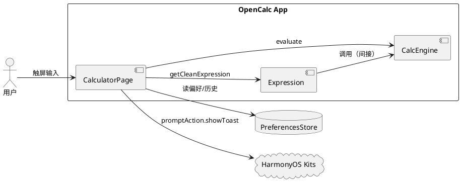
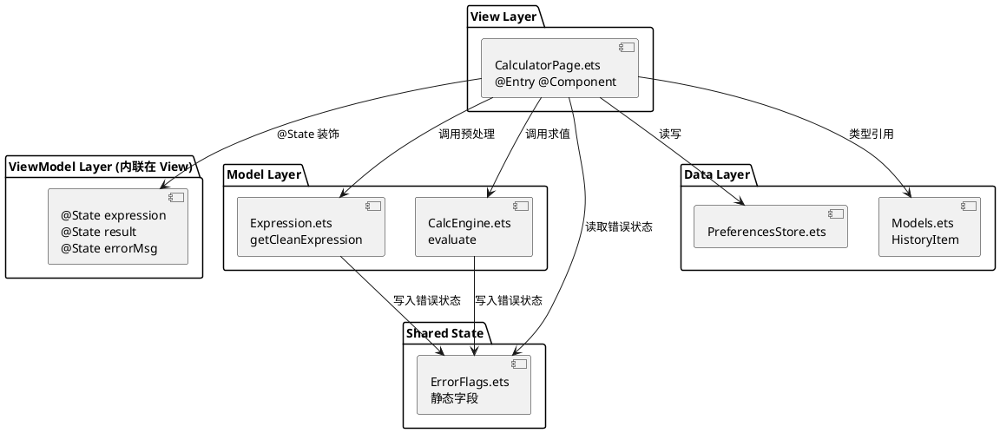
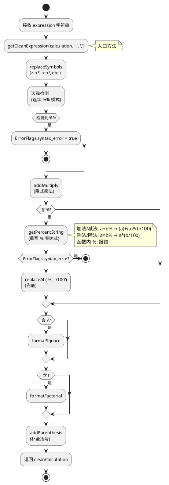
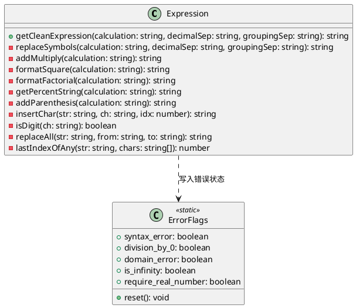
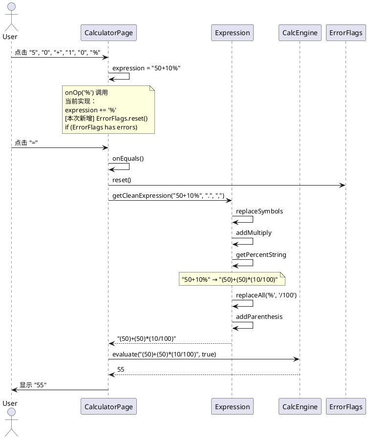

# Delta Design — 百分号按钮功能

> 变更 ID: 20260612-requirement-add-percent-button
> 设计阶段: PLANNING - Step 8 组件设计
> 设计时间: 2026-06-12
> 关联文档: `proposal.md` · `delta-spec.md` · `info.md`

---

## D1. 概述

### 1.1 应用定位

OpenCalc HarmonyOS 是一款 ArkTS 科学计算器。本次新增 **百分号（`%`）按钮**，作为键盘底部辅助区的核心高频功能。

### 1.2 核心交互

```
用户点击 % 按钮
    ↓
onOp('%') 触发 → 表达式字符串追加 '%'
    ↓
用户继续输入或点击 =
    ↓
onEquals → Expression.getCleanExpression → CalcEngine.evaluate
    ↓
% 被转换为等价的数学表达式（如 50+10% → (50)+(50)*(10/100)）
    ↓
显示结果（55）
```

### 1.3 技术栈概览

| 维度 | 当前/新增 |
| --- | --- |
| 框架 | ArkTS（Stage 模型，ArkUI 声明式） |
| 状态管理 | V1（`@State`/`@Prop`）—— **未变更** |
| 使用的 Kit | `@kit.ArkUI`, `@kit.BasicServicesKit`, `@kit.AbilityKit` —— **未变更** |
| Native C++/Rust | 无 |
| Hvigor 插件 | `@ohos/hvigor-ohos-plugin` —— **未变更** |
| 测试框架 | `@ohos/hypium` 1.0.15 + `@ohos/hamock` 1.0.0 —— **已配置** |
| ArkTS 严格模式 | 是 |

[推断] 本次变更不引入新技术栈，仅扩展现有实现。

---

## D2. 功能清单

| 功能名 | 说明 | 入口 | 优先级 | 关联 SR |
| --- | --- | --- | --- | --- |
| 百分号按钮显示 | 在键盘辅助区显示 `%` 按钮 | CalculatorPage.ButtonGrid | P0 | SR-01 |
| 加法 % 解析 | `a+b%` → `(a)+(a)*(b/100)` | Expression.getCleanExpression | P0 | SR-02 |
| 减法 % 解析 | `a-b%` → `(a)-(a)*(b/100)` | Expression.getCleanExpression | P0 | SR-03 |
| 乘法 % 解析 | `a*b%` → `a*b/100` | Expression.getCleanExpression | P0 | SR-04 |
| 除法 % 解析 | `a/b%` → `a/b/100` | Expression.getCleanExpression | P0 | SR-05 |
| 负数 % 解析 | 沿用上述规则，保留负号 | Expression.getCleanExpression | P1 | SR-06 |
| 函数内 % 错误检测 | 函数括号内 % → 错误 | Expression.getCleanExpression | P1 | SR-07 |
| 重复 % 错误检测 | `%%` 模式 → 错误 | Expression.getCleanExpression | P1 | SR-08 |
| 错误状态清错 | Error + % → 清错 | CalculatorPage.onOp | P1 | SR-09 |
| 连续 % 行为 | % 应用到刚输入的最后一个操作数 | 自然状态机 | P1 | SR-10 |
| 8 个 AC 单元测试 | 验证 % 解析正确性 | entry/src/test/ets/calculator/Expression.test.ets | P0 | （验证） |

---

## D3. 实现模型

### 3.1 上下文视图



### 3.2 总体架构



**关键说明**：本次变更在 View 层新增 `%` 按钮，在 Model 层 `Expression` 中扩展 % 解析逻辑（包含核心语义 + 边缘场景）。其他层不变。

### 3.3 HAP/HAR/HSP 模块划分

[推断] 与现有项目结构一致：

- **entry HAP**（主模块）：本次变更涉及的所有文件均位于此 HAP
- **HAR/HSP**：无（项目是单 HAP 简单应用）
- **OHPM 依赖**：未新增

### 3.4 设计系统规格

#### 3.4.1 色彩系统

`%` 按钮复用现有运算符色（`getOp()`），与 `×`、`÷` 等按钮视觉一致：

| 主题 | 运算符色 | 用途 |
| --- | --- | --- |
| Light 默认 | `#B4D2E4`（浅蓝） | % 按钮背景 |
| Dark | `#0070BC`（深蓝） | % 按钮背景 |
| AMOLED | `#0070BC` | % 按钮背景 |

#### 3.4.2 主题系统

**未变更**。`%` 按钮颜色随 `themeIdx` 自动切换。

#### 3.4.3 排版系统

`%` 按钮文字字号复用 `BtnOpPct` 模板：

| 屏幕方向 | 字号 |
| --- | --- |
| 横屏 | 14 |
| 竖屏 | 20 |

#### 3.4.4 间距与尺寸系统

`%` 按钮尺寸复用 `BtnOpPct` 模板：

| 属性 | 值 | 说明 |
| --- | --- | --- |
| width | `17%` | 5列布局，每列 17% |
| height | 36（横屏）/ 56（竖屏） | 固定像素 |
| borderRadius | 50 | 圆形 |
| margin | 1（横屏）/ 4（竖屏） | 间距 |

#### 3.4.5 图标与图形资源

`%` 使用文本字符 `%`，无图形资源。

#### 3.4.6 动画规格

**未变更**。复用现有按钮点击反馈（无显式动画）。

#### 3.4.7 响应式断点与栅格

| 屏幕方向 | 触发条件 | 布局 |
| --- | --- | --- |
| 横屏 | `width > height` | 5列布局，按钮高度 36 |
| 竖屏 | `width <= height` | 5列布局，按钮高度 56 |

### 3.5 Expression 模块实现设计

#### 3.5.1 模块介绍

- **路径**：`entry/src/main/ets/calculator/Expression.ets`
- **职责**：表达式字符串预处理（符号替换、隐式乘法、% 转换、! 转换、括号补全）
- **变更类型**：扩展（不新增类、不新增公开方法）

#### 3.5.2 功能描述

| 功能 | 说明 |
| --- | --- |
| `getCleanExpression` | 主入口：调用各预处理步骤 |
| `getPercentString` | 私有方法：% 操作符重写（核心扩展点） |
| 新增错误检测 | 函数内 % 检测、重复 % 检测 |

#### 3.5.3 目录结构

[推断] **未变更**：

```
entry/src/main/ets/calculator/
├── Expression.ets       (扩展)
├── Calculator.ets       (未变更)
└── NumberFormatter.ets  (未变更)
```

#### 3.5.4 架构图谱

**核心算法流程图**：



**类图**：



#### 3.5.5 功能与用例分析

##### 用例：% 解析（核心）

- **前置条件**：用户已输入含 `%` 的表达式
- **步骤**：
  1. `getCleanExpression` 检测到 `%` 字符
  2. 调用 `getPercentString` 进行重写
  3. 兜底 `replaceAll('%', '/100')`
- **后置条件**：
  - 表达式被重写为可求值形式
  - 错误情况下 `ErrorFlags.syntax_error = true`

##### 用例：连续 % 错误检测

- **前置条件**：用户输入 `50+10%%` 或 `50%%`
- **步骤**：
  1. `getCleanExpression` 入口检测 `expression.indexOf('%%') !== -1`
  2. 设置 `ErrorFlags.syntax_error = true`
  3. 立即返回原表达式（不再继续解析）
- **后置条件**：UI 显示"表达式错误"

##### 用例：函数内 % 错误检测

- **前置条件**：用户输入 `sin(30%)`
- **步骤**：
  1. `getPercentString` 在 `parenthesisLevel > 0` 时检测到 `%`
  2. 设置 `ErrorFlags.syntax_error = true`
  3. 返回当前结果
- **后置条件**：UI 显示"表达式错误"

#### 3.5.6 接口设计

**未变更**。`Expression.getCleanExpression` 的接口签名保持不变。

#### 3.5.7 状态管理设计

[推断] `Expression` 是无状态类（每次调用 `getCleanExpression` 是独立操作），状态通过 `ErrorFlags` 静态字段传播。

**未变更**。

#### 3.5.8 核心算法

##### 算法 1：% 解析（`getPercentString`）

**输入**：预处理后的表达式字符串（含 `%`）
**输出**：% 被重写后的表达式

**核心逻辑**（与现有已提交实现一致）：

```
遍历字符串，识别 % 位置
  ├── 阶乘后 % (a!%): 重写为 ((a)!)/100
  ├── 括号表达式后 % ((expr)%): 重写为 ((expr))/100
  │   ├── 简单表达式: ((expr))/100
  │   ├── 乘除上下文: base * ((expr))/100
  │   └── 加减上下文: (base) + (base) * (subExpr/100)
  └── 普通数字后 % (b%):
      ├── 简单: (b/100)
      ├── 乘除上下文: base * (b/100)
      └── 加减上下文: (base) + (base) * (b/100)
```

**复杂度**：
- 时间：O(n²)（包含 `replaceAll` 后的字符串重建）
- 空间：O(n)
- [推断] 实测 < 50ms（普通表达式 < 100 字符）

##### 算法 2：连续 % 检测（新增）

```
if (calculation.indexOf('%%') !== -1) {
  ErrorFlags.syntax_error = true
  return calculation
}
```

**复杂度**：O(n)

##### 算法 3：函数内 % 检测（新增）

```
在 getPercentString 中：
  if (ch === '%' && parenthesisLevel > 0) {
    ErrorFlags.syntax_error = true
    return result
  }
```

**复杂度**：O(n)（合并到现有遍历中）

#### 3.5.9 错误处理

| 错误场景 | 错误标志 | UI 提示 | 恢复策略 |
| --- | --- | --- | --- |
| 函数内 % | `ErrorFlags.syntax_error = true` | "表达式错误" | 用户清除表达式 |
| 连续 %% | `ErrorFlags.syntax_error = true` | "表达式错误" | 用户清除表达式 |
| 普通 % 语法错误 | `ErrorFlags.syntax_error = true` | "表达式错误" | 用户清除表达式 |
| 除零（`0/0%`） | `ErrorFlags.division_by_0 = true` | "除数不能为零" | 用户清除表达式 |
| 错误状态 + 按 % | `ErrorFlags.reset()` 自动清错 | 注入新表达式 | 立即可继续输入 |

[推断] 错误处理沿用现有 `onEquals` 中的模式（line 83-87 of `CalculatorPage.ets`）。

#### 3.5.10 依赖关系

- **内部依赖**：`ErrorFlags`（写入错误状态）
- **外部依赖**：无新增

### 3.6 CalculatorPage 模块实现设计

#### 3.6.1 模块介绍

- **路径**：`entry/src/main/ets/pages/CalculatorPage.ets`
- **职责**：UI 渲染、用户事件处理、状态管理
- **变更类型**：复用现有 `BtnOpPct` 模板（已实现），新增 `onOp` 错误恢复逻辑

#### 3.6.2 功能描述

| 功能 | 说明 | 状态 |
| --- | --- | --- |
| % 按钮显示 | 复用 `BtnOpPct('%')` | **已存在（line 278）** |
| % 按钮事件 | `onOp('%')` 触发字符串追加 | **已存在** |
| 错误状态下按 % 清错 | 在 `onOp` 中检测 `ErrorFlags` 状态 | **需新增** |
| 错误消息显示 | 复用 `onEquals` 中的错误处理 | **未变更** |

#### 3.6.3 目录结构

[推断] **未变更**：

```
entry/src/main/ets/pages/
├── CalculatorPage.ets  (扩展 onOp)
└── Index.ets           (未变更)
```

#### 3.6.4 架构图谱

**时序图：用户输入 `50+10%` 并得到 55**



#### 3.6.5 功能与用例分析

##### 用例：% 按钮点击

- **前置条件**：用户处于输入状态
- **步骤**：
  1. 用户点击 `%` 按钮（位于 Row 1, Col 2）
  2. `BtnOpPct('%')` 的 `onClick` 触发
  3. 调用 `onOp('%')`
  4. [本次新增] 检测 `ErrorFlags`，如有错误则 `reset()`
  5. `expression += '%'`
  6. `errorMsg = ''`
- **后置条件**：表达式字符串包含 `%`，可继续输入或计算

#### 3.6.6 接口设计

[推断] **未变更公开接口**。`onOp(op: string)` 签名不变，行为扩展。

#### 3.6.7 状态管理设计

**未变更**。`expression`、`result`、`errorMsg` 三个 `@State` 字段保持。

#### 3.6.8 核心算法

无新增核心算法。

#### 3.6.9 错误处理

**新增**：在 `onOp('%')` 触发时检测并清错。

```typescript
onOp(op: string): void {
  // 本次新增：错误状态恢复
  if (ErrorFlags.syntax_error || ErrorFlags.division_by_0 ||
      ErrorFlags.domain_error || ErrorFlags.is_infinity ||
      ErrorFlags.require_real_number) {
    ErrorFlags.reset()
    this.errorMsg = ''
    this.expression = ''  // 清空旧表达式，让新输入从空白开始
  }
  this.expression = this.expression + op
}
```

#### 3.6.10 依赖关系

- **内部依赖**：`Expression`, `CalcEngine`, `ErrorFlags`, `Models`, `PreferencesStore`
- **外部依赖**：`@kit.ArkUI` (promptAction), `@kit.BasicServicesKit` (pasteboard), `@kit.AbilityKit` (common)
- **未新增**依赖

### 3.7 测试模块实现设计

#### 3.7.1 模块介绍

- **路径**：`entry/src/test/ets/calculator/Expression.test.ets`
- **职责**：验证 `Expression` 类的 % 解析逻辑
- **变更类型**：扩展（增加测试用例）

#### 3.7.2 功能描述

[推断] 8 个 AC 测试用例：

| AC | 描述 | 输入 | 预期输出 | 验证项 |
| --- | --- | --- | --- | --- |
| AC-001-01 | 加法 % | `'50+10%'` | `'(50)+(50)*(10/100)'` | SR-02 |
| AC-001-02 | 减法 % | `'200-15%'` | `'(200)-(200)*(15/100)'` | SR-03 |
| AC-001-03 | 乘法 % | `'8×5%'` | `'8*(5/100)'` | SR-04 |
| AC-001-04 | 除法 % | `'100÷10%'` | `'100/(10/100)'` | SR-05 |
| AC-001-05 | 负数 % | `'-50+10%'` | `'(-50)+(-50)*(10/100)'` | SR-06 |
| AC-001-06 | 函数内 % 错误 | `'sin(30%)'` | ErrorFlags.syntax_error = true | SR-07 |
| AC-001-07 | 连续 % 错误 | `'50%%'` | ErrorFlags.syntax_error = true | SR-08 |
| AC-001-08 | 错误恢复 | Error状态后按 % | errorMsg 清空 | SR-09 |

#### 3.7.3 目录结构

[推断] **未变更**：

```
entry/src/test/
├── List.test.ets               (测试套件聚合)
└── ets/calculator/
    └── Expression.test.ets     (扩展 % 测试)
```

#### 3.7.4 架构图谱

[推断] 测试架构：

```
List.test.ets
    └── import expressionPercentTest from './ets/calculator/Expression.test.ets'
            └── export default function expressionPercentTest() {
                  describe('Expression_getPercentString_xxx', () => {
                    it('AC-1_xxx', 0, () => { ... expect(...).assertEqual(...) })
                  })
                }
```

#### 3.7.5 功能与用例分析

[推断] 见 §3.7.2。

#### 3.7.6 接口设计

**未变更**。`Expression` 类的公开方法签名保持。

#### 3.7.7 状态管理设计

**未变更**。测试是无状态的，每次 `it` 执行前 `ErrorFlags.reset()`。

#### 3.7.8 核心算法

无新增核心算法（仅测试代码）。

#### 3.7.9 错误处理

[推断] 测试需要：
- 每个 `it` 前 `ErrorFlags.reset()`
- 错误场景验证 `ErrorFlags.syntax_error === true`
- 错误场景同时验证 `getCleanExpression` 不抛异常

#### 3.7.10 依赖关系

- **内部依赖**：`Expression`, `ErrorFlags`
- **外部依赖**：`@ohos/hypium` (describe/it/expect), `@ohos/hamock` (mock 框架)

---

## D4. 接口设计

### 4.1 内部数据访问 API

[推断] **未变更**。`PreferencesStore` 接口保持。

### 4.2 业务抽象接口

[推断] **未变更**。`Expression` 和 `CalcEngine` 接口保持。

### 4.3 后台任务与 ExtensionAbility 接口

**未涉及**。OpenCalc 是单 HAP 单页面应用，无后台任务。

### 4.4 Want / Action 协议

**未涉及**。

### 4.5 URI / Deep Link / AppLinking 协议

**未涉及**。

### 4.6 IPC 与 RPC 接口

**未涉及**。

### 4.7 Native（C/C++）接口

**未涉及**。

### 4.8 文件交换接口

**未涉及**。

---

## D5. 数据模型

### 5.1 关系型数据库模型

**未涉及**。无 RDB 变更。

### 5.2 领域模型

[推断] **未变更**。`HistoryItem`、`NumberingSystem` 等保持。

### 5.3 Preferences 结构

[推断] **未变更**。无新增 preferences key。

### 5.4 分布式数据对象模型

**未涉及**。

### 5.5 文件格式 Schema

**未涉及**。

---

## D6. UI 设计系统

### 6.1 色彩系统

见 §3.4.1。

### 6.2 主题与暗色模式

[推断] `%` 按钮颜色随 `themeIdx` 自动切换，逻辑沿用 `getOp()`。

### 6.3 排版系统

见 §3.4.3。

### 6.4 间距与尺寸规范

见 §3.4.4。

### 6.5 图标与图形资源

`%` 按钮使用文本字符 `%`，无图标资源。

### 6.6 动画规格

**未变更**。无显式动画。

### 6.7 一多响应式规范

[推断] **未变更**。`%` 按钮复用 `BtnOpPct` 的横屏/竖屏适配逻辑：

- 横屏：高度 36，margin 1
- 竖屏：高度 56，margin 4

---

## D7. 页面清单与导航

### 7.1 页面清单总表

[推断] **未变更**。`CalculatorPage` 是唯一页面，本次在其 `ButtonGrid` 中添加/确认 `%` 按钮。

| 页面名 | 路径 | 入口 Ability | 传参 | 功能摘要 |
| --- | --- | --- | --- | --- |
| CalculatorPage | `pages/CalculatorPage.ets` | EntryAbility | — | 主计算器页面，含 % 按钮 |

### 7.2 全局导航图

**未变更**。OpenCalc 是单页应用，无导航跳转。

### 7.3 Deep Link / AppLinking 处理

**未涉及**。

### 7.4 Want 跳转矩阵

**未涉及**。

---

## D8. 用户交互规格

### 8.1 手势交互目录

| 交互 | 触发器 | 行为 | 状态 |
| --- | --- | --- | --- |
| 点击 % 按钮 | `onClick` (BtnOpPct) | `onOp('%')` 追加字符 | **已存在** |
| 长按显示屏 | `LongPressGesture` | `onCopy()` 复制结果 | 未变更（与 % 无关） |

### 8.2 弹窗/Sheet/Menu 目录

[推断] **未变更**。% 错误场景沿用 `errorMsg` 文本提示，不弹窗。

### 8.3 剪贴板与反馈行为

[推断] 错误提示通过 `errorMsg` 状态显示。是否需要 `promptAction.showToast` 由 IMPLEMENTING 阶段决定（[推断] 推荐沿用现有模式：错误显示在显示屏上而非 toast）。

### 8.4 卡片交互

**未涉及**。

---

## D9. 平台集成

### 9.1 构建配置与依赖

| 文件 | 变更 |
| --- | --- |
| `oh-package.json5` | **未变更** |
| `build-profile.json5` | **未变更** |
| `oh-package-lock.json5` | **未变更** |

[推断] 无新增 OHPM 依赖。

### 9.2 权限与运行时请求

**未涉及**。% 功能不需任何权限。

### 9.3 系统能力（Kits）清单

| Kit | 关键 API | 用途 | 变更 |
| --- | --- | --- | --- |
| `@kit.ArkUI` | `promptAction.showToast` | 提示 | 未变更（可选用于错误提示） |
| `@kit.BasicServicesKit` | `pasteboard` | 复制 | 未变更 |
| `@kit.AbilityKit` | `common.UIAbilityContext` | 上下文 | 未变更 |

### 9.4 后台与 Extension

**未涉及**。

### 9.5 备份与恢复

**未涉及**。

### 9.6 分布式与跨端

**未涉及**。

---

## D10. 偏好设置目录

**未变更**。本次不新增 preferences key。

---

## 设计决策摘要

| 决策点 | 决策 | 理由 |
| --- | --- | --- |
| % 按钮位置 | 键盘辅助区第 1 行第 2 列（与 AC、括号同级） | 用户澄清结果；与已有 `BtnOpPct` 模板一致 |
| % 解析逻辑 | Windows 风格语义 | 用户澄清结果 |
| 重复 % 处理 | 入口即检测 `indexOf('%%')` 报错 | 简单可靠；用户期望"错误提示" |
| 函数内 % 处理 | 在 `getPercentString` 中检测 `parenthesisLevel > 0` | 与现有解析逻辑融合 |
| 错误恢复 | `onOp('%')` 触发时检测并 `reset` | 简单；与其他 `onOp` 行为一致 |
| 测试用例 | 8 个 AC，覆盖所有需求 SR | 与 delta-spec.md 对齐 |
| 架构 | 不变更 | 复杂度评估 M，无需变更 |

---

## 自验证

| 检查项 | 状态 |
| --- | --- |
| 功能一致性：proposal.md / delta-spec.md ↔ §2 功能清单 | ✅ 通过（10 SR 全部对应） |
| 页面一致性：delta-spec.md 的 UI 需求 ↔ §7.1 | ✅ 通过（CalculatorPage 唯一页面） |
| 数据一致性：delta-spec.md 数据模型 ↔ §5 | ✅ 通过（无新增） |
| 权限一致性：delta-spec.md 权限需求 ↔ §9.2 | ✅ 通过（无权限） |
| Kit 一致性：§9.3 vs 现有代码 | ✅ 通过（未新增 Kit） |

---

> 本文档由 mod-design skill 生成。
> 标记 [推断] 的内容为基于设计推断，非确定性事实。
> 生成时间: 2026-06-12
