# HarmonyOS UI 自动化测试 - 执行流程图

```mermaid
flowchart TD
    Start(["开始测试"])
    Start --> Phase0["阶段零: 用例分析与规划"]
    Phase0 --> P0A["读取 TestCase.xlsx"]
    P0A --> P0B["分类用例\nexecute / skip / state_dependent"]
    P0B --> P0C["设置行背景色 + 写入跳过原因"]
    P0C --> P0D["识别状态依赖与阻塞链"]
    P0D --> P0E["生成 01_用例分析.md\n+ 02_测试执行计划.md"]
    P0E --> P0F["创建目录结构\n{test_dir}/screenshot/\n{test_dir}/dump/"]
    P0F --> Phase1["阶段一: 环境准备"]
    Phase1 --> P1Dec{"应用是否在前台?"}
    P1Dec -->|否| P1Launch["start_app 启动应用"]
    P1Dec -->|是| P1Confirm["确认初始页面 + 截图"]
    P1Launch --> P1Confirm
    P1Confirm --> Phase2["阶段二: 逐行执行测试"]
    Phase2 --> P2A["读取当前行\nC列(操作) + D列(预期)"]
    P2A --> P2B["dump UI树 → {test_dir}/dump/\n确认当前状态"]
    P2B --> P2C["执行原子操作\nclick / inputText / fling / keyEvent"]
    P2C --> P2D["操作后 dump UI树"]
    P2D --> P2E["对比实际 vs 预期"]
    P2E --> P2Retry{"验证通过?"}
    P2Retry -->|是| P2F["截图 → {test_dir}/screenshot/"]
    P2Retry -->|否| P2R["重试机制\n最多3次, 间隔10秒"]
    P2R --> P2RDec{"重试成功?"}
    P2RDec -->|是| P2F
    P2RDec -->|否| P2F
    P2F --> P2G["判定结果\n通过 / BUG / 阻塞"]
    P2G --> Phase3["阶段三: 写入Excel + 嵌入截图"]
    Phase3 --> P3A["写入结果列 + 设置字体颜色"]
    P3A --> P3B["缩放截图 → 嵌入G列(图片对象)"]
    P3B --> P3C["写入时间列"]
    P3C --> P3D["wb.save()"]
    P3D --> Phase4["阶段四: 循环与状态管理"]
    Phase4 --> P4Dec1{"还有下一行?"}
    P4Dec1 -->|是| P4Dec2{"是否状态转换点?"}
    P4Dec2 -->|是| P4Exec["执行状态依赖用例"]
    P4Exec -.->|回到阶段二| P2A
    P4Dec2 -.->|否 继续下一行| P2A
    P4Dec1 -->|否 全部完成| Phase5["阶段五: 生成测试报告"]
    Phase5 --> P5A["统计各状态数量"]
    P5A --> P5B["汇总BUG清单(按优先级)"]
    P5B --> P5C["计算通过率\n记录开始/结束/耗时"]
    P5C --> P5D["生成 03_测试报告.md"]
    P5D --> End(["测试完成"])
    style Start fill:#dae8fc,stroke:#6c8ebf,font-weight:bold
    style End fill:#dae8fc,stroke:#6c8ebf,font-weight:bold
    style Phase0 fill:#fff2cc,stroke:#d6b656,font-weight:bold
    style P0A fill:#fff2cc,stroke:#d6b656
    style P0B fill:#fff2cc,stroke:#d6b656
    style P0C fill:#fff2cc,stroke:#d6b656
    style P0D fill:#fff2cc,stroke:#d6b656
    style P0E fill:#fff2cc,stroke:#d6b656
    style P0F fill:#fff2cc,stroke:#d6b656
    style Phase1 fill:#d5e8d4,stroke:#82b366,font-weight:bold
    style P1Dec fill:#d5e8d4,stroke:#82b366
    style P1Launch fill:#d5e8d4,stroke:#82b366
    style P1Confirm fill:#d5e8d4,stroke:#82b366
    style Phase2 fill:#dae8fc,stroke:#6c8ebf,font-weight:bold
    style P2A fill:#dae8fc,stroke:#6c8ebf
    style P2B fill:#dae8fc,stroke:#6c8ebf
    style P2C fill:#dae8fc,stroke:#6c8ebf
    style P2D fill:#dae8fc,stroke:#6c8ebf
    style P2E fill:#dae8fc,stroke:#6c8ebf
    style P2Retry fill:#dae8fc,stroke:#6c8ebf
    style P2R fill:#f8cecc,stroke:#b85450
    style P2RDec fill:#f8cecc,stroke:#b85450
    style P2F fill:#dae8fc,stroke:#6c8ebf
    style P2G fill:#dae8fc,stroke:#6c8ebf
    style Phase3 fill:#e1d5e7,stroke:#9673a6,font-weight:bold
    style P3A fill:#e1d5e7,stroke:#9673a6
    style P3B fill:#e1d5e7,stroke:#9673a6
    style P3C fill:#e1d5e7,stroke:#9673a6
    style P3D fill:#e1d5e7,stroke:#9673a6
    style Phase4 fill:#f8cecc,stroke:#b85450,font-weight:bold
    style P4Dec1 fill:#f8cecc,stroke:#b85450
    style P4Dec2 fill:#f8cecc,stroke:#b85450
    style P4Exec fill:#f8cecc,stroke:#b85450
    style Phase5 fill:#d5e8d4,stroke:#82b366,font-weight:bold
    style P5A fill:#d5e8d4,stroke:#82b366
    style P5B fill:#d5e8d4,stroke:#82b366
    style P5C fill:#d5e8d4,stroke:#82b366
    style P5D fill:#d5e8d4,stroke:#82b366
```



## 阶段说明

| 阶段 | 颜色 | 说明 |
|------|------|------|
| 阶段零 | 黄色 | 用例分析与规划：读取Excel、分类用例、识别依赖链、创建目录结构 |
| 阶段一 | 绿色 | 环境准备：确认应用运行、截图初始状态 |
| 阶段二 | 蓝色 | 逐行执行：dump UI树 → 操作 → 验证(含重试) → 截图 → 判定 |
| 阶段三 | 紫色 | 写入Excel：结果+颜色、嵌入截图(图片对象)、记录时间 |
| 阶段四 | 红色 | 循环控制：状态转换检测、下一行/完成判断 |
| 阶段五 | 绿色 | 生成报告：统计汇总、BUG清单(按优先级)、精确时间统计 |

## 关键改进点（相比初版）

| 改进项 | 说明 |
|--------|------|
| 目录结构 | screenshot/ 和 dump/ 作为 test_dir 子目录，不再放项目根目录 |
| 重试机制 | 关键操作失败后最多重试3次，间隔10秒，避免模拟器偶发问题导致误判 |
| 截图嵌入 | G列必须嵌入图片对象(ws.add_image)，禁止写路径文本 |
| 时间统计 | 报告精确到分钟，包含开始/结束/总耗时 |
| MCP工具名 | 必须使用双下划线 `mcp__codegenie-mcp__xxx`，单下划线会失败 |
| dump保存 | UI树dump文件统一保存到 `{test_dir}/dump/` 目录 |

## 输出产物

```
项目根目录/
├── TestCase.xlsx                          # 测试结果(F/G/H列)
└── ai_auto_test/
    └── {YYYY-MM-DD_HHmm}_{account}/      # 如 2026-05-05_2046_vip
        ├── 01_用例分析.md
        ├── 02_测试执行计划.md
        ├── 03_测试报告.md
        ├── screenshot/                    # 所有截图
        │   ├── 00_initial_state.png
        │   ├── row3_click_vip_icon.png
        │   └── ...
        └── dump/                          # 所有UI树dump
            ├── row3_before.txt
            ├── row3_after.json
            └── ...
```
