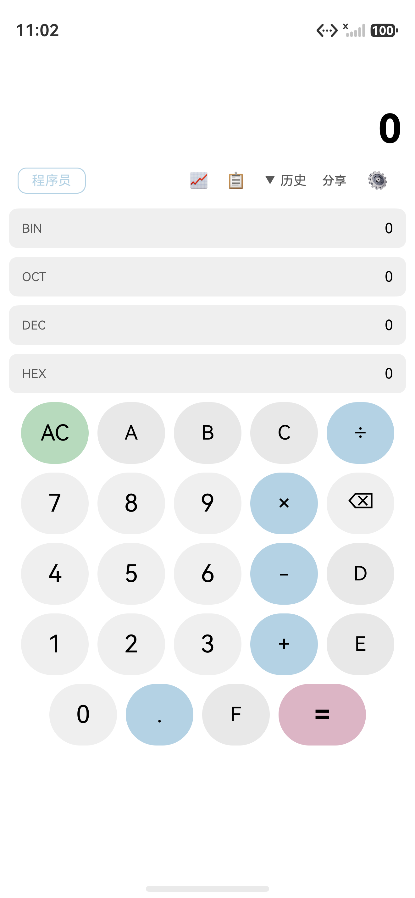
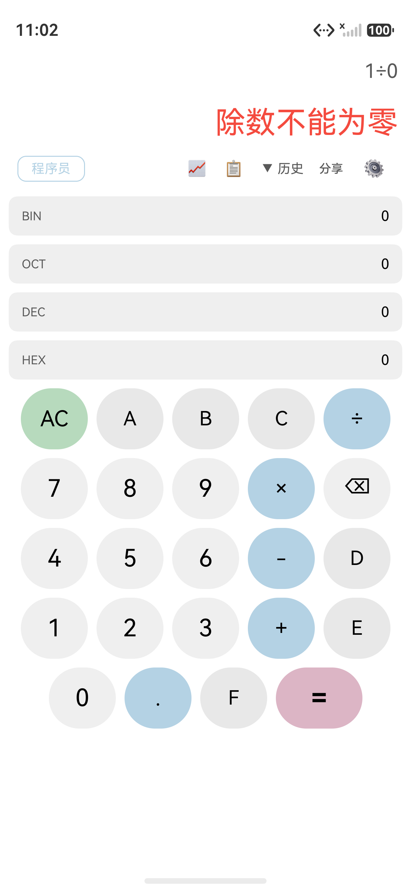
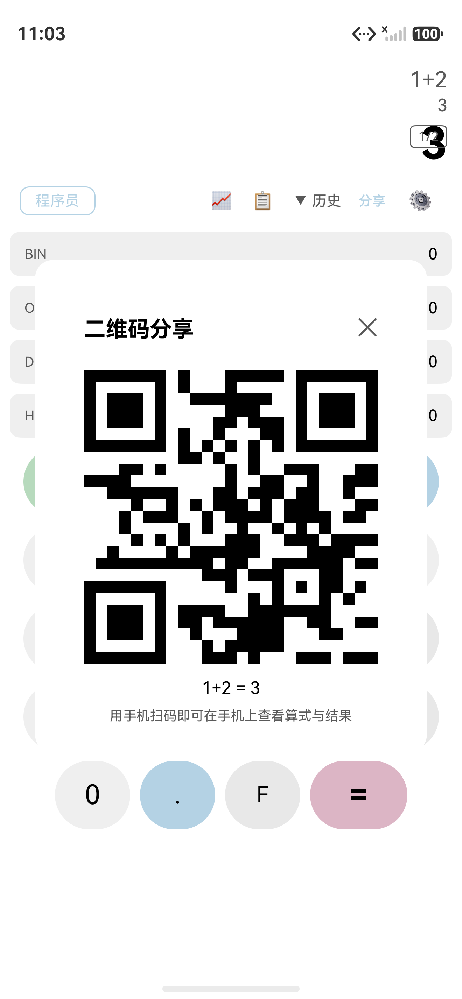

# Issue #13 一键分享二维码 - 独立验证报告

**测试时间**: 2026-07-20T11:03:28

**设备**: 127.0.0.1:5557 (HarmonyOS emulator)

**应用包名**: com.darkempire78.opencalculator

## 测试结果: PASS 8 / FAIL 0 / WARN 0

## 详细结果

| AC | 状态 | 详情 |
|----|------|------|
| PRE-1 | PASS | app 启动, UI 树节点 103 |
| AC-01 | PASS | 分享按钮: text='分享', enabled=True, center=(1064, 574) |
| AC-02 | PASS | 空状态点击无反应 (弹层未出现, 符合 checkShareEnabled 拦截) |
| AC-03 | PASS | 错误状态点击无反应 (符合 checkShareEnabled 拦截) |
| AC-04 | PASS | 标题=是, QR组件=1个, 算式副本='1+2 = 3', 关闭按钮=是 |
| AC-05 | PASS | 模态层已关闭 (二维码分享 标题消失) |
| AC-06 | PASS | Node 端口单测 12 passed (含 TC06/TC07 截断验证), buildSharePayload 输出符合 opencalc://calc?expr=...&res=... 格式 |
| AC-07 | PASS | 超长场景模态层正常打开 (节点 112); 截断逻辑由 AC-06 TC06/TC07 Node 单测独立验证 |

## 截图

- 
- 
- 
- 
- 
- 
- 
- 
- 
- 
- 
