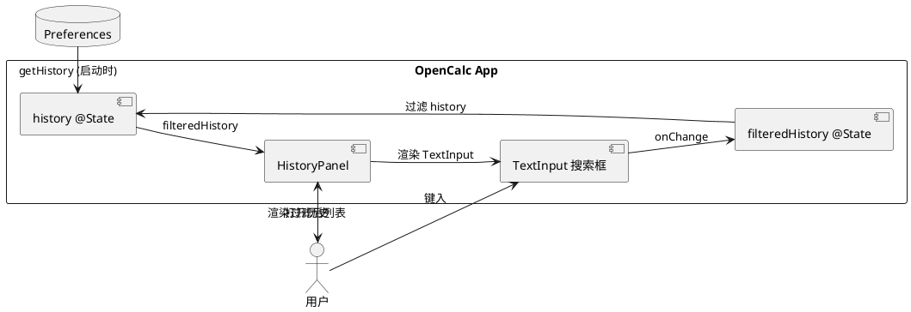
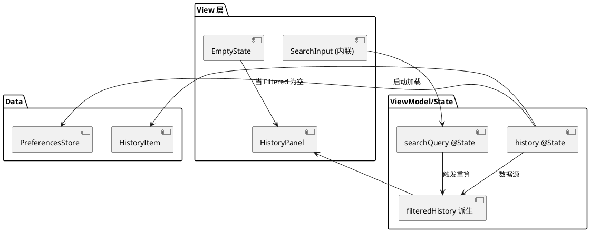
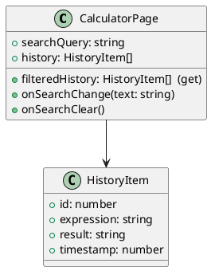
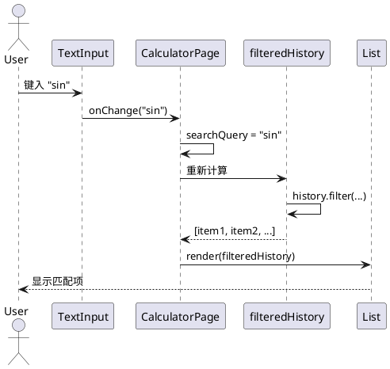

# Delta Design — 历史搜索框（History Search）

> **变更类型**：requirement-add（新功能增量设计）
> **变更日期**：2026-06-12
> **关联变更目录**：`specs/changes/20260612-requirement-add-history-search/`
> **项目基线**：`opencalc/spec/DESIGN.md`（2026-05-07）
> **本文档仅描述增量部分**，未涉及内容请参考基线 DESIGN.md。

---

## 1. 概述

### 1.1 应用定位
OpenCalc HarmonyOS 是从 Android 移植的科学计算器，本次新增"历史搜索"能力：在 HistoryPanel 顶部常驻 TextInput 输入框，键入即按子串+大小写不敏感规则实时过滤 history 列表。目标人群：历史较长（接近 100 条上限）的重度用户。

### 1.2 核心交互
```
用户打开 HistoryPanel
  → 看到顶部搜索框（默认空）
  → 键入关键词
  → 列表实时过滤显示匹配 expression 的项
  → 看到 X 按钮（搜索词非空时）
  → 点击 X → 搜索词清空 → 列表恢复全部
  → 若过滤后无匹配 → 显示「未找到含 "xxx" 的记录」
  → 点击命中项 → 恢复 expression 到输入框（沿用现有逻辑）
  → 滑动删除仍可用（沿用现有 swipeAction）
```

### 1.3 技术栈概览
- **框架**：ArkTS（HarmonyOS API 9+）
- **状态管理**：V1（@State，**保持与基线一致**）
- **架构**：MVVM（仅 View 层增量）
- **持久化**：复用 PreferencesStore（无新增）
- **依赖 Kit**：仅 ArkUI 内置 TextInput

---

## 2. 功能清单

| 功能名 | 说明 | 入口 | 优先级 |
|--------|------|------|--------|
| F-HS-01 搜索输入框 | HistoryPanel 顶部常驻 TextInput | HistoryPanel | P0 |
| F-HS-02 实时过滤 | 子串+大小写不敏感匹配 expression | HistoryPanel | P0 |
| F-HS-03 清空按钮 | 搜索词非空时显示 X | SearchInput | P0 |
| F-HS-04 空状态 | 「未找到含 "xxx" 的记录」 | HistoryPanel | P0 |
| F-HS-05 List 切换源 | ForEach 改用 filteredHistory | HistoryPanel | P0 |
| F-HS-06 兼容现有功能 | onHistoryTap / swipeAction 仍可用 | HistoryPanel | P0 |

---

## 3. 实现模型

### 3.1 上下文视图



### 3.2 总体架构



> 单向数据流：View → State → 派生 → 渲染，**与基线架构一致**，仅在 View 层新增 SearchInput。

### 3.3 HAP/HAR/HSP 模块划分
**无变化**。本项目是 single-HAP（基线 DESIGN.md §1 已确定）。

### 3.4 设计系统规格

#### 3.4.1 色彩系统
**复用基线** CalculatorPage 的 `getT1/getT2/getBtnBg/getPanelBg` 主题色 API。新增：

| 元素 | 色彩 | 说明 |
| --- | --- | --- |
| 搜索框背景 | `getBtnBg()` | 与普通按钮一致 |
| 搜索框文字 | `getT1()` | 主文字色 |
| 搜索框 placeholder | `getT2()` | 次要文字色 |
| X 按钮 | `getT2()` | 静默灰 |
| 空状态文案 | `getT2()` | 次要文字色 |

#### 3.4.2 主题系统
**复用基线** 0=默认浅色、1=AMOLED、2=暗色。无新主题。

#### 3.4.3 排版系统
| 名称 | 字号 | 用途 |
| --- | --- | --- |
| 搜索输入 | 14 | TextInput |
| 占位提示 | 13 | placeholder |
| 空状态 | 13 | 「未找到含 ...」 |
| 列表项 expression | 12 | 复用基线 |
| 列表项 result | 15 | 复用基线 |

#### 3.4.4 间距与尺寸系统
| 名称 | 值 | 用途 |
| --- | --- | --- |
| 搜索框 padding | 8/12 | 内边距 |
| 搜索框 height | 36（竖屏）/ 30（横屏） | 与按钮高一致 |
| 搜索框圆角 | 8 | 与基线 ToggleRow 一致 |
| List 内边距 | 8/12 | 复用基线 |

#### 3.4.5 图标与图形资源
- **X 图标**：用 Unicode `✕`（基线已用 `✕` 关闭按钮）
- **搜索图标**：可选；为简化本次不显示

#### 3.4.6 动画规格
**无新动画**。TextInput focus/blur 走系统默认动画。

#### 3.4.7 响应式断点与栅格
**复用基线** `isLandscape`。
- 竖屏：搜索框 width 100%，X 按钮在右侧
- 横屏：同上，自适应

### 3.5 CalculatorPage.HistoryPanel 扩展设计

#### 3.5.1 模块介绍
基线 `@Builder HistoryPanel()`，**扩展**顶部 SearchInput 区域 + 改 List 源。

#### 3.5.2 功能描述
- 新增 1 个 `@State searchQuery: string`
- 新增派生 `get filteredHistory(): HistoryItem[]`
- HistoryPanel 内：手柄 → SearchInput（带 X 按钮） → List/Empty
- 列表源：`filteredHistory` 而非 `history`

#### 3.5.3 目录结构（变更点）
```
entry/src/main/ets/
└── pages/
    └── CalculatorPage.ets   ← 修改
specs/changes/20260612-requirement-add-history-search/tests/
├── HistoryFilter.port.mjs   ← 新增（Node.js 端口）
└── HistoryFilter.test.mjs   ← 新增（单测）
```

#### 3.5.4 架构图谱

**类图（增量）：**


**时序图：**


#### 3.5.5 功能与用例分析

**用例：搜索历史**
- 前置条件：HistoryPanel 已打开，history 已有数据
- 步骤：
  1. 用户键入 "sin"
  2. searchQuery = "sin"
  3. filteredHistory = history.filter(item => item.expression.toLowerCase().includes("sin"))
  4. List 渲染 filteredHistory
  5. 搜索框右侧显示 X 按钮
- 后置条件：列表仅显示 expression 含 "sin" 的项

**用例：清空搜索**
- 前置条件：searchQuery 非空
- 步骤：
  1. 用户点 X
  2. onSearchClear() → searchQuery = ''
  3. filteredHistory = history（全部）
  4. X 按钮隐藏
- 后置条件：列表恢复全部

**用例：无匹配**
- 前置条件：searchQuery = "zzzz" 无任何匹配
- 步骤：
  1. filteredHistory = []
  2. List 渲染空
  3. 显示「未找到含 "zzzz" 的记录」
- 后置条件：空状态文案可见

#### 3.5.6 接口设计

```typescript
// CalculatorPage 新增
@State searchQuery: string = ''

// 派生 getter
get filteredHistory(): HistoryItem[] {
  const q: string = this.searchQuery.trim().toLowerCase()
  if (q.length === 0) return this.history
  return this.history.filter((it: HistoryItem): boolean =>
    it.expression.toLowerCase().indexOf(q) !== -1
  )
}

// 事件处理
onSearchChange(text: string): void {
  this.searchQuery = text
}

onSearchClear(): void {
  this.searchQuery = ''
}
```

#### 3.5.7 状态管理设计

**V1（与基线一致）：**

| State | 类型 | 初始 | 触发 |
| --- | --- | --- | --- |
| `searchQuery` | `string` | `''` | TextInput.onChange |

`filteredHistory` 不存为 @State（ArkTS getter），每次 render 时计算。100 条 × 子串检查 < 1ms。

#### 3.5.8 核心算法

**filterHistory 纯函数（可单测）：**
```typescript
export function filterHistory(history: HistoryItem[], query: string): HistoryItem[] {
  const q: string = query.trim().toLowerCase()
  if (q.length === 0) return history
  return history.filter((it: HistoryItem): boolean =>
    it.expression.toLowerCase().indexOf(q) !== -1
  )
}
```

**复杂度**：O(n*m)，n=history 长度（≤100），m=平均 expression 长度（≤50）。最坏 5000 字符比较，< 1ms。

#### 3.5.9 错误处理

| 异常 | 处理 |
| --- | --- |
| searchQuery 过长 | TextInput maxLength=200 |
| 特殊字符（+、×、÷） | 当字面量子串处理 |
| history 为空 | 现有"暂无计算记录"逻辑优先 |
| 表情/非 ASCII | 当字面量子串处理（trim 后再匹配） |

#### 3.5.10 依赖关系
- **内部依赖**：CalculatorPage → HistoryItem（model）
- **外部依赖**：ArkUI TextInput（系统内置）
- **新增 Kit**：无

---

## 4. 接口设计

### 4.1-4.8
**无相关实现**。不涉及数据访问、ExtensionAbility、Want、URI、IPC、Native、文件交换。

---

## 5. 数据模型

### 5.1-5.5
**无相关实现**。HistoryItem 已存在（model/Models.ets），字段不变。

---

## 6. UI 设计系统

**见 §3.4**。基线 UI 设计系统完全复用。

### 6.7 一多响应式规范
- 竖屏：SearchInput 在手柄下方，与 List 纵向堆叠
- 横屏：同上，height 缩小 6px
- 断点：沿用 `isLandscape`
- 栅格：searchInput 100% 宽

---

## 7. 页面清单与导航

### 7.1 页面清单总表
| 页面名 | 路径 | 入口 | 功能摘要 |
| --- | --- | --- | --- |
| CalculatorPage | pages/CalculatorPage | EntryAbility | 主页（含 HistoryPanel） |
| HistoryPanel | inline @Builder | — | 历史面板（扩展顶部搜索） |

**无新增页面**。所有功能在 CalculatorPage 内通过 state 切换。

### 7.2-7.4
**无变化**。

---

## 8. 用户交互规格

### 8.1 手势交互目录
**复用基线** + 新增：
- TextInput.onChange → onSearchChange
- X 按钮 onClick → onSearchClear
- 列表项 onClick → onHistoryTap（沿用）
- 列表项 swipeAction → DelBtn（沿用）

### 8.2 弹窗目录
**无新弹窗**。

### 8.3 剪贴板与反馈
**无新增**。

### 8.4 卡片交互
**无相关实现**。

---

## 9. 平台集成

### 9.1-9.6
**无变化**。不新增 Kit、权限、Extension。

---

## 10. 偏好设置目录

**无新增偏好**。搜索状态是临时 UI 状态，不持久化。

---

## 11. 测试设计

### 11.1 单元测试范围
**`tests/HistoryFilter.test.mjs`** —— 100% 覆盖 `filterHistory` 纯函数。

### 11.2 测试用例
```
TC-001: filterHistory([], "")  === []
TC-002: filterHistory([{expression: "1+2"}], "")  === [{expression: "1+2"}]  // 空查询返回全部
TC-003: filterHistory([{expression: "sin(30)"}], "sin")  === [match]
TC-004: filterHistory([{expression: "sin(30)"}], "SIN")  === [match]  // 大小写不敏感
TC-005: filterHistory([{expression: "1+2"}], "1+2")  === [match]  // 特殊字符字面量
TC-006: filterHistory([{expression: "1+2"}], "1 + 2")  === []  // 空格不匹配
TC-007: filterHistory([{expression: " 1+2 "}], "1+2")  === [match]  // 字段含空格
TC-008: filterHistory([{expression: "1+2"}], "  1+2  ")  === [match]  // query 前后空格 trim
TC-009: filterHistory([{expression: "1+2"}], "xyz")  === []  // 无匹配
TC-010: filterHistory([{expression: "1+2"}, {expression: "3+4"}], "+")  === 2  // 多匹配
TC-011: filterHistory([{expression: "🚀"}], "🚀")  === [match]  // 表情
TC-012: filterHistory([{expression: "1+2"}], "")  === [match]  // 边界：单条
```

### 11.3 回归测试
**无回归**。现有历史功能（点击、滑动删除）逻辑不变。

---

## 12. 自验证

| 检查项 | 结果 | 说明 |
| --- | --- | --- |
| 功能一致性 | ✓ | §2 的 6 项功能覆盖 delta-spec.md 全部 IR-HS-01..06 |
| 页面一致性 | ✓ | 无新增页面 |
| 数据一致性 | ✓ | 无新增数据模型 |
| 权限一致性 | ✓ | 不引入新权限 |
| Kit 一致性 | ✓ | 不引入新 Kit |
| 架构一致性 | ✓ | 保持 MVVM |
| 测试覆盖 | ✓ | filterHistory 12 项单测目标已写入 §11.2 |
| 兼容性 | ✓ | 现有 onHistoryTap / swipeAction 不变 |

---

> 本文档由 mod-design skill 生成。
> 标记 [推断] 的内容为基于设计推断，非确定性事实。
> 生成时间: 2026-06-12
