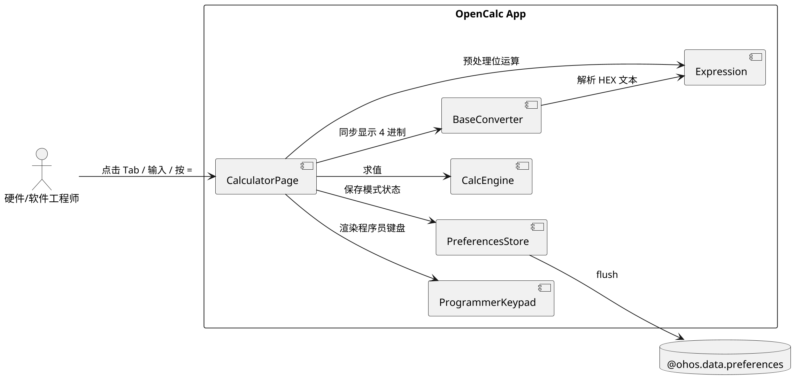
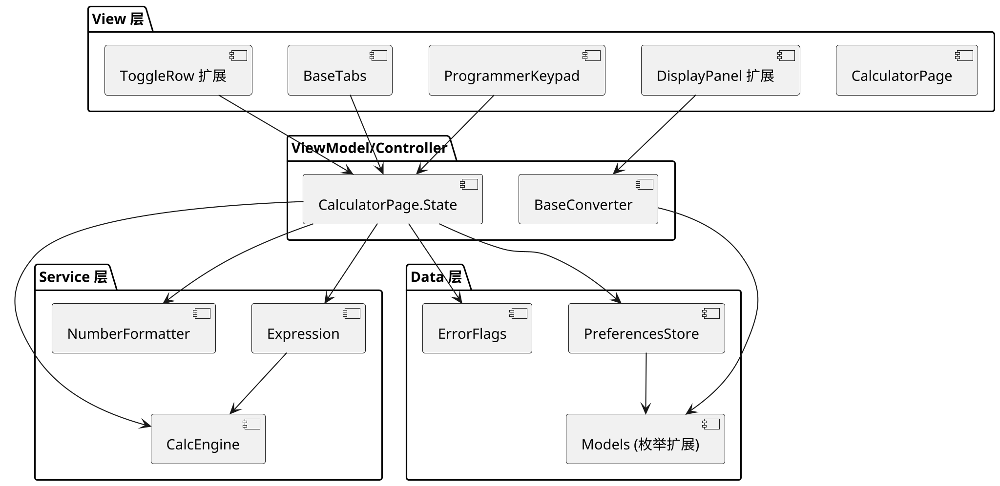
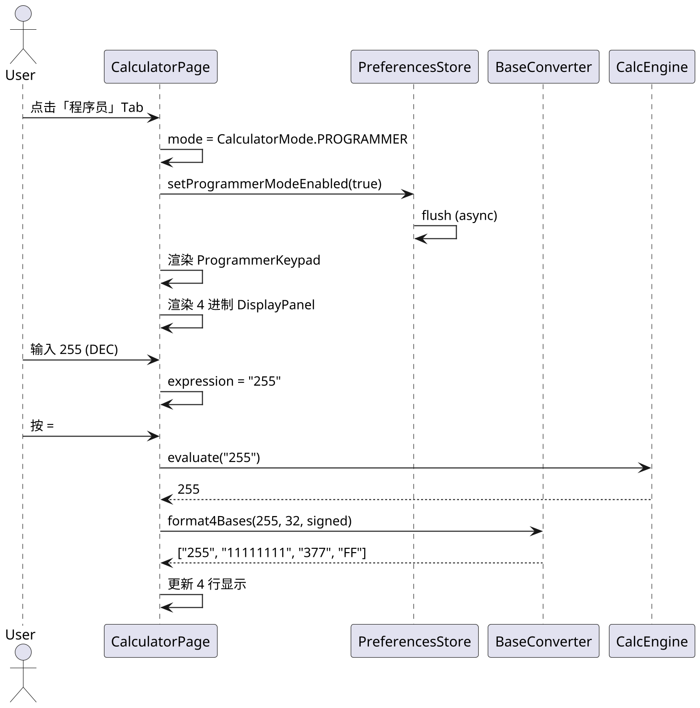

# Delta Design — 程序员模式（Programmer Mode）

> **变更类型**：requirement-add（新功能增量设计）
> **变更日期**：2026-06-12
> **关联变更目录**：`specs/changes/20260612-requirement-programmer-mode/`
> **项目基线**：`opencalc/spec/DESIGN.md`（2026-05-07）
> **本文档仅描述增量部分**，未涉及内容请参考基线 DESIGN.md。

---

## 1. 概述

### 1.1 应用定位
OpenCalc HarmonyOS 是从 Android 移植的科学计算器，本次新增"程序员模式"作为第 3 种计算模式（与基础模式、科学模式并列），面向硬件工程师 / CS 学生 / 嵌入式开发者，提供 DEC/BIN/OCT/HEX 进制互转、位运算（&、\|、^、~、<<、>>）和 8/16/32/64 位宽、signed/unsigned 控制能力。

### 1.2 核心交互
```
用户打开 App
  → 顶部 Tab 选择「程序员」模式
  → 键盘重布局为 ProgrammerKeypad（A-F、位运算按钮）
  → 显示区出现 4 行同步显示：DEC / BIN / OCT / HEX
  → 输入数字或按位运算
  → 按 = 或继续输入
  → 当前进制 Tab 高亮
  → 切换当前进制 → 4 行全部同步刷新
  → 切换位宽 / 符号性 → 4 行显示位数调整
  → 退出程序员模式 → 状态持久化
```

### 1.3 技术栈概览
- **框架**：ArkTS（HarmonyOS API 9+）
- **状态管理**：V1（@State/@Prop，**保持与基线一致**）
- **架构**：MVVM（View → ViewModel → Service → Data）
- **持久化**：`@ohos.data.preferences`（已有 PreferencesStore 封装）
- **测试框架**：`@ohos/hypium`（基线已声明）
- **Native**：不涉及
- **依赖 Kit**：
  - `@kit.ArkData`（preferences）
  - `@kit.ArkUI`（promptAction）
  - `@kit.BasicServicesKit`（pasteboard，复用基线）

---

## 2. 功能清单

| 功能名 | 说明 | 入口 | 优先级 |
|--------|------|------|--------|
| F-PM-01 模式入口 Tab | 顶部 3 Tab（基础 / 科学 / 程序员）切换 | CalculatorPage.ToggleRow | P0 |
| F-PM-02 程序员键盘 | A-F、&、\|、^、~、<<、>>、位宽/符号按钮 | ProgrammerKeypad（新增） | P0 |
| F-PM-03 4 进制同步显示 | DEC/BIN/OCT/HEX 4 行结果区 | CalculatorPage.DisplayPanel | P0 |
| F-PM-04 BaseConverter 工具 | 纯函数模块：转换/格式化/位宽截断 | calculator/BaseConverter.ets（新增） | P0 |
| F-PM-05 Preferences 扩展 | 新增 4 字段（mode/activeBase/bitWidth/signedness） | preferences/PreferencesStore.ets | P0 |
| F-PM-06 表达式引擎扩展 | 在程序员模式下支持 &、\|、^、~、<<、>> | calculator/Expression.ets | P0 |
| F-PM-07 当前进制 Tab | DEC/BIN/OCT/HEX 单选高亮 | CalculatorPage.BaseTabs | P0 |
| F-PM-08 位宽与符号 UI | 8/16/32/64 + signed/unsigned 选择 | CalculatorPage 顶部 | P0 |
| F-PM-09 浮点截断 | 输入 1.5 → 自动转 1 | CalcEngine 输入层 | P0 |
| F-PM-10 单元测试 | BaseConverter.test.ets + Expression.test.ets 扩展 | entry/src/test/ | P0 |
| F-PM-11 状态持久化 | 4 字段写入 Preferences | PreferencesStore | P0 |
| F-PM-12 错误处理 | 位宽溢出静默截断、非法字符提示 | BaseConverter + UI | P1 |

---

## 3. 实现模型

### 3.1 上下文视图



### 3.2 总体架构



> 单向数据流：View → State → Service → Data，**与基线架构一致**，仅在 View 层新增 Keypad/Tabs 组件，在 ViewModel/Controller 引入 BaseConverter。

### 3.3 HAP/HAR/HSP 模块划分
**无变化**。本项目是 single-HAP（基线 DESIGN.md §1 已确定）。所有新增代码位于 `entry/src/main/ets/` 与 `entry/src/test/`。

### 3.4 设计系统规格

#### 3.4.1 色彩系统
**复用基线 `CalculatorPage` 的 `getOp/getEq/getClr/getT1/getT2/getBtnBg` 主题色 API**。新增：
| 元素 | 色彩 | 说明 |
| --- | --- | --- |
| 当前进制 Tab 高亮 | `getOp()`（蓝/浅蓝） | 表示激活态 |
| 非当前进制 Tab | `getT2()`（灰） | 静默态 |
| 位运算按钮背景 | `getFuncBg()` | 与 sin/cos 同级 |
| A-F 按钮 | `getClr()`（绿/浅绿） | 强调十六进制字符 |

#### 3.4.2 主题系统
**复用基线** 0=默认浅色、1=AMOLED、2=暗色。程序员模式不引入新主题。

#### 3.4.3 排版系统
| 名称 | 字号 | 用途 |
| --- | --- | --- |
| Tab 文字 | 12 | 顶部 Tab |
| 进制结果行 | 14 | 4 进制同步显示 |
| 主结果行 | 28/36（横/竖） | 复用基线 |
| 位宽/符号选择 | 12 | ToggleRow 扩展 |

#### 3.4.4 间距与尺寸系统
**复用基线** 8/12/16 padding。Tab 间距 4px。

#### 3.4.5 图标与图形资源
- **当前进制高亮**：`backgroundColor: getOp()` + 圆角 8
- **非当前**：`backgroundColor: '#00000000'`（透明）
- **A-F 字符按钮**：复用 `BtnFunc` 样式（绿色背景）

#### 3.4.6 动画规格
**无新动画**。Tab 切换沿用 ArkUI 默认 200ms 渐变。进制切换是状态变化，无动画需求（结果瞬时刷新）。

#### 3.4.7 响应式断点与栅格
**复用基线** `isLandscape` 机制。
- 竖屏：5 列键盘（A-F 与现有按钮同行扩展）
- 横屏：4 列键盘（自适应）
- 4 进制结果区在两种方向下均垂直堆叠 4 行

### 3.5 CalculatorPage 扩展设计

#### 3.5.1 模块介绍
基线 `@Entry` 主页，**扩展** `ToggleRow`、`ButtonGrid`、`DisplayPanel` 三部分以容纳程序员模式。

#### 3.5.2 功能描述
- 新增 5 个 `@State`：mode / activeBase / bitWidth / signedness / programmerInput
- 顶部 ToggleRow 改为 3-Tab 切换
- 显示区在 mode==='programmer' 时多渲染 4 行进制结果
- 按钮网格按 mode 切换三种布局

#### 3.5.3 目录结构（变更点）
```
entry/src/main/ets/
├── calculator/
│   ├── BaseConverter.ets        ← 新增
│   ├── BaseConverter.test.ets   ← 新增（src/test 镜像）
│   ├── Expression.ets           ← 修改（位运算符号替换）
│   └── Calculator.ets           ← 修改（增加 band/bor/bxor/bnot/shl/shr 函数识别）
├── model/
│   └── Models.ets               ← 修改（新增枚举与字段）
├── preferences/
│   └── PreferencesStore.ets     ← 修改（4 个 getter/setter + getAllPreferences 扩展）
└── pages/
    └── CalculatorPage.ets       ← 修改（state/ToggleRow/DisplayPanel/ButtonGrid）
```

#### 3.5.4 架构图谱

**类图（增量）：**
```plantuml
@startuml
skinparam dpi 200

class CalculatorPage {
  + mode: CalculatorMode
  + activeBase: Base
  + bitWidth: BitWidth
  + signedness: Signedness
  + resultRaw: number
  + loadProgrammerPrefs()
  + saveProgrammerPrefs()
  + onEquals()
}

class BaseConverter {
  + {static} toBase(value: number, base: Base, bitWidth: BitWidth, signed: boolean): string
  + {static} fromBase(text: string, base: Base): number
  + {static} format4Bases(value: number, bitWidth: BitWidth, signed: boolean): string[]
  + {static} isValidCharForBase(ch: string, base: Base): boolean
}

enum CalculatorMode { BASIC, SCIENTIFIC, PROGRAMMER }
enum Base { BIN=2, OCT=8, DEC=10, HEX=16 }
enum BitWidth { B8=8, B16=16, B32=32, B64=64 }
enum Signedness { SIGNED, UNSIGNED }

class Expression {
  + replaceSymbols(...) : 新增 &/|^/~/<</>>
}

class CalcEngine {
  + parseFactor() : 新增 band/bor/bxor/bnot/shl/shr 函数识别
}

CalculatorPage --> BaseConverter
CalculatorPage --> Expression
CalculatorPage --> CalcEngine
CalculatorPage --> CalculatorMode
BaseConverter --> Base
BaseConverter --> BitWidth
BaseConverter --> Signedness
Expression --> CalcEngine
@enduml
```

**时序图（模式切换）：**


#### 3.5.5 功能与用例分析

**用例：程序员模式进制切换**
- 前置条件：mode = PROGRAMMER
- 步骤：
  1. 用户输入数值（如 HEX 模式输 `FF`）
  2. 用户点 BIN Tab
  3. 触发 `onBaseChange(Base.BIN)`
  4. activeBase = BIN
  5. 调用 `BaseConverter.format4Bases(valueRaw, bitWidth, signedness)` 刷新 4 行
  6. 持久化 activeBase
- 后置条件：BIN 行高亮，4 行同步刷新

**用例：位宽溢出截断**
- 前置条件：mode = PROGRAMMER, bitWidth = 8, signedness = UNSIGNED
- 步骤：
  1. 用户输入 256
  2. BaseConverter.toBase(256, 10, 8, false)
  3. 内部 mask = (1<<8)-1 = 255
  4. value & mask = 0
  5. 4 行显示 0 / 0 / 0 / 0
- 后置条件：DEC 行显示 "0"，无错误

**用例：HEX 字符输入**
- 前置条件：mode = PROGRAMMER, activeBase = HEX
- 步骤：
  1. 用户点 "A" 按钮
  2. onDigit("A") → BaseConverter.isValidCharForBase("A", HEX) = true
  3. expression += "A"
  4. 用户继续点 F = "AF"
  5. onEquals → fromBase("AF", HEX) = 175
- 后置条件：4 进制显示 175 / 0b10101111 / 0257 / 0xAF

#### 3.5.6 接口设计

```typescript
// calculator/BaseConverter.ets
export enum Base { BIN = 2, OCT = 8, DEC = 10, HEX = 16 }
export enum BitWidth { B8 = 8, B16 = 16, B32 = 32, B64 = 64 }
export enum Signedness { SIGNED, UNSIGNED }
export enum CalculatorMode { BASIC, SCIENTIFIC, PROGRAMMER }

export class BaseConverter {
  /** 整数转指定进制字符串（带 0x/0b/0o 前缀） */
  static toBase(value: number, base: Base, bitWidth: BitWidth, signed: boolean): string

  /** 进制字符串解析为整数（支持 0x/0b/0o 前缀） */
  static fromBase(text: string, base: Base): number

  /** 4 进制同步格式化（DEC/BIN/OCT/HEX 各一行） */
  static format4Bases(value: number, bitWidth: BitWidth, signed: boolean): string[]

  /** 字符在该进制下是否合法（HEX 接受 0-9 A-F，BIN 仅 0/1） */
  static isValidCharForBase(ch: string, base: Base): boolean
}
```

```typescript
// model/Models.ets 扩展
export interface CalculatorPreferences {
  // ... 已有字段 ...
  programmerModeEnabled: boolean   // default false
  programmerActiveBase: number     // default 10 (DEC)
  programmerBitWidth: number       // default 32
  programmerSignedness: number     // 0=signed, 1=unsigned; default 0
}
```

```typescript
// preferences/PreferencesStore.ets 扩展
export class PreferencesStore {
  // ... 已有方法 ...
  async getProgrammerModeEnabled(): Promise<boolean>
  async setProgrammerModeEnabled(v: boolean): Promise<void>
  async getProgrammerActiveBase(): Promise<number>
  async setProgrammerActiveBase(v: number): Promise<void>
  async getProgrammerBitWidth(): Promise<number>
  async setProgrammerBitWidth(v: number): Promise<void>
  async getProgrammerSignedness(): Promise<number>
  async setProgrammerSignedness(v: number): Promise<void>
  // getAllPreferences 已扩展
}
```

#### 3.5.7 状态管理设计

**V1（与基线一致）：**

| State | 类型 | 初始 | 触发 |
| --- | --- | --- | --- |
| `mode` | `CalculatorMode` | `BASIC` | Tab 切换 |
| `activeBase` | `Base` | `DEC` | 进制 Tab |
| `bitWidth` | `BitWidth` | `B32` | 位宽选择 |
| `signedness` | `Signedness` | `SIGNED` | 符号切换 |
| `resultRaw` | `number` | `0` | onEquals 写入 |
| `programmerDisplay` | `string[]` | `["0","0","0","0"]` | format4Bases 输出 |

**持久化（不绑 @State，使用 aboutToAppear 加载）：**
```typescript
async loadProgrammerPrefs(): Promise<void> {
  if (!this.prefs) return
  this.mode = await this.prefs.getProgrammerModeEnabled() ? CalculatorMode.PROGRAMMER : CalculatorMode.BASIC
  this.activeBase = await this.prefs.getProgrammerActiveBase()
  this.bitWidth = await this.prefs.getProgrammerBitWidth()
  this.signedness = await this.prefs.getProgrammerSignedness() === 1 ? Signedness.UNSIGNED : Signedness.SIGNED
}
```

#### 3.5.8 核心算法

**BaseConverter.toBase 算法：**
```typescript
static toBase(value: number, base: Base, bitWidth: BitWidth, signed: boolean): string {
  // 1. 截断到位宽
  const mask: number = bitWidth === B64 ? Number.MAX_SAFE_INTEGER : (1 << bitWidth) - 1
  let v: number = Math.trunc(value) & mask
  // 2. signed 模式下，高位为 1 时转为负数
  if (signed && (v & (1 << (bitWidth - 1))) !== 0) {
    v = v - (1 << bitWidth)
  }
  // 3. 转字符串
  const raw: string = v.toString(base).toUpperCase()
  // 4. 加前缀
  if (base === HEX) return '0x' + raw
  if (base === BIN) return '0b' + raw
  if (base === OCT) return '0o' + raw
  return raw
}
```

**BaseConverter.fromBase 算法：**
```typescript
static fromBase(text: string, base: Base): number {
  const t: string = text.replace(/^0[xXbBoO]/, '').toUpperCase()
  return parseInt(t, base)
}
```

**Expression 扩展（replaceSymbols）：**
```typescript
// 程序员模式独占（条件触发）
if (mode === CalculatorMode.PROGRAMMER) {
  calc = this.replaceAll(calc, '<<', ' shl( ')   // 注意 << 优先于 <
  calc = this.replaceAll(calc, '>>', ' shr( ')
  calc = this.replaceAll(calc, '&', ' band( ')    // 二元
  calc = this.replaceAll(calc, '|', ' bor( ')
  calc = this.replaceAll(calc, '^', ' bxor( ')    // 程序员模式下 ^ 改为 bxor
  // 一元 ~ 在 Expression 层后处理（识别 ~x → bnot(x)）
}
```

**CalcEngine.parseFactor 扩展：**
- 在 `eat('f')` / `eat('l')` 等分支后增加 `eat('b')` 识别 `band/bor/bxor/bnot`
- 识别 `shl` `shr` 类似 `log/logtwo/logten` 的模式

#### 3.5.9 错误处理

| 异常 | 处理 |
| --- | --- |
| Preferences 读取失败 | 使用默认值（mode=BASIC, base=DEC, width=B32, signed） |
| 位宽溢出 | `& mask` 静默截断，UI 不报错 |
| 64 位 BigInt 缺失 | typeof BigInt === 'undefined' → 降级 number（±2^53） |
| 非法字符输入 | activeBase=DEC 时输入 A → toast "DEC 模式不支持 A-F" |
| 模式切换时 expression 残留 | 清空 expression，toast "已清空" |
| `^` 冲突（幂 vs 位XOR） | 程序员模式下 ^ → bxor；基础/科学模式 ^ → 幂 |
| BigInt 64 位计算 | `BigInt.asUintN(64, value)` + 转字符串 |

#### 3.5.10 依赖关系
- **内部依赖**：
  - `BaseConverter` → 无（纯函数）
  - `CalculatorPage` → `BaseConverter` + `Expression` + `CalcEngine` + `PreferencesStore` + `Models`（扩展）
  - `Expression` → `CalcEngine`（通过 `band/bor/bxor` 等函数）
  - `PreferencesStore` → `Models`（扩展接口）
- **外部依赖**：
  - `@ohos.data.preferences`（基线已有）
  - `@ohos/hypium`（测试）
  - 无新 Kit

---

## 4. 接口设计

### 4.1 内部数据访问 API
**见 §3.5.6**（PreferencesStore 4 个 getter/setter）。

### 4.2 业务抽象接口
**BaseConverter 静态类**：见 §3.5.6。

### 4.3-4.8
**无相关实现**。不涉及后台任务、ExtensionAbility、Want/Action、URI/Deep Link、IPC/RPC、Native、文件交换。

---

## 5. 数据模型

### 5.1 关系型数据库模型
**无相关实现**。Preferences KV 存储，无 RDB 需求。

### 5.2 领域模型
**见 §3.5.6 CalculatorPreferences 扩展**。

### 5.3 Preferences 结构
| key | 类型 | 默认值 | 说明 |
| --- | --- | --- | --- |
| `programmerModeEnabled` | boolean | false | 启动时是否进入程序员模式 |
| `programmerActiveBase` | number | 10 | 当前激活进制（2/8/10/16） |
| `programmerBitWidth` | number | 32 | 位宽（8/16/32/64） |
| `programmerSignedness` | number | 0 | 0=signed, 1=unsigned |

### 5.4 分布式数据对象模型
**无相关实现**。

### 5.5 文件格式 Schema
**无相关实现**。历史记录结构不变。

---

## 6. UI 设计系统

**见 §3.4**。基线 UI 设计系统（CalculatorPage 的 `getOp/getClr` 等 API）完全复用。

### 6.1-6.6
**见 §3.4**。

### 6.7 一多响应式规范
- **竖屏**：ToggleRow 3-Tab 横向排列；ButtonGrid 5 列；DisplayPanel 4 进制结果纵向堆叠
- **横屏**：ToggleRow 折叠到顶部按钮；ButtonGrid 4 列（更紧凑）；DisplayPanel 4 进制结果纵向堆叠，右侧可折叠历史
- **断点**：沿用基线 `isLandscape = w > h`
- **栅格**：4 / 5 列 Grid，padding 8/12

---

## 7. 页面清单与导航

### 7.1 页面清单总表
| 页面名 | 路径 | 入口 Ability | 传参 | 功能摘要 |
| --- | --- | --- | --- | --- |
| CalculatorPage | pages/CalculatorPage | EntryAbility | — | 主页（基础/科学/程序员三模式） |
| SettingsPanel | inline @Builder | — | — | 复用基线 |
| AboutPanel | inline @Builder | — | — | 复用基线 |

**无新增页面**。所有功能在 CalculatorPage 内通过 state 切换。

### 7.2 全局导航图
**无变化**。不引入路由跳转。

### 7.3-7.4
**无相关实现**。

---

## 8. 用户交互规格

### 8.1 手势交互目录
**复用基线**：
- 数字 / 运算符 / 函数 / 常量按钮 onClick
- DisplayPanel LongPressGesture → onCopy
- 顶部 Tab onClick → mode 切换

**新增**：
- 进制 Tab onClick → activeBase 切换
- 位宽/符号 Toggle → bitWidth/signedness 切换
- A-F 按钮 onClick（程序员模式独占）

### 8.2 弹窗/Sheet/Menu 目录
**复用基线** SettingsPanel / AboutPanel。
**新增 promptAction.showToast 调用**：
- 切换到程序员模式清空 expression 时 → "已切换至程序员模式"
- DEC 模式下输入 A-F 字符 → "DEC 模式不支持字母"

### 8.3 剪贴板与反馈行为
**复用基线** onCopy（结果复制）。程序员模式复制当前激活进制的字符串。

### 8.4 卡片交互
**无相关实现**。

---

## 9. 平台集成

### 9.1 构建配置与依赖
**无变化**。`oh-package.json5` 已声明 `@ohos/hypium`（基线），`build-profile.json5` 无需改动。

### 9.2 权限与运行时请求
**无新增权限**。所有功能使用已有 Preferences 权限。

### 9.3 系统能力（Kits）清单
| Kit | 关键 API | 用途 | 状态 |
| --- | --- | --- | --- |
| `@kit.ArkData` | preferences | 持久化 | 已有 |
| `@kit.ArkUI` | promptAction | Toast 提示 | 已有 |
| `@kit.BasicServicesKit` | pasteboard | 复制 | 已有 |

### 9.4 后台与 Extension
**无相关实现**。本功能无需后台。

### 9.5 备份与恢复
**无相关实现**。沿用基线 Preferences 备份机制（系统级）。

### 9.6 分布式与跨端
**无相关实现**。

---

## 10. 偏好设置目录

### 10.1 计算模式偏好
**复用基线** scientificModeDefault（科学模式）+ 新增：

| key | 类型 | 默认值 | 说明 | 行为影响 |
| --- | --- | --- | --- | --- |
| `programmerModeEnabled` | boolean | false | 启动是否进入程序员模式 | 决定 CalculatorPage 初始 mode |
| `programmerActiveBase` | number | 10 | 当前激活进制 | 决定 onEquals 后默认显示与输入接受字符 |
| `programmerBitWidth` | number | 32 | 位宽 | 影响 BaseConverter 截断与显示位数 |
| `programmerSignedness` | number | 0 | 0=signed, 1=unsigned | 影响负数显示 |

### 10.2-10.N
**复用基线**（主题、振动、防休眠等不涉及本变更）。

---

## 11. 测试设计

### 11.1 单元测试范围
**`entry/src/test/calculator/BaseConverter.test.ets`** —— 100% 覆盖 BaseConverter 4 个静态方法。
**`entry/src/test/calculator/Expression.test.ets`**（扩展）—— 新增 `band/bor/bxor/bnot/shl/shr` 用例 + `&|^~<<>>` 符号预处理用例。

### 11.2 测试用例（节选）
```
// BaseConverter.toBase
TC-001: toBase(0, DEC, 32, true)  === "0"
TC-002: toBase(255, BIN, 8, false) === "0b11111111"
TC-003: toBase(255, HEX, 8, false) === "0xFF"
TC-004: toBase(255, OCT, 8, false) === "0o377"
TC-005: toBase(256, BIN, 8, false) === "0b00000000"  // 截断
TC-006: toBase(-1, DEC, 8, false)  === "255"          // unsigned
TC-007: toBase(-1, DEC, 8, true)   === "-1"           // signed
TC-008: toBase(255, DEC, 8, true)  === "-1"           // signed 高位置 1
TC-009: toBase(4096, HEX, 16, false) === "0x1000"

// BaseConverter.fromBase
TC-010: fromBase("0xFF", HEX) === 255
TC-011: fromBase("FF", HEX)   === 255
TC-012: fromBase("0b1010", BIN) === 10
TC-013: fromBase("0o17", OCT) === 15

// BaseConverter.format4Bases
TC-020: format4Bases(255, 8, false) === ["255","0b11111111","0o377","0xFF"]
TC-021: format4Bases(-1, 8, true)   === ["-1","0b11111111","0o377","0xFF"]
TC-022: format4Bases(-1, 8, false)  === ["255","0b11111111","0o377","0xFF"]

// BaseConverter.isValidCharForBase
TC-030: isValidCharForBase("A", DEC) === false
TC-031: isValidCharForBase("A", HEX) === true
TC-032: isValidCharForBase("2", BIN) === false
TC-033: isValidCharForBase("7", OCT) === true

// Expression 扩展（位运算）
TC-100: getCleanExpression("5 & 3", mode=PROGRAMMER) 包含 "band"
TC-101: getCleanExpression("1 << 4", mode=PROGRAMMER) 包含 "shl"
TC-102: getCleanExpression("~0", mode=PROGRAMMER) 包含 "bnot"
```

### 11.3 回归测试
**必须保持** Issue #9 percent 按钮的全部测试用例通过（基线已有）。

---

## 12. 自验证

| 检查项 | 结果 | 说明 |
| --- | --- | --- |
| 功能一致性 | ✓ | §2 的 12 项功能覆盖 delta-spec.md 全部 IR-PM-01..08 |
| 页面一致性 | ✓ | 无新增页面，所有功能在 CalculatorPage 内 |
| 数据一致性 | ✓ | §5.3 Preferences 4 字段对齐 delta-spec.md |
| 权限一致性 | ✓ | 不引入新权限 |
| Kit 一致性 | ✓ | 仅复用基线 3 个 Kit |
| 架构一致性 | ✓ | 保持 MVVM，无新 HAP/HAR |
| 测试覆盖 | ✓ | BaseConverter 100% 单测目标已写入 §11.2 |
| 兼容性 | ✓ | 4 字段为可选，老 Preferences JSON 兼容 |
| 风险缓解 | ✓ | FMEA 5 项异常均在 §3.5.9 给出处理 |

---

> 本文档由 mod-design skill 生成。
> 标记 [推断] 的内容为基于设计推断，非确定性事实。
> 生成时间: 2026-06-12
