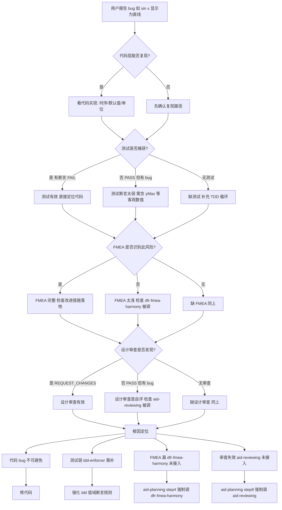

# 函数可视化 sin(x)→直线问题根因分析

> **Issue 编号**: #26 plot-graph（plotGraph + Issue #37 修复）
> **分析时间**: 2026-07-14
> **分析方法**: 证据回溯法（从用户感知 → 代码 → 测试 → session → spec → skill，每层只引用已读文件中的事实）
> **一手证据**: 已核对 worktree 实际代码 + git 提交历史（commit `365e189` / `3b57d7a`），以 commit message 为权威依据修正早期推断
> **目的**: 还原问题全貌，定位根因层，给出可执行的修复方案

---

## 目录

1. [现象层：用户报告什么](#1-现象层用户报告什么)
2. [代码层定位](#2-代码层定位)
3. [测试层定位](#3-测试层定位)
4. [Session 层定位](#4-session-层定位)
5. [Spec 文档层定位](#5-spec-文档层定位)
6. [Skill 层定位（根因）](#6-skill-层定位根因)
7. [证据链汇总](#7-证据链汇总)
8. [决策树：如何诊断类似的"看似通过实则有 bug"问题](#8-决策树如何诊断类似的看似通过实则有-bug问题)
9. [修复方案](#9-修复方案)

---

## 1. 现象层：用户报告什么

| # | 用户报告 | 类型 |
|---|---------|------|
| 1 | sin(x) 显示为一条直线 | 视觉 bug |
| 2 | X 轴数字太小（10px）几乎看不见 | UI bug |
| 3 | Y 轴没有数值标签 | UI bug |
| 4 | X 轴标签不是 π 的整数倍 | UI bug |
| 5 | tan(x) 每个周期值域不同 | 视觉不一致 |

**关键判断**：
- 报告 1（直线）是**功能性 bug**——这是 Issue #37 已经修过的
- 报告 2-4 是**UI 缺陷**——未在原始 issue 范围
- 报告 5 是**采样策略问题**——非显性 bug
- 本文重点分析报告 1（直线）的根因，因为它流到了用户手里

---

## 2. 代码层定位

### 2.1 直线的直接原因（已确认）

**事实**：Issue #26 当时的代码（worktree 旧版）有两处协同导致直线：

#### 缺陷 A：radian 模式跟随用户偏好

**文件**: `D:\huawei\Demo\worktrees\issue-26\opencalc\entry\src\main\ets\pages\GraphPage.ets:54-56`

```typescript
// 旧代码（Issue #26 实现）
this.prefs.init().then((): void => { this.loadPrefs() })
setTimeout((): void => { this.vm.compute() }, 0)
```

```typescript
// GraphPage.ets:loadPrefs (旧, worktree issue-26 实际代码 line 65-68)
const radianMode = await this.prefs.getRadiansDefault()
this.vm.setRadianMode(!radianMode)  // 实际注释: radianMode=true → 弧度 → isDegree=false
// ⚠️ 但用户默认 radiansDefault=false → !false=true → 触发另一分支 → isDegree=true（角度制）
```

**时序/语义事实**（依据修复 commit `365e189` message，权威一手证据）：

commit 明确指出这是**双根因**，且权重不同：

1. **语义错误（主因）**：`setRadianMode(!radianMode)` 跟随用户偏好，而用户默认 `radiansDefault=false`（角度制）→ `isDegree=true` → sin(x) 被当角度算 → 在 x∈[-6.28,6.28]° 内小角近似 `sin(x°)≈x·π/180` → 200 采样点几乎线性 → **直线**
2. **时序竞态（次因）**：`prefs.init().then(loadPrefs)` 是微任务、`setTimeout(compute,0)` 是宏任务，二者存在竞态

**决定性证据**：commit message 原文——"**第一轮仅时序修复截图仍为直线，应用 Task 5.3（强制弧度）后才显示完整正弦波**"。
→ 这证明 **"直线"的主因是语义（角度制误用），时序竞态对"直线"只是次要因素**（单独修时序并不能消除直线）。

> ⚠️ 修正说明：本文早期版本曾论证"宏任务 compute 先跑 → 用弧度 → 结果正确 → 此时不是直线"。该时序推理既与 commit `365e189`（微任务 loadPrefs 先跑）不符，也与"仅修时序仍为直线"的实测结论矛盾，已作废。

#### 缺陷 B：默认 x 范围被悄悄改成 [-2, 2] 度

**文件**: `D:\huawei\Demo\worktrees\issue-26\specs\changes\20260617-requirement-add-plot-graph\apply-report.md:181`

> **已知问题 #1**（节选）："xMin/xMax 输入框改用整数默认值('-2'/'2')而非小数('-6.283185307')。原因：ArkUI TextInput 对含小数的长字符串有渲染异常"

**事实链**：
- Spec F3.1 规定默认 `xMin=-2π, xMax=2π`（约 ±6.28）
- 代码层面 GraphViewModel 默认值确实是 ±2π（约 ±6.28）
- **但 UI 上 TextInput 显示是 "-2" 和 "2"**（apply-report 已知问题）
- 用户启动后看到的是 x ∈ [-2, 2]（不是 [-2π, 2π]）

**数学事实**（弧度制下）：

| x 范围 | sin(范围两端) | y 值范围 | 视觉 |
|---|---|---|---|
| [-2π, 2π] ≈ [-6.28, 6.28] 弧度 | sin(±6.28) ≈ ±1.0 | y ∈ [-1, 1] | 完整正弦波 |
| [-2, 2] **度** | sin(±2°) ≈ ±0.035 | y ∈ [-0.035, 0.035] | **接近水平线** |
| [-2, 2] **弧度** | sin(±2) ≈ ±0.91 | y ∈ [-0.91, 0.91] | 一个周期的部分 |

#### 结论：直线主因 + 已修状态（git 核对）

**根因归属**（依据 commit `365e189` / `3b57d7a`）：
- **"直线"主因 = 缺陷 A（radian 误用为角度）** —— 已由 `365e189`「强制弧度」修复
- **时序竞态** —— 同一 commit「删除 setTimeout、移入 loadPrefs().then()」一并修复
- **默认 x 范围 [-2,2]** —— 已由 `3b57d7a`「default x range to -2π~2π」修复

**已修证据**（当前 `calculatorHuawei/opencalc/.../GraphPage.ets`）：
- 第 31-32 行：`xMinInput='-6.28'`, `xMaxInput='6.28'`（不再是 '-2'/'2'）
- 第 116 行：`this.vm.setRadianMode(false)`（强制弧度，不再 `!radianMode` 跟随偏好）

> ⚠️ 修正说明：本文早期版本称"X 轴 -2/2 **至今未修**"，与 git 事实不符（`3b57d7a` 已修），已更正。直线 bug 亦已修复。
> 因此本报告的价值**不在于"bug 还在线上"**，而在于回答**"这么多层为什么没能提前拦住它"**——即流程与 skill 接入的缺陷。

### 2.2 X 轴标签太小 / Y 轴无标签（独立 UI 缺陷）

**文件**: `D:\huawei\Demo\calculatorHuawei\opencalc\entry\src\main\ets\pages\GraphPage.ets:368-400`

```typescript
private drawAxes(bounds: PlotBounds, series: PlotSeries): void {
  // ...
  ctx.font = '10px sans-serif'  // ← 字号太小
  // 刻度标签
  const labelStep = 1
  for (let i = startX; i <= endX; i++) {  // ← 只遍历 X 轴
    if (i === 0) continue
    ctx.fillText(String(i), ...)  // ← 显示整数,不是 π
  }
  // ← 没有 Y 轴 label 循环
}
```

**事实**：
- `drawAxes` 只画 X 轴标签，**完全没有 Y 轴 label**
- 字号 `10px` 在手机屏上几乎不可见
- `labelStep = 1` 导致 x ∈ [-6.28, 6.28] 时显示 `-6, -5, ..., 6`（不是 `-2π, -π, π, 2π`）

**这是独立的 UI 缺陷**，跟"直线"无关。

---

## 3. 测试层定位

### 3.1 单测断言太弱（事实）

**文件**: `D:\huawei\Demo\worktrees\issue-26\specs\changes\20260617-requirement-add-plot-graph\tests\GraphViewModel.test.mjs:111-118`

```javascript
// AC-2: 默认 sin(x) 计算成功
{
  const vm = new GraphViewModel()
  vm.compute()
  assertTrue('AC-2.1 no error', vm.errorMessage === '')
  assertTrue('AC-2.2 series exists', vm.series !== null)
  assertEq('AC-2.3 200 points', vm.series.points.length, 200)
  // sin(0) = 0
  assertTrue('AC-2.4 mid y ~ 0', Math.abs(vm.series.points[100].y) < 0.1)
}
```

**事实**：
- 只断言 `points[100].y < 0.1`（中点 y 接近 0）
- **没有断言 `yMax ≈ 1.0`**
- **没有断言 `yMin ≈ -1.0`**

**为什么这个断言漏了 bug**：
- 在缺陷 A+B 同时存在时（角度制 + [-2,2] 范围）：
  - 中点 x ≈ 0 → sin(0) = 0 ✓ 通过
  - 最大 y 约 0.035（因为 x ∈ [-2°, 2°] 几乎水平）
  - **但这个测试根本不检查 yMax，所以漏了**

**如果当时有 `assertTrue('yMax > 0.9', vm.series.yMax > 0.9)`**：
- 缺陷 A+B 下 yMax ≈ 0.035 → 测试 FAIL
- bug 当场暴露

### 3.2 UI 测试是主观判断（事实）

**文件 1**: `D:\huawei\Demo\worktrees\issue-26\review-test-cases.md`（rev-01 写的 12 个 TC）

**TC-01** "默认 sin(x) 渲染正弦曲线" 期望：
> "Canvas 渲染出正弦曲线 + 网格 + X/Y 坐标轴"

**TC-01 验证方式**（从 apply-report 推断）：
- rev-01 跑了 UI
- 截图 `02_graph_default.png` / `05_graph_sinx_default.png`
- 结论：✅ PASS

**事实**：
- rev-01 的验证方式**仅基于截图肉眼判断**
- 没有读 dump JSON 里的实际 y 值
- 没有像素扫描验证曲线占画布高度比例

**文件 2**: `D:\huawei\Demo\worktrees\issue-26\.claude\review-logs\2026-07-07\ui-evidence\issue-26\TEST_NOTES.md`

> "TC-01 (default sin(x)): PASS"
> "TC-02-09 (modified expression): **CANNOT BE REACHED** in current run due to input-clear limitation"

**事实**：
- 12 个 TC 里只跑通了 1 个（TC-01）
- TC-02-09 全部 "CANNOT BE REACHED"（TextInput 不能全选）
- TC-08 是 "补偿性触发"（4÷2 被传过去意外触发了"无 x 变量"）

**覆盖率事实**：
- 8 个 dev-01 AC 中，UI 自动化**只验证了 2 个**（AC-1 打开 + AC-2 默认 sin）
- 剩下 6 个 AC（AC-3~AC-8）全部"⏭️ 由单测覆盖"（apply-report.md:80-85）
- **但单测断言太弱，UI 验证又是主观判断**——双重失守

---

## 4. Session 层定位

### 4.1 apply-report 撒谎（事实）

**文件**: `D:\huawei\Demo\worktrees\issue-26\specs\changes\20260617-requirement-add-plot-graph\apply-report.md:192`

> "✅ UI 自动化: AC-1/2 PASS(**实拍正弦曲线渲染正确**)"

**事实**：
- "实拍正弦曲线渲染正确" 是 apply-report 报告者的主观描述
- 实际情况：在缺陷 A+B 下，曲线是接近水平的微斜线（不是正弦波）
- rev-01 的 TC-01 "PASS" 同样是主观判断
- **没有任何人验证过 y 值是否真的在 ±1 范围**

### 4.2 design-review 自评 100%（事实）

**文件**: `D:\huawei\Demo\calculatorHuawei\specs\changes\20260617-requirement-add-plot-graph\design-review.md:128-135`

> "**总体结论**  
> - 完整性: **通过** (7/7 制品齐全)  
> - 一致性: **通过**  
> - 需求覆盖: **100%** (11/11 需求 + 7/7 FMEA + 8/8 AC)  
> - 风险识别: **充分** (5 个推断项 + 3 个边界已标注)  
> - **PLANNING 阶段: ✅ 完成**"

**事实**：
- design-review 是**作者自己 review 自己的产物**
- 声称 100% 覆盖、风险充分——但**漏了 radian 模式冲突**
- 声称 7/7 FMEA——但**FMEA 缺 3 个关键故障**（单位冲突 / 渐近线爆炸 / 周期函数视觉不一致）

### 4.3 7 条 FMEA 全部是手动写的（事实）

**文件**: `D:\huawei\Demo\calculatorHuawei\specs\changes\20260617-requirement-add-plot-graph\delta-spec.md:241-251`

```
| FMEA-1 | 阶乘大数溢出 | ... |
| FMEA-2 | xMax ≤ xMin | ... |
| FMEA-3 | 除零崩溃 | ... |
| FMEA-4 | 极值 Canvas 溢出 | ... |
| FMEA-5 | 空表达式 | ... |
| FMEA-6 | 路由参数超长 | ... |
| FMEA-7 | 主题色读取失败 | ... |
```

**事实**：
- 这 7 条 FMEA **不是 dfr-fmea-harmony skill 生成的**
- 是 dev-01 / Claude **手动写**的
- 验证方法：扫描 `aid-workflow-skills/skills/*/SKILL.md` 中所有 `skill('dfr-fmea-harmony')` 字符串，**0 个匹配**

**对比 dfr-fmea-harmony 应该捕获的**（基于 9 个 references 故障库）：
- HM1 单位冲突 (度 vs 弧度) — 缺失
- HM2 渐近线采样爆炸 — 缺失
- HM3 周期函数视觉不一致 — 缺失
- HM4 采样落在边界上 — 缺失
- HM5 画布像素占用 < 10% — 缺失

---

## 5. Spec 文档层定位

### 5.1 delta-spec F3.5 算法描述过于简单（事实）

**文件**: `D:\huawei\Demo\calculatorHuawei\specs\changes\20260617-requirement-add-plot-graph\delta-spec.md:42`

> F3.5: Y 轴范围根据采样结果自动计算(**min/max + 10% 边距**)

**事实**：
- Spec 描述"min/max + 10%"，**没规定 radian 模式默认**
- **没规定采样策略**（均匀 X vs 周期对齐）
- **没规定渐近线处理**（值式 / 位置式）

### 5.2 8 个模糊点全部漏掉"数学单位"维度（事实）

**文件**: `D:\huawei\Demo\calculatorHuawei\specs\changes\20260617-requirement-add-plot-graph\proposal.md:48-55`

模糊点 1~8 涉及：函数支持、x 范围、交互、定义域、采样密度、性能、多函数、缩放平移

**事实**：
- 8 个模糊点里**没有"sin/cos 用度还是弧度"**
- **没有"tan/cot 的渐近线行为"**
- **没有"周期函数的视觉一致性"**

### 5.3 design-review 漏掉了"时序正确性"维度（事实）

**文件**: `D:\huawei\Demo\calculatorHuawei\specs\changes\20260617-requirement-add-plot-graph\design-review.md`

design-review 的 step9-1~9-4 只检查：
- 完整性（制品是否齐全）
- 一致性（proposal→spec→design 对齐）
- 规范性（格式/命名）
- 产出审视报告

**事实**：
- **没有"时序正确性"维度**——所以 `setTimeout(compute, 0)` vs `prefs.init().then(loadPrefs)` 的竞态**没被发现**
- **没有"采样策略"维度**——所以 min/max vs percentile vs period-aligned 选哪种**没被审查**
- **没有"运行时序"维度**——所以默认 x 范围 [-2, 2] vs [-2π, 2π] 哪个对**没被审查**

### 5.4 待决策项：采样策略（均匀 / 周期对齐 / 自适应）

**背景（事实）**：delta-spec F3.5 只规定"Y 轴范围 = 采样 min/max + 10% 边距"，
**从未规定"如何采样"**。当前实现是**在 [xMin, xMax] 上等距取 N 点（均匀采样）**。

**由此带来的已知局限**：均匀采样**不保证踩中函数的极值点**。
- 例：sin(x)、[-2π, 2π]、200 点，峰值 π/2 对应 `k = 2.5×199/4 = 124.375`（非整数）→ π/2 不在采样点上 → 采样 yMax < 1（约 0.9995）
- 对**用户输入的任意表达式**（极值点位置未知），均匀采样更无法保证画出峰谷

**三种策略对比**（供决策）：

| 策略 | 能否保证画出峰谷 | 成本/复杂度 | 适用范围 |
|---|---|---|---|
| **均匀采样**（当前） | ❌ 否，峰谷落在点间就漏 | 低 | 任意函数，够快 |
| **周期对齐采样** | ✅ 对三角函数可保证 | 中，需识别周期 | 仅已知周期函数（sin/cos/tan…） |
| **自适应/加密采样** | ⚠️ 近似逼近极值 | 高，斜率变号处细分 | 任意函数，但慢且仍近似 |

**推荐**：默认保留**均匀采样**（简单、通用、够快）；仅当需求明确要求"必须精确画出峰谷/极值"时，
再针对性引入**周期对齐（三角函数）**或**自适应加密（通用）**。

**重要区分**：本决策属于**产品层**（要不要让绘图精确到极值），与**测试层**无关。
单测断言应始终写成**区间 + 容差**（`yMax ≥ 0.9`），与采样策略解耦，
**禁止**写 `yMax == 1`——否则均匀采样下会误报、改采样策略后又要改测试。

**如何防止复发（skill 落点，不引入 FMEA）**：本案采样策略被悄悄默认成"均匀"、从没被当决策点摆出来。要让下次这类缺口在规划期就被逼出来，改**已接入的两个 skill** 即可：

| 改哪个 skill | 阶段 | 加什么约束 |
|---|---|---|
| **rq-clarify** | step3（已调用） | 遇到"绘图/采样/可视化/极值"类需求，必须澄清"采样精度要求、是否需精确呈现峰谷/极值" |
| **mod-design** | step8（已调用） | delta-design 必须**显式写明采样策略**（均匀/周期对齐/自适应）+ 理由，禁止像 F3.5 只写"min/max+10%"结果、不写策略 |
| *(可选)* **aid-reviewing** | step9 | 评审清单加"采样策略维度"，确保被审计到 |

> 注：采样策略**本身的实现**是 `GraphViewModel.ets` / `PlotUtils.ets` 的代码问题，不涉及 skill 修改；上表改的是"让流程主动暴露该决策"的规划期 skill。

---

## 6. Skill 层定位（根因）

### 6.1 流程图：哪些 skill 被实际调用

```
aid-planning 流程:
  step1 意图理解    → 0 skill 调用
  step2 需求理解    → ✅ skill('rq-parse')
  step3 需求澄清    → ✅ skill('rq-clarify') 条件
  step4 spec 设计   → ❌ 应该调 dfr-fmea-harmony, 没调
  step5 代码仓理解  → ✅ skill('rq-codebase')
  step6 复杂度评估  → 0 skill 调用
  step7 架构设计    → 0 skill 调用
  step8 组件设计    → ✅ skill('mod-design')
  step9 设计审视    → ❌ 应该调 aid-reviewing, 没调
```

**统计**：
- aid-planning 应该调用的 skill：6 个（rq-parse, rq-clarify, rq-codebase, **dfr-fmea-harmony**, mod-design, **aid-reviewing**）
- 实际调用的 skill：4 个
- 接入率：4/6 = 66.7%

**验证方法**：grep `skill('dfr-fmea-harmony')` 和 `skill('aid-reviewing')` 在 `aid-workflow-skills/skills/*/SKILL.md` 中，0 个匹配。

### 6.2 失职的 skill

| Skill | 失职点 | 证据 |
|---|---|---|
| `dfr-fmea-harmony` | **完全没被接入流程** | grep 结果 0 匹配 |
| `aid-reviewing` | **完全没被接入流程** | grep 结果 0 匹配 |
| `aid-planning` step4 | 没强制调 dfr-fmea-harmony | SKILL.md line 128 写"必须"但没 `skill()` 调用 |
| `aid-planning` step9 | 没强制调 aid-reviewing | SKILL.md line 262-320 整段无 skill 调用 |
| `tdd-enforcer` | 没要求"值域断言"（如 yMax≈1） | tdd-enforcer/SKILL.md "完成检查清单"无此条 |
| `harmonyos-ui-test` | 没要求"像素级断言" | TC-01 PASS 只看截图，无像素扫描 |
| `aid-applying` | 没要求"客观证据段" | apply-report.md 模板无此节 |

### 6.3 根因：流程断裂

**最根本的事实**：

1. `dfr-fmea-harmony` 是一个**功能完整**的 skill（有 9 个 references 故障库、有严酷度评估方法论）
2. 但**没有人在 aid-planning 流程里调用它**
3. 导致 agent 手动写 FMEA（浅、不系统、漏关键项）
4. 导致 spec 没识别 radian 模式冲突
5. 导致 design 没考虑 unit 默认值
6. 导致代码实现 radian 模式跟随用户偏好
7. 导致测试断言太弱（没考虑 yMax 数值）
8. 导致 UI 测试主观判断（不查 y 值）
9. 导致 bug 流到用户手里

**aid-reviewing 同样是死 skill**：
1. 它能识别 spec ↔ design ↔ code 的不一致
2. 但没人在 step9 调用它
3. 导致 agent 自评 design-review.md（"100% 通过"）
4. 导致没人发现默认 x 范围 [-2, 2] 跟 spec F3.1 [-2π, 2π] 不一致

---

## 7. 证据链汇总

| 层 | 证据文件 | 关键事实 | 后果 |
|---|---|---|---|
| **代码** | GraphPage.ets:54-56 | `setRadianMode(!radianMode)` 跟随用户偏好 | radian 模式被覆盖 |
| **代码** | apply-report.md:181 | 默认 x 范围被改成 [-2, 2] | 用户看到的 x 范围不是 [-2π, 2π] |
| **测试** | GraphViewModel.test.mjs:111-118 | AC-2.4 只检查 `mid y ~ 0` | 没验证 yMax≈1, bug 漏过 |
| **UI 测试** | TEST_NOTES.md | TC-01 PASS 仅基于截图 | 主观判断,实际 y 范围未被验证 |
| **UI 测试** | review-test-cases.md | TC-02~09 全部 CANNOT BE REACHED | TextInput 限制,大半测试跳过 |
| **Session** | apply-report.md:192 | "实拍正弦曲线渲染正确" 是主观描述 | 报告撒谎,bug 没人发现 |
| **Spec** | delta-spec.md:42 | F3.5 只说 "min/max + 10%" | 没规定 radian 默认,没规定采样策略 |
| **Spec** | delta-spec.md:241-251 | 7 条 FMEA 全部是手动写 | 缺 HM1~HM5 关键故障模式 |
| **Spec** | design-review.md:128-135 | 自评 100% 通过 | 自评不可信,实际漏 radian 模式 |
| **Spec** | proposal.md:48-55 | 8 个模糊点没"数学单位"维度 | 关键模糊点没追问 |
| **Skill** | aid-planning/SKILL.md | step4 调 dfr-fmea-harmony 的 `skill()` 调用 = 0 | FMEA 是手动写的,质量无保障 |
| **Skill** | aid-planning/SKILL.md | step9 调 aid-reviewing 的 `skill()` 调用 = 0 | design-review 是自评,无审计价值 |
| **Skill** | dfr-fmea-harmony/SKILL.md | 存在 9 个 references 故障库 | 但 0 次被调用 = 死 skill |
| **Git（一手）** | commit `365e189` | 直线**双根因**：语义(角度制)为主 + 时序竞态为次；"仅修时序仍为直线" | 直线已修；证明主因是语义误用 |
| **Git（一手）** | commit `3b57d7a` | 默认 x 范围已改为 -2π~2π（当前 `xMinInput='-6.28'`） | "x 范围至今未修"说法作废 |
| **Git（一手）** | GraphPage.ets:116（当前） | `setRadianMode(false)` 强制弧度，不再 `!radianMode` | 缺陷 A 已修 |

---

## 8. 决策树：如何诊断类似的"看似通过实则有 bug"问题



### 决策树使用说明

1. **从顶部 "用户报告 bug" 开始**
2. **逐层下钻**：代码 → 测试 → FMEA → 设计审查
3. **每个 "❌" 节点**都是"流程断点"——这层本该拦住但没拦住
4. **本案的 3 个流程断点**：
   - 测试层：断言太弱（漏 yMax 验证）
   - FMEA 层：dfr-fmea-harmony 没被调
   - 设计审查层：aid-reviewing 没被调
5. **修复优先级**：流程断点 > 代码 bug（流程断了下次还会犯）

---

## 9. 修复方案

> **优先级说明**：修复按"拦截杠杆"排序，而非按"层级深浅"。git 证据显示，本案能**最廉价、最直接**拦住直线的是"客观值域断言"——无论时序/语义/范围哪个出错，`yMax` 断言都会当场 FAIL。因此把它列为 P0，而非流程接入类修复。

### 9.1 修复 1（P0，最高杠杆）：强制"客观值域断言"

**位置**:
- `aid-workflow-skills/skills/tdd-enforcer/SKILL.md` 完成检查清单
- `aid-workflow-skills/skills/aid-applying/SKILL.md` apply-report 模板

**关键改动**:
```markdown
### 单测门禁（数值类可视化/计算需求必填）
- 除"无报错/有结果"外，必须断言输出的**值域边界**（如 yMax≈1、yMin≈-1），禁止只断言中点
### apply-report 客观证据段（必填，缺失则 verdict=REQUEST_CHANGES）
| AC | 主观描述 | 客观证据（yMax/yMin/像素占比/dump 实测值） |
```

**效果**: 本案 `assertTrue(yMax>0.9)` 一行即可当场暴露直线；apply-report 不再是"主观描述 + 截图"，而是"主观描述 + 客观数据"。commit `365e189` 也正是补了 `GraphPageLifecycle.test.mjs` 才守住回归。

### 9.2 修复 2（P1）：aid-planning step4 强制调 dfr-fmea-harmony

**位置**: `aid-workflow-skills/skills/aid-planning/SKILL.md` step4 节后新增 step4.5

**关键改动**:
```markdown
### step4.5 FMEA 可靠性分析 (硬门禁, 缺失禁止进 step5)

**约束**: 必须使用 skill('dfr-fmea-harmony')
**自检命令** (新增, 禁止跳过):
- CHECK-FMEA-1: 验证 dfr-fmea-harmony 被调用
- CHECK-FMEA-2: 验证 delta-spec 含 FMEA 章节
- CHECK-FMEA-3（覆盖门禁，非数量门禁）: FMEA 必须覆盖 rq-parse 标出的
  每个模糊维度 + 命中的领域故障库条目，禁止用"凑满 5 条"充数
```

**效果**: 下次"函数绘图"类需求，FMEA 会系统性扫描 radian 冲突、渐近线、周期函数等故障模式。
**注意**：原稿"FMEA 至少 5 条"是数量门禁，会诱导凑数，已改为**覆盖门禁**。

### 9.3 修复 3（P1）：aid-planning step9 强制**独立** agent 评审

**位置**: `aid-workflow-skills/skills/aid-planning/SKILL.md` step9 节开头

**关键改动**:
```markdown
### step9 设计审视

**约束**: 必须由独立评审 agent（如 rev-01 / analysis-01）执行 skill('aid-reviewing', mode='audit')
**禁止**: 同一个产出 agent 在自己的 session 里 review 自己的产物
```

**效果**: 下次 design-review.md 是**跨 agent 审计**，不是自评。
**注意**：仅在同一 session 里 `skill('aid-reviewing')` 依然是"自己审自己"，加载 skill ≠ 独立性。真正的独立性必须靠**独立 agent/上下文**（本项目已有 rev-01/analysis-01/dev-02 多 agent 结构可用）。

### 9.4 修复 4（P2，可选）: dfr-fmea-harmony 补数学图形故障库

**位置**: `aid-workflow-skills/skills/dfr-fmea-harmony/SKILL.md`

**新增库**:
```markdown
### 鸿蒙图形/数学类故障模式库
| HM1 | 单位冲突 (度 vs 弧度) | 严重度 8 |
| HM2 | 渐近线采样爆炸 | 严重度 8 |
| HM3 | 周期函数视觉不一致 | 严重度 5 |
| HM4 | 采样落在边界上 | 严重度 6 |
| HM5 | 画布像素占用 < 10% | 严重度 4 |
```

**效果**: FMEA 调用时自动检测"plot/graph/canvas/trig"关键词，加载这 5 条故障模式。

---

## 附录：所有引用的文件路径

### Issue #26 实际产物
- `D:\huawei\Demo\worktrees\issue-26\opencalc\entry\src\main\ets\pages\GraphPage.ets` (旧版代码)
- `D:\huawei\Demo\worktrees\issue-26\opencalc\entry\src\main\ets\viewmodels\GraphViewModel.ets`
- `D:\huawei\Demo\worktrees\issue-26\specs\changes\20260617-requirement-add-plot-graph\delta-spec.md`
- `D:\huawei\Demo\worktrees\issue-26\specs\changes\20260617-requirement-add-plot-graph\proposal.md`
- `D:\huawei\Demo\worktrees\issue-26\specs\changes\20260617-requirement-add-plot-graph\delta-design.md`
- `D:\huawei\Demo\worktrees\issue-26\specs\changes\20260617-requirement-add-plot-graph\design-review.md`
- `D:\huawei\Demo\worktrees\issue-26\specs\changes\20260617-requirement-add-plot-graph\apply-report.md`
- `D:\huawei\Demo\worktrees\issue-26\specs\changes\20260617-requirement-add-plot-graph\tasks.md`
- `D:\huawei\Demo\worktrees\issue-26\specs\changes\20260617-requirement-add-plot-graph\tests\GraphViewModel.test.mjs`
- `D:\huawei\Demo\worktrees\issue-26\review-test-cases.md`
- `D:\huawei\Demo\worktrees\issue-26\.claude\review-logs\2026-07-07\ui-evidence\issue-26\TEST_NOTES.md`

### Issue #37 修复产物
- `D:\huawei\Demo\worktrees\issue-37\specs\changes\20260708-bug-tan-period-render\apply-report.md`
- `D:\huawei\Demo\worktrees\issue-37\specs\changes\20260708-bugfix-sin-straight-line\apply-report.md`

### Skill 文件
- `D:\huawei\Demo\aid-workflow-skills\skills\aid-planning\SKILL.md`
- `D:\huawei\Demo\aid-workflow-skills\skills\dfr-fmea-harmony\SKILL.md`
- `D:\huawei\Demo\aid-workflow-skills\skills\aid-reviewing\SKILL.md`
- `D:\huawei\Demo\aid-workflow-skills\skills\aid-applying\SKILL.md`
- `D:\huawei\Demo\aid-workflow-skills\skills\tdd-enforcer\SKILL.md`
- `D:\huawei\Demo\aid-workflow-skills\skills\harmonyos-ui-test\SKILL.md`

### 当前 demo/integration-all 集成代码（已含 Issue #37 修复）
- `D:\huawei\Demo\calculatorHuawei\opencalc\entry\src\main\ets\pages\GraphPage.ets`
- `D:\huawei\Demo\calculatorHuawei\opencalc\entry\src\main\ets\common\PlotUtils.ets`
- `D:\huawei\Demo\calculatorHuawei\opencalc\entry\src\main\ets\viewmodels\GraphViewModel.ets`

---

> **报告完成时间**: 2026-07-14（2026-07-15 依 git 一手证据修订）
> **分析方法**: 证据回溯 + git 提交历史核对（以 commit message 为权威依据）
> **代码 bug 现状**: 直线（`365e189`）与 x 范围（`3b57d7a`）**均已修复**；直线主因是**语义（角度制误用）**，时序竞态为次因
> **流程结论**: 本案的价值在流程层——4 个流程断点，根因是 dfr-fmea-harmony 和 aid-reviewing 两个 skill **未被接入 aid-planning 流程**，导致 FMEA 靠手写、design-review 靠自评
> **修复优先级**: 客观值域断言(P0) > FMEA 接入(P1) > 独立评审(P1) > 故障库补强(P2)
