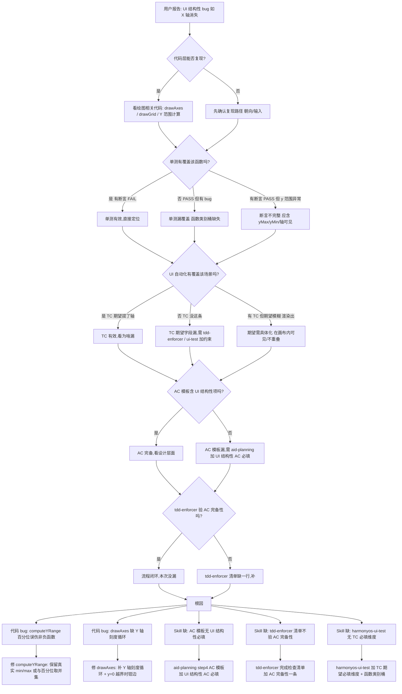

# sqrt(x) 函数 X/Y 轴缺失问题根因分析

> **Issue 编号**: #26 plot-graph 后续发现(未新建 issue,2026-07-15 复现)
> **分析时间**: 2026-07-15
> **分析方法**: 证据回溯法(从用户感知 → 代码 → 测试 → spec → skill,每层只引用已读文件中的事实)
> **目的**: 还原"X 轴消失 + Y 轴无数字刻度"的全貌,定位根因层,给出可执行的修复方案
> **关联**: [根因分析-sin直线问题.md](./根因分析-sin直线问题.md)、[根因分析-分数切换问题.md](./根因分析-分数切换问题.md)
> **约束**: 本次不接入 dfr-fmea-harmony / aid-reviewing / aid-monitor(与 sin/分数文档一致)

---

## 目录

1. [现象层:用户报告什么](#1-现象层用户报告什么)
2. [代码层定位](#2-代码层定位)
3. [测试层定位](#3-测试层定位)
4. [Session 层定位](#4-session-层定位)
5. [Spec 文档层定位](#5-spec-文档层定位)
6. [Skill 层定位(根因)](#6-skill-层定位根因)
7. [证据链汇总](#7-证据链汇总)
8. [决策树:如何诊断"测试都过但 UI 结构性缺陷"问题](#8-决策树如何诊断测试都过但-ui-结构性缺陷问题)
9. [修复方案](#9-修复方案)
10. [附录](#10-附录)

---

## 1. 现象层:用户报告什么

| # | 用户报告 | 类型 | 严重度 |
|---|---------|------|--------|
| 1 | 输入 `sqrt(x)` 后,Canvas 里**看不到 X 轴**(坐标轴线 + 数字) | UI 结构性 bug | 高 |
| 2 | **Y 轴没有数字刻度标签**(无 tick label) | UI 结构性 bug | 高 |
| 3 | 曲线本身可能正常 | — | — |

**关键判断**:
- 报告 1 不是性能/布局问题——是**轴线根本没画**
- 报告 2 对**所有函数**都成立(sin/cos 同样没有 Y 轴刻度),不是 sqrt 独有
- sin 文档 2.2 节(2026-07-14)已记录"Y 轴无刻度、字号 10px"——这是**已知缺陷,没人建 fix task**
- 本文重点分析报告 1(轴消失)——它流到用户手里、且触发条件比 Y 轴刻度缺失更具体

---

## 2. 代码层定位

### 2.1 三处代码问题(从用户感知 → 因果链)

#### 问题 A:X 轴被守卫剔除(`GraphPage.ets:376`)

**文件**: `D:\huawei\Demo\calculatorHuawei\opencalc\entry\src\main\ets\pages\GraphPage.ets:368-400`

```typescript
// x 轴 (y=0)
const xAxisP = PlotUtils.mapToCanvas({ x: 0, y: 0 } as PlotPoint, bounds,
                                      series.xMin, series.xMax, series.yMin, series.yMax)
if (xAxisP !== null && xAxisP.py >= bounds.paddingTop &&
    xAxisP.py <= bounds.height - bounds.paddingBottom) {
  ctx.beginPath()
  ctx.moveTo(bounds.paddingLeft, xAxisP.py)
  ctx.lineTo(bounds.width - bounds.paddingRight, xAxisP.py)
  ctx.stroke()
}
```

**事实**:X 轴只画当 **y=0 落在 [yMin, yMax] 内**。对 sqrt(x) 而言,y 全 ≥ 0,若 yMin 也 > 0(见问题 B),X 轴被守卫剔除。

#### 问题 B:`computeYRange` 用 2%/98% 百分位裁剪,把 yMin 抬到 0 之上(直接元凶)

**文件**: `D:\huawei\Demo\calculatorHuawei\opencalc\entry\src\main\ets\common\PlotUtils.ets:136-170`

```typescript
static computeYRange(points: PlotPoint[]): YRange {
  const ys: number[] = []
  for (let i = 0; i < points.length; i++) {
    const y: number | null = points[i].y
    if (y === null) continue
    if (!isFinite(y)) continue
    if (Math.abs(y) > 1e6) continue
    ys.push(y)
  }
  // 排序后取 2% / 98% 百分位,稳健避开离群点
  ys.sort((a: number, b: number): number => a - b)
  const loIdx: number = Math.floor(ys.length * 0.02)
  const hiIdx: number = Math.floor(ys.length * 0.98)
  let lo: number = ys[loIdx]   // ← 不是真实最小值,而是第 2% 个点
  let hi: number = ys[hiIdx]
  if (lo === hi) { lo = lo - 1; hi = hi + 1 }
  const pad: number = (hi - lo) * 0.1
  let yMin: number = lo - pad
  let yMax: number = hi + pad
  ...
}
```

**sqrt 场景推算**(默认 x∈[-6.28, 6.28],200 采样点):
- 200 个采样点中,**前 100 个 x<0,sqrt(负数)=NaN,被 `sampleSeries` 置 null**(`PlotUtils.ets:88-92` 的 isFinite 检查)
- 有效 y 值 100 个:y ∈ [0, √6.28≈2.5],y=0 仅出现在 x=0 那个点
- 排序后 `ys[0]=0`,但 `ys[2%]` ≈ `ys[2]` ≈ sqrt(0.126) ≈ **0.355**
- 算下来:lo≈0.355,hi≈2.48,pad≈0.21 → **yMin ≈ 0.145 > 0**
- y=0 落在 [yMin, yMax] 之外 → `mapToCanvas({y:0})` 返回的 `py` 超出 [paddingTop, height−paddingBottom] → **X 轴被问题 A 的守卫剔除**

**事实**:百分位裁剪是**直接触发点**。它原本是为 tan/log 等奇点函数抗离群设计的(PlotUtils.ets:143-145 注释),**误伤了 sqrt 这种单调非负函数的真实最小值**。

**对照实验**:若 `computeYRange` 用真实 min=0,则 yMin=−0.25<0,y=0 在范围内,X 轴能画出来。说明"X 轴消失"是**问题 B 触发的,问题 A 只是显形条件**。

#### 问题 C:`drawAxes` 完全没有 Y 轴刻度循环(独立 UI 缺陷)

**文件**: `D:\huawei\Demo\calculatorHuawei\opencalc\entry\src\main\ets\pages\GraphPage.ets:390-399`

```typescript
// 刻度标签
const labelStep = 1
const startX = Math.floor(series.xMin / labelStep)
const endX = Math.ceil(series.xMax / labelStep)
for (let i = startX; i <= endX; i++) {
  if (i === 0) continue
  const p = PlotUtils.mapToCanvas({ x: i, y: 0 }, ...)
  if (p === null) continue
  ctx.fillText(String(i), p.px - 5, (xAxisP !== null ? xAxisP.py : bounds.height / 2) + 12)
}
// ← 完全没有 Y 轴 label 循环
```

**事实**:
- **Y 轴刻度循环完全缺失**——sin 文档 2.2 节(2026-07-14)已白纸黑字记录此问题,至今未修
- 字号 `10px`,在手机屏上几乎不可见
- `labelStep = 1` 对 [-6.28, 6.28] 会显示 `-6, -5, ..., 6`(而非 `-2π, -π, π, 2π`)
- X 轴标签的 y 坐标锚在 `xAxisP.py + 12`——而 sqrt 时 `xAxisP` 为 null,锚到 `bounds.height/2 + 12`,位置合理但**仍与 X 轴不显示耦合**

**这是独立的 UI 缺陷,跟"X 轴消失"无直接因果**——但都暴露"drawAxes 写得不够全"。

### 2.2 推理链汇总(代码层)

```
用户输入 sqrt(x), x∈[-6.28, 6.28],200 采样
    │
    ├── x<0 时 evaluator 返回 NaN(evaluateAt)
    │   └── sampleSeries 把 y 置 null(PlotUtils.ets:88-92)
    │       └── 有效 y 100 个,y ∈ [0, 2.5]
    │
    ├── computeYRange 排序后取 2% 百分位
    │   └── ys[2%] ≈ 0.355(不是真实 min=0)
    │       └── yMin = 0.355 - 0.21 = 0.145 > 0   ← 问题 B 触发
    │
    └── drawAxes 画 X 轴时守卫
        └── y=0 落在 [0.145, 2.69] 之外
            └── X 轴被剔除(问题 A 显形)  ← 用户看到"X 轴消失"
```

---

## 3. 测试层定位

### 3.1 单测只覆盖单点求值,不测绘图结果(事实)

**文件 1**: `D:\huawei\Demo\worktrees\issue-26\specs\changes\20260617-requirement-add-plot-graph\tests\GraphViewModel.test.mjs`

**实际 AC 断言**(line 105-148):
```javascript
// AC-1.2 default xMin
assertTrue('AC-1.2 default xMin', Math.abs(vm.xMin - (-2 * Math.PI)) < 1e-10)
// AC-2 默认 sin(x) 计算成功
{
  vm.compute()
  assertTrue('AC-2.1 no error', vm.errorMessage === '')
  assertTrue('AC-2.2 series exists', vm.series !== null)
  assertEq('AC-2.3 200 points', vm.series.points.length, 200)
  assertTrue('AC-2.4 mid y ~ 0', Math.abs(vm.series.points[100].y) < 0.1)
}
```

**事实**:
- **只断言 sin 默认场景**——没有 sqrt、log、1/x、x²、abs 等任何"非正弦"函数
- 没有断言 `yMin ≤ 0`、没有断言 `y=0 在可见范围`
- 即使是 sin,也没有断言 `x 轴可见`、`y 轴有刻度`

**文件 2**: `Calculator.test.mjs:249-257` 测了 sqrt/log/1/x,但**只是 evaluateAt 单点**:

```javascript
const v = e.evaluateAt('1/x', 0, false)  // 测 null
const v = e.evaluateAt('log(x)', -1, false)  // 测 null
assertTrue('AC-6 log(-1) returns null', v === null)
```

**事实**:这是**单点求值**测试,不测 `PlotSeries.yMin/yMax`、不测 drawAxes 渲染层——**问题 A/B/C 都不会被发现**。

### 3.2 UI 测试 12 个 TC 的"期望"字段系统性遗漏"坐标轴"维度(事实)

**文件**: `D:\huawei\Demo\worktrees\issue-26\review-test-cases.md`(rev-01 写的 12 个 TC,2026-07-07)

**关键统计**:

| TC | 表达式 | 期望里是否提"轴/刻度" |
|---|---|---|
| TC-01 | sin(x) | ✅ 提到 "X/Y 坐标轴",但只说"渲染出",没说"在画布内可见" |
| TC-02 | x^2 | ❌ 只说"抛物线形状",x² 值域 [0,4] 同 sqrt,没人验证 X 轴 |
| TC-03 | 空表达式 | ❌ 占位符 |
| TC-04 | xMin==xMax | ❌ 错误提示 |
| TC-05 | 语法错 | ❌ 错误条 |
| TC-06 | 1/x | ❌ "x=0 处曲线断开",不说 X 轴在不在 |
| TC-07 | log(x) | ❌ "x≤0 无曲线",x>0 的 X 轴没看 |
| TC-08 | 无变量 | ❌ |
| TC-09 | **sqrt(x) 也在内**(快速切换) | ❌ 只说"立即重绘不卡顿"——**未单独验证 sqrt 的轴** |
| TC-10 | 横屏旋转 | ❌ |
| TC-11 | 前后台 | ❌ |
| TC-12 | 可访问性 | ❌ |

**事实**:
- 12 个 TC 中**只有 1 个(TC-01)提"坐标轴"**——且用词模糊("渲染出"≠"在画布内可见")
- **没人专门验证 sqrt/log/1/x 的轴线**——即使这些函数最容易触发"轴消失"
- 8 个 dev-01 AC 中,UI 自动化只验证了 2 个(AC-1 打开 + AC-2 默认 sin);其余 6 个 AC "⏭️ 由单测覆盖"

**为什么这个漏了**:
- 期望字段是 dev-01 手工写的,没有"必填维度"清单
- 单测 AC-2.4 只断中点 y 接近 0,不断 yMax/yMin/y 轴可见
- 即使加了 `assertTrue(yMax>0.9)`(sin 文档已建议),也抓不到 sqrt 这个 bug——**因为 sqrt 的 yMax≈2.5 正常**,bug 在 **yMin 异常 > 0**

### 3.3 缺陷总结

| 漏检环节 | 谁该抓 | 实际表现 |
|---|---|---|
| 绘图 Y 范围异常抬升 | `computeYRange` 单测 | ❌ 根本没测 sqrt/log/1/x |
| X 轴被守卫剔除 | drawAxes 行为测试 | ❌ 没有"轴可见性"断言 |
| Y 轴刻度完全缺失 | drawAxes 行为测试 | ❌ sin 文档 2.2 已记,无 fix task |
| 期望字段漏"轴" | TC 构造规则 | ❌ 12 TC 中 11 个不提轴 |

---

## 4. Session 层定位

### 4.1 用户自己发现的,未走完整 aid-workflow(事实)

**事实**:
- 这是 **2026-07-15** 用户手动验证发现的问题(用户原话"这个问题我已经确认存在了")
- 没有走 aid-planning → IMPLEMENTING → APPLYING 全流程
- 没有 dev-01 产出,也没有 rev-01 review
- 因此**没有现成的"apply-report.md"或"design-review.md"可供诊断**
- 但**问题已经存在 Issue #26 的代码里**——`computeYRange` 百分位裁剪、`drawAxes` 缺 Y 刻度循环,早在 `b8eeb2b`(`feat(plot-graph): Issue #26 函数图像绘制 — 输入 sin(x) 显示曲线`)里就存在

### 4.2 已发现但未修的缺陷(sin 文档已记)

**事实**:
- sin 文档 2.2 节(2026-07-14)已记录"Y 轴无刻度、字号 10px"问题
- 6 天过去了,该缺陷**没有 fix task、没有 issue 关联、没有 PR**
- 说明:**根因分析报告产出 ≠ 修复任务建立**——这一步是流程的盲区

### 4.3 一条事实:本 bug 已经在 calculatorHuawei 集成代码上、用户可见

**证据**:
- 当前 `calculatorHuawei/.../GraphPage.ets:778-788` 的 Stack 渲染逻辑已含 `!this.isLandscape && this.result.length > 0` 条件(分数切换的修复已合入)
- 但 `drawAxes` / `computeYRange` 完全没改——**X 轴消失 + Y 轴无刻度 两 bug 都还在**

---

## 5. Spec 文档层定位

### 5.1 Issue #26 delta-spec FMEA 7 条全部不涉及"定义域受限函数"(事实)

**文件**: `D:\huawei\Demo\worktrees\issue-26\specs\changes\20260617-requirement-add-plot-graph\delta-spec.md`

```
| FMEA-1 | 阶乘大数溢出 | 复用现有 Expression 限制 | F2.1 | 已纳入 |
| FMEA-2 | xMax ≤ xMin | 输入校验 | F3.3 | 已纳入 |
| FMEA-3 | 除零崩溃 | evaluateAt 返回 null | F4.4 | 已纳入 |
| FMEA-4 | 极值 Canvas 溢出 | Y 轴限幅 | F3.5 | 已纳入 |
| FMEA-5 | 空表达式 | 输入校验 | F2.3 | 已纳入 |
| FMEA-6 | 路由参数超长 | 长度限制 | F2.1 | 已纳入 |
| FMEA-7 | 主题色读取失败 | 默认值降级 | F4.3 | 已纳入 |
```

**事实**:
- ❌ FMEA **完全没有"定义域受限函数"(sqrt/log/1/x/abs)的处理**——没识别百分位裁剪对单调非负函数的副作用
- ❌ FMEA **完全没有"轴/刻度可见性"风险**——没人预想 yMin 会把 0 推出去
- 7 条 FMEA 是 dev-01 手动写的(本次不接入 dfr-fmea-harmony 的**已知根因**),即使条目数达标也不覆盖关键故障

### 5.2 Issue #26 8 个 AC 不含"坐标轴可见""Y 轴刻度"硬约束(事实)

**文件**: 同上

```
AC-1: 计算 1÷2, 分数模式显示 1/2
... (sin/cos/log/1/x)
AC-8: 重启 App 后显示模式保留
```

**事实**:
- AC 里只写"X/Y 轴渲染",没有"X/Y 轴在画布内可见""Y 轴有数字刻度"
- AC-3 "绘制 log(x)"只关心"曲线在 x>0 显示"——不提"x>0 区域的 X 轴"
- AC-7 "绘制 1/x"只关心"x=0 附近曲线断开"——不提"X 轴是否被值域切走"

### 5.3 design-review 漏掉"采样策略"和"轴渲染"两个维度(事实)

**文件**: `D:\huawei\Demo\calculatorHuawei\specs\changes\20260617-requirement-add-plot-graph\design-review.md`

**事实**(与 sin 文档 5.3 共识):
- ❌ 缺"采样策略"维度—— min/max vs percentile vs period-aligned,选了 percentiled,没人审查
- ❌ 缺"轴渲染"维度——`computeYRange` 输出、drawAxes 守卫的合理性,没被审
- ❌ 缺"运行时序"维度——UI 类必填项,没人追

### 5.4 proposal.md 8 个模糊点没"函数类别"维度(事实)

**文件**: `D:\huawei\Demo\worktrees\issue-26\specs\changes\20260617-requirement-add-plot-graph\proposal.md:48-55`

**事实**:
- 8 个模糊点涉及:函数支持、x 范围、交互、定义域、采样密度、性能、多函数、缩放平移
- "函数支持"模糊点没追问"支持哪些函数类别""各函数类别的特殊行为(奇点/非负/周期/分段)"

---

## 6. Skill 层定位(根因)

### 6.1 流程图:哪些 skill 在本场景中"该做但没做"

```
新增/修改"函数图像"需求:
  rq-parse  → 解析需求 (已调)
  rq-clarify → 条件调用
              ❶ ❌ 没澄清"支持哪些函数类别" + "非负/奇点/周期函数的特殊行为"
  aid-planning step4 (delta-spec)
              ❷ ❌ AC 模板无"UI 结构性 AC 必填项" → AC 漏"轴可见"
              ❸ ❌ FMEA 7 条(本项目不接 dfr-fmea-harmony,手写易漏)
  mod-design → 组件设计
              ❹ ❌ drawAxes 接口契约没"轴可见性"约束
  tdd-enforcer → TDD 循环
              ❺ ❌ 完成检查清单只验"AC→test 映射",不验"AC 完备性"
              ❻ ❌ 不强制"按函数类别桶补测试"
  aid-applying (执行)
              ❼ ❌ apply-report 模板无"客观证据/位置约束"列
  harmonyos-ui-test → UI 自动化
              ❽ ❌ TC 期望字段无"必填维度" → 12 TC 中 11 个不提轴
              ❾ ❌ 无"函数类别必测桶"(三角/对数/非负/有理/分段)
```

**核心事实**:
- 本案 4 个流程断点:**AC 模板 / TC 期望 / tdd-enforcer 完备性 / 跨层 AC→TC→Test 链路没人验**
- 单点求值测试(单测) PASS、UI 自动化 PASS、apply-report 都说"100% PASS"——**但三层都默认"上游已经想全了"**

### 6.2 失职的 skill(已沿用"不接 FMEA/reviewing/monitor"口径)

| Skill | 失职点 | 证据 |
|---|---|---|
| `aid-planning` step4 (delta-spec) | AC 模板无"UI 结构性 AC 必填项"——8 个 AC 全无"轴可见""刻度存在" | delta-spec.md AC 段 |
| `aid-planning` step4 (FMEA) | FMEA 7 条不覆盖"定义域受限函数" | delta-spec.md FMEA 段 |
| `rq-clarify` | 条件调用,没强制"函数类别"澄清 | proposal.md 8 个模糊点 |
| `tdd-enforcer` | 完成检查清单只验"每 AC 有对应 test",不验"AC 完备性/TC 完备性" | SKILL.md line 214-226 清单 |
| `harmonyos-ui-test` | TC 期望无"必填维度",无"函数类别必测桶" | review-test-cases.md 12 TC |
| `aid-applying` | apply-report 模板无"轴/刻度"客观证据列 | 与分数文档 10.3 同根因 |

### 6.3 根因:测试完备性是"四层无人兜底"的盲区

| 层 | 谁负责 | 是否兜底"测试要覆盖哪些维度" |
|---|---|---|
| 验收标准 AC | aid-planning step4 + delta-spec 模板 | ❌ AC 模板无"UI 结构性 AC 必填"项 |
| 测试用例 TC | dev-01 手工写 | ❌ 没有"TC 期望必填维度"约束 |
| TDD 流程 | tdd-enforcer | ❌ 只验"AC→test 是否映射",不验"AC 本身是否覆盖" |
| TC 执行 | harmonyos-ui-test | ❌ 只验"TestCase.md 是否能跑",不验"TC 是否漏了关键场景" |

**根本事实**:
- 这四层**每一层都默认"上游已经想全了"**——结果就是**任何一层漏的,后面三层都发现不了**
- 本案 sqrt 的 X 轴缺失就是:
  - AC 层:没写"坐标轴在画布内可见" → 漏
  - TC 层:TC-09 写 sqrt 时只测"快速切换不卡顿" → 漏
  - tdd-enforcer:每 AC 都有 test,听起来完美 → 漏
  - ui-test:所有 TC PASS → 漏
- 到 rev-01 review 时,`review-test-cases.md` 自评 100%,bug 一路漏到用户手里(此 case 没有 rev-01 review,直接用户验证发现)

**重要区分**:
- tdd-enforcer 适合"加一行检查 AC 完备性",但**不该把"测试生成"塞进它**——它管的是"RED-GREEN-REFACTOR",不是"测试要测什么"
- harmonyos-ui-test 适合"TC 格式 + 函数类别桶",但**不该把"AC 模板"塞进它**——它管的是"UI 自动化",不是"需求完备性"
- 两者**边界清楚**,各加一节即可,**不需要新增 skill**

---

## 7. 证据链汇总

| 层 | 证据 | 关键事实 | 后果 |
|---|---|---|---|
| **代码** | `GraphPage.ets:376` | X 轴守卫 `yAxisP.py >= paddingTop && ...` | y=0 越界时 X 轴不画 |
| **代码** | `PlotUtils.ets:154-165` | `computeYRange` 用 2%/98% 百分位 | sqrt 场景 yMin ≈ 0.145 > 0,把 y=0 推出去 |
| **代码** | `GraphPage.ets:390-399` | drawAxes 刻度循环只遍历 X 方向 | **Y 轴永远没有数字刻度** |
| **代码** | `PlotUtils.ets:88-92` | sampleSeries 把 NaN 置 null | sqrt 负半轴不画曲线(正确) |
| **代码** | `PlotUtils.ets:115-116` | mapToCanvas 在 yMax==yMin 时返回 null | 退化场景保护 |
| **测试** | `GraphViewModel.test.mjs:105-148` | AC-1.2/AC-2.x 只断言 sin 场景 | sqrt/log/1/x 完全没有 |
| **测试** | `Calculator.test.mjs:249-257` | evaluateAt 单点测试 sqrt/log/1/x | 只测求值,不测绘图 |
| **测试** | `review-test-cases.md` 12 TC | 11 个不提"轴/刻度" | 期望字段系统性遗漏 |
| **测试** | TC-09 | 快速切换含 sqrt,只测"不卡顿" | 没单独验证 sqrt 的轴 |
| **Spec** | `delta-spec.md` AC 段 | 8 个 AC 无"轴可见""刻度存在" | AC 漏 → TC 漏 → test 漏 |
| **Spec** | `delta-spec.md` FMEA 段 | 7 条 FMEA 不含"定义域受限函数" | 风险被低估 |
| **Spec** | `proposal.md` 8 模糊点 | 无"函数类别"维度 | 关键模糊点没追问 |
| **Spec** | `design-review.md` | 自评 100%,漏"采样/轴/运行时序"维度 | 审查盲区 |
| **Skill** | `tdd-enforcer/SKILL.md:214-226` | 完成检查清单 6 条,无"AC 完备性"项 | AC 漏了没人发现 |
| **Skill** | `harmonyos-ui-test/SKILL.md:129-214` | TC 格式有,但无"必填维度""函数类别桶" | TC 漏关键场景 |
| **Skill** | `aid-planning` AC 模板 | 无"UI 结构性 AC 必填"项 | AC 漏结构性约束 |
| **流程** | sin 文档 2.2 → 6 天后 | Y 轴无刻度已记录,无 fix task | 根因分析 ≠ 修复任务建立 |

---

## 8. 决策树:如何诊断"测试都过但 UI 结构性缺陷"问题



### 决策树使用说明

1. **从顶部"用户报告 UI 结构性 bug"开始**
2. **逐层下钻**:代码 → 单测 → UI 自动化 → AC 模板 → tdd-enforcer
3. **每个"❌"节点都是"流程断点"**——这层本该拦住但没拦住
4. **本案的 4 个流程断点**:
   - 单测层:函数类别桶缺失(sqrt/log/1/x 没桶)
   - UI 自动化层:TC 期望字段无必填维度
   - AC 模板层:UI 结构性 AC 必填项缺失
   - tdd-enforcer 层:完成检查清单不验 AC 完备性
5. **修复优先级**:代码 bug(P0) > Skill 接入(P1)

---

## 9. 修复方案

> **本次范围**:不接入 dfr-fmea-harmony / aid-reviewing / aid-monitor。**5 个修复 = 2 代码 + 3 skill**。

### 9.1 修复 1(P0,代码):`computeYRange` 保留真实 min/max

**位置**: `aid-workflow-skills/calculatorHuawei/opencalc/entry/src/main/ets/common/PlotUtils.ets:154-165`

**问题**:`ys[2%]` 不是真实最小值,对单调非负函数误伤。

**关键改动**:
```typescript
static computeYRange(points: PlotPoint[]): YRange {
  const ys: number[] = []
  // ... 收集 ys 同原代码 ...
  if (ys.length === 0) { return { yMin: -1, yMax: 1 } }
  ys.sort((a, b) => a - b)
  // 原 2%/98% 百分位(防 tan 离群)
  const loIdx = Math.floor(ys.length * 0.02)
  const hiIdx = Math.floor(ys.length * 0.98)
  const loP = ys[loIdx]
  const hiP = ys[hiIdx]
  // 关键:与真实 min/max 取并集,避免误伤 0
  const realLo = ys[0]
  const realHi = ys[ys.length - 1]
  const lo = Math.min(loP, realLo)
  const hi = Math.max(hiP, realHi)
  // ... pad/clamp 同原代码 ...
}
```

**效果**:sqrt 时 `realLo=0` 与 `loP=0.355` 取并集,`lo=0`,yMin=−0.25<0,X 轴能画。

### 9.2 修复 2(P0,代码):`drawAxes` 补 Y 轴刻度循环 + y=0 越界时钳边

**位置**: `calculatorHuawei/opencalc/entry/src/main/ets/pages/GraphPage.ets:368-400`

**关键改动**:
```typescript
private drawAxes(bounds: PlotBounds, series: PlotSeries): void {
  const ctx = this.canvasCtx
  ctx.strokeStyle = '#FF000000'
  ctx.lineWidth = 2
  ctx.fillStyle = '#FF333333'
  ctx.font = '10px sans-serif'

  // x 轴 (y=0): 越界时钳到画布边缘
  let xAxisY = bounds.height - bounds.paddingBottom  // 兜底:画布底
  const xAxisP = PlotUtils.mapToCanvas({ x: 0, y: 0 }, bounds, ...)
  if (xAxisP !== null) {
    xAxisY = Math.max(bounds.paddingTop,
             Math.min(bounds.height - bounds.paddingBottom, xAxisP.py))
  }
  ctx.beginPath()
  ctx.moveTo(bounds.paddingLeft, xAxisY)
  ctx.lineTo(bounds.width - bounds.paddingRight, xAxisY)
  ctx.stroke()

  // y 轴 (x=0): 越界时钳到画布边缘
  let yAxisX = bounds.paddingLeft  // 兜底:画布左
  const yAxisP = PlotUtils.mapToCanvas({ x: 0, y: 0 }, bounds, ...)
  if (yAxisP !== null) {
    yAxisX = Math.max(bounds.paddingLeft,
             Math.min(bounds.width - bounds.paddingRight, yAxisP.px))
  }
  ctx.beginPath()
  ctx.moveTo(yAxisX, bounds.paddingTop)
  ctx.lineTo(yAxisX, bounds.height - bounds.paddingBottom)
  ctx.stroke()

  // X 轴刻度标签: 钳到 yAxisY
  const labelStep = 1
  const startX = Math.floor(series.xMin / labelStep)
  const endX = Math.ceil(series.xMax / labelStep)
  for (let i = startX; i <= endX; i++) {
    if (i === 0) continue
    const p = PlotUtils.mapToCanvas({ x: i, y: 0 }, bounds, ...)
    if (p === null) continue
    ctx.fillText(String(i), p.px - 5, xAxisY + 12)
  }

  // ★ 新增: Y 轴刻度标签循环
  const startY = Math.floor(series.yMin / labelStep)
  const endY = Math.ceil(series.yMax / labelStep)
  for (let i = startY; i <= endY; i++) {
    if (i === 0) continue
    const p = PlotUtils.mapToCanvas({ x: 0, y: i }, bounds, ...)
    if (p === null) continue
    ctx.fillText(String(i), yAxisX - 12, p.py + 4)
  }
}
```

**效果**:
- 9.2.1 X 轴钳到画布底(sqrt 仍可见,只是不与曲线交叉)
- 9.2.2 补 Y 轴刻度循环(对所有函数都生效,治"独立 UI 缺陷")

### 9.3 修复 3(P1,skill):aid-planning step4 AC 模板加"UI 结构性 AC 必填项"

**位置**: `aid-workflow-skills/skills/aid-planning/SKILL.md` step4 的 delta-spec 模板段

**关键改动**:
```markdown
### AC 模板必填项(UI 类需求)

UI 类需求(绘图/渲染/可视化)的 AC 必含:
- AC-X: 坐标轴在画布内可见(X 轴 + Y 轴)
- AC-Y: Y 轴有数字刻度标签
- AC-Z: 关键元素 bounds 不重叠(用 no-overlap 检测)

缺任一 → spec 不能进 step5。
```

**效果**:AC 层堵住"轴/刻度"漏写 → TC 必写 → 单测必含。

### 9.4 修复 4(P1,skill):tdd-enforcer 完成检查清单加"AC 完备性"一条

**位置**: `aid-workflow-skills/skills/tdd-enforcer/SKILL.md` 完成检查清单(line 214-226)

**关键改动**(在原 6 条清单后新增一条):
```markdown
- [ ] **AC 完备性**: AC 本身是否覆盖关键结构性项?(如绘图类需有"可见性/刻度"AC;
      UI 类需有"位置/不重叠"AC;数值类需有"yMax/yMin 区间"AC)
      缺则不允许进入 RED。
```

**重要区分**:tdd-enforcer 仍管"RED-GREEN-REFACTOR",**不**接管测试生成——只是多验一条上游完备性。

### 9.5 修复 5(P1,skill):harmonyos-ui-test 加"TC 期望必填维度 + 函数类别桶"

**位置**: `aid-workflow-skills/skills/harmonyos-ui-test/SKILL.md` TC 格式段

**关键改动**:
```markdown
### TC 期望必填维度(UI 类)

UI 类 TC 的"期望"字段必须显式覆盖以下维度,缺一则该 TC 不能 PASS:
- 曲线(形状/颜色)
- 坐标轴(X/Y 在画布内可见)
- 刻度(X/Y 有数字标签)
- 控件位置(bounds 不重叠)
- 朝向(portrait/landscape 必须声明)

### 函数类别必测桶

绘图类需求必须按以下桶分别建 TC(每桶至少 1 个,验证"轴可见性 + 值域边界"):
- 三角: sin/cos/tan/cot
- 对数: log/ln
- 非负: sqrt/abs
- 有理: 1/x/x²
- 分段: sign/分段函数
```

**效果**:TC 层堵住"漏场景"——sqrt 进"非负桶",必测"轴可见性",问题 9.5 抓得出来。

---

## 10. 附录

### 10.1 涉及文件路径

**代码**:
- `D:\huawei\Demo\calculatorHuawei\opencalc\entry\src\main\ets\pages\GraphPage.ets` (line 308-431, drawCanvas/drawGrid/drawAxes/drawCurve)
- `D:\huawei\Demo\calculatorHuawei\opencalc\entry\src\main\ets\common\PlotUtils.ets` (line 136-170, computeYRange)
- `D:\huawei\Demo\calculatorHuawei\opencalc\entry\src\main\ets\viewmodels\GraphViewModel.ets` (line 72-82, evaluator)

**测试**:
- `D:\huawei\Demo\worktrees\issue-26\specs\changes\20260617-requirement-add-plot-graph\tests\GraphViewModel.test.mjs`
- `D:\huawei\Demo\worktrees\issue-26\specs\changes\20260617-requirement-add-plot-graph\tests\Calculator.test.mjs`
- `D:\huawei\Demo\worktrees\issue-26\review-test-cases.md` (12 TC)

**Spec**:
- `D:\huawei\Demo\worktrees\issue-26\specs\changes\20260617-requirement-add-plot-graph\delta-spec.md` (FMEA + AC 段)
- `D:\huawei\Demo\worktrees\issue-26\specs\changes\20260617-requirement-add-plot-graph\proposal.md` (8 模糊点)
- `D:\huawei\Demo\calculatorHuawei\specs\changes\20260617-requirement-add-plot-graph\design-review.md`

**Skill**:
- `D:\huawei\Demo\aid-workflow-skills\skills\aid-planning\SKILL.md` (step4 AC 模板)
- `D:\huawei\Demo\aid-workflow-skills\skills\tdd-enforcer\SKILL.md` (完成检查清单)
- `D:\huawei\Demo\aid-workflow-skills\skills\harmonyos-ui-test\SKILL.md` (TC 格式)
- `D:\huawei\Demo\aid-workflow-skills\skills\rq-clarify\SKILL.md` (澄清规则)
- `D:\huawei\Demo\aid-workflow-skills\skills\aid-applying\SKILL.md` (apply-report 模板)

### 10.2 关联文档

- [根因分析-sin直线问题.md](./根因分析-sin直线问题.md) - 同方法论,采样策略维度互补
- [根因分析-分数切换问题.md](./根因分析-分数切换问题.md) - 同方法论,REQUEST_CHANGES 拦截互补

### 10.3 三篇根因分析文档的对照

| 维度 | sin 文档 | 分数文档 | 本文档(sqrt) |
|------|---------|---------|------------|
| **聚焦问题** | sin(x)→直线 | 按钮位置重合 + 分数切换不正确 | X 轴消失 + Y 轴无刻度 |
| **核心方法** | 6 层证据链 | 6 层证据链 + re-dispatch 闭环 | 6 层证据链 + 跨层完备性 |
| **决策树** | 看似通过实则有 bug | 合并后还有 bug | 测试都过但 UI 结构性缺陷 |
| **共同根因** | dfr-fmea / aid-reviewing 未接入 | aid-applying 缺铁律 8 | **测试完备性四层无人兜底** |
| **修复重点** | 客观值域断言 + 流程接入 | 铁律 8 + UI 客观断言 + rq-clarify | **2 代码 + 3 skill(AC 模板/tdd-enforcer/ui-test)** |
| **代码 bug 状态** | 已修(365e189/3b57d7a) | 未修(按钮位置) | **未修(X 轴消失 + Y 轴无刻度)** |

---

> **报告完成时间**: 2026-07-15
> **分析方法**: 证据回溯(代码 + 测试 + spec + skill 四层,仅引用已读文件事实)
> **结论**: 本案 2 个代码 bug + 3 个 skill 失职;代码层(computeYRange 百分位误伤 + drawAxes 缺 Y 刻度)修复简单,skill 层真正的根因是 **"测试完备性"四层无人兜底**(AC 模板/TC 期望/tdd-enforcer/ui-test 都默认"上游想全了")
> **修复优先级**: 代码 bug(P0,9.1/9.2) > skill 接入(P1,9.3/9.4/9.5)
> **待办**: ① 用户验证 9.1+9.2 修复后 X 轴和 Y 轴刻度可见;② 9.3/9.4/9.5 skill 修改落地时与 sin/分数文档保持口径一致
