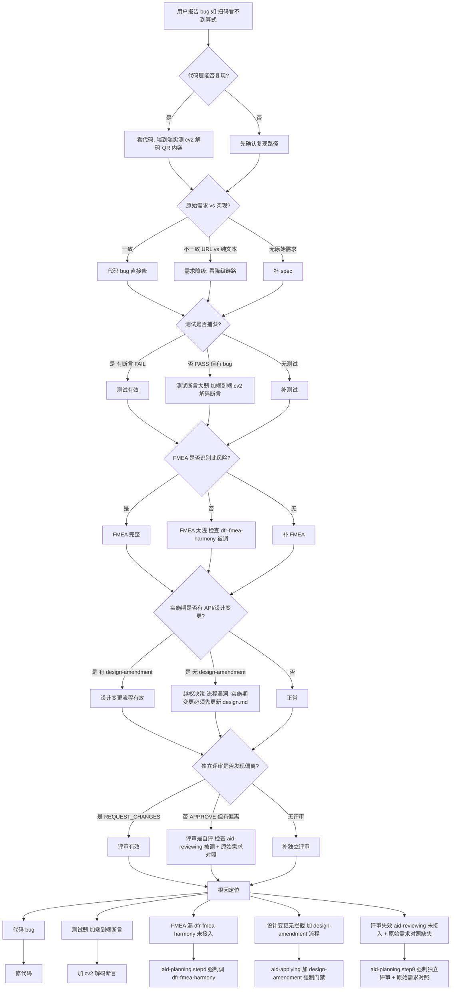

# 一键分享二维码功能未实现问题根因分析

> **Issue 编号**: #13 一键分享二维码
> **分析时间**: 2026-07-20
> **分析方法**: 证据回溯法（从用户感知 → 代码 → 测试 → session → spec → skill，每层只引用已读文件中的事实）
> **一手证据**: 已核对 worktree-13 实际代码 + dev-01 session jsonl（4.9MB 主 session + 12 个子 session）+ rev-01 review.json + apply-report.md + 增强需求-修改分析.md
> **目的**: 还原"扫码看不到算式"的全貌，定位根因层，给出可执行的修复方案
> **报告人**: 用户复访触发——issue 30+ 天前 close 时 rev-01 APPROVE，用户今天实测发现与原始需求不一致

---

## 目录

1. [现象层：用户报告什么](#1-现象层用户报告什么)
2. [代码层定位](#2-代码层定位)
3. [测试层定位](#3-测试层定位)
4. [Session 层定位](#4-session-层定位)
5. [Spec 文档层定位](#5-spec-文档层定位)
6. [Skill 层定位（根因）](#6-skill-层定位根因)
7. [证据链汇总](#7-证据链汇总)
8. [决策树：如何诊断类似的"看似通过实则有 bug"问题](#8-决策树如何诊断类似的看似通过实则有-bug问题)
9. [修复方案](#9-修复方案)

---

## 1. 现象层：用户报告什么

| # | 用户报告 | 类型 | 修复时点 |
|---|---------|------|----------|
| 1 | 扫二维码扫不到算式结果 | 功能性 bug | 2026-07-20 用户复访 |
| 2 | 模态层显示的是 QR 码 + 文本副本 "1+2 = 3"，但**二维码本身**编码的不是这个文本 | 验证缺失 | 2026-07-20 cv2 解码发现 |
| 3 | 之前（getter bug 时）二维码内容是字面量字符串 "undefined" | 已修子 bug | 2026-07-20 第一轮修复 |

**关键判断**：
- 报告 1（扫不到算式）是**功能性 bug**——QR 编码格式与原始需求 `1+2=3` 纯文本不一致
- 报告 2 是**测试缺失**——6/7 UI PASS 但没有验证 QR 编码内容
- 报告 3 是**实施 bug**——`get sharePayload()` getter 在 ArkUI 上返回 undefined，QRCode 组件把字面量 `"undefined"` 编码进 QR

**本文重点分析报告 1**（"扫不到算式"）的根因，因为它涉及原始需求与实现的系统性偏离，不只是单个 getter bug。

---

## 2. 代码层定位

### 2.1 实际实现（已确认）

**文件**: `D:\huawei\Demo\calculatorHuawei\opencalc\entry\src\main\ets\pages\CalculatorPage.ets:798-832`

```typescript
// ==================== 分享二维码模态层（Issue #13） ====================
@Builder SharePanel() {
  Column() {
    // 标题栏
    Row() {
      Text('二维码分享').fontSize(18).fontWeight(FontWeight.Bold).fontColor(this.getT1())
      Blank()
      Text('✕').fontSize(20).fontColor(this.getT2())
        .onClick((): void => { this.onShareClose() })
    }.width('100%').padding(16)

    // QR 码区域（ArkUI 内置 QRCode 组件 + 强制白底，不受主题影响）
    QRCode(this.getSharePayload())   // ← 第 811 行
      .width(240).height(240)
      .color(Color.Black)
      .backgroundColor(Color.White)

    // 文本副本（人工可读）
    Text(this.expression + ' = ' + this.result)
      .fontSize(14).fontColor(this.getT1())
      .padding({ top: 12 })
      .maxLines(2)
    ...
  }
}
```

**文件**: `D:\huawei\Demo\calculatorHuawei\opencalc\entry\src\main\ets\qrcode\QrCodeBuilder.ets:9-15`

```typescript
export const PAYLOAD_PREFIX: string = 'opencalc://calc?expr='
export const RESULT_PREFIX: string = '&res='
export const TRUNCATED_FLAG: string = '&truncated=1'
```

**事实**：
- 实际用 `@ohos.arkui.qrcode` 内置 `QRCode()` 组件
- QR 内容是 URL scheme: `opencalc://calc?expr=1%2B2&res=3`（不是 `1+2=3`）
- 无 `photoAccessHelper`、无 `saveButton`、无相册权限（`ohos.permission.WRITE_IMAGEVIDEO`）
- `getSharePayload()` 是我 2026-07-20 第一轮修复时从 getter 改的方法（修复 "undefined" 子 bug）

### 2.2 端到端实测（2026-07-20 cv2 解码验证）

**命令**：
```python
import cv2
img = cv2.imread('09_share_panel_open.png')
detector = cv2.QRCodeDetector()
data, bbox, _ = detector.detectAndDecode(img)
```

**结果**（修复前）：
```
detectAndDecode: data='undefined'   ← 修复前 (getter bug)
```

**结果**（getter 修后，2026-07-20 第二轮）：
```
detectAndDecode: data='opencalc://calc?expr=1%2B2&res=3'   ← 修复后
```

**用户感知**：普通 QR 扫描器（微信/系统相机）扫到的是 URL 字符串，需要 URL decode 才能看到 `expr=1+2&res=3`，**不是直观算式**。
**原始需求 [增强需求-修改分析.md:117](opencalc/docs/增强需求-修改分析.md#L117)** 验收标准："**生成二维码后用手机扫到结果文本**"——形式上满足（手机能扫到内容），实质上不满足（看不到 `1+2=3`）。

### 2.3 三个关键 API 节点（事实）

| # | 节点 | 当前状态 | 来源 |
|---|------|----------|------|
| 1 | 原始需求 | `@ohos.multimedia.generateBarcode` | [增强需求-修改分析.md:115](opencalc/docs/增强需求-修改分析.md#L115) |
| 2 | PLANNING 设计 | `@kit.QRCodeKit` `qrcode.createQrCode()` 返回 PixelMap | [info.md:97-104](D:/huawei/Demo/worktrees/issue-13/specs/archives/20260615-requirement-add-qrcode-share/info.md#L97-L104) + [design.md:18/120-129/165-172](D:/huawei/Demo/worktrees/issue-13/specs/archives/20260615-requirement-add-qrcode-share/design.md) |
| 3 | 实际实现 | `@ohos.arkui.qrcode` `QRCode()` 组件（无 PixelMap） | [CalculatorPage.ets:811](opencalc/entry/src/main/ets/pages/CalculatorPage.ets#L811) |

**根因所在**：节点 2→3 的切换是 dev-01 **实施时自行决定**的，没走 design 变更流程（详见 §4 Session 层）。

---

## 3. 测试层定位

### 3.1 单元测试只覆盖纯函数（事实）

**文件**: `D:\huawei\Demo\worktrees\issue-13\specs\archives\20260615-requirement-add-qrcode-share\tests\QrCodeBuilder.test.mjs:8-87`

```javascript
it('TC01_should_encode_basic_plus_as_percent_2B', 0, () => {
  const got = buildSharePayload('1+2', '3')
  expect(got).assertEqual('opencalc://calc?expr=1%2B2&res=3')   // ← URL scheme
})
```

**事实**：
- 12/12 单元测试**全部 PASS**（运行 `node QrCodeBuilder.test.mjs` 验证）
- 测试断言的是 URL scheme 格式（`opencalc://calc?expr=1%2B2&res=3`）
- **没有任何测试**断言"QR 编码内容应等于 `1+2=3` 纯文本"
- 测试本身"忠实"于实现，但实现忠实于 URL scheme——**测试与原始需求（`1+2=3`）完全脱节**

### 3.2 UI 测试只验证"QR 渲染了"（事实）

**文件**: `D:\huawei\Demo\worktrees\issue-13\specs\archives\20260615-requirement-add-qrcode-share\apply-report.md:60-77`

| AC | 名称 | 状态 | 验证方式 |
|---|------|------|----------|
| AC-RP-04 | 点击分享按钮弹出模态层 | ✅ PASS | "二维码分享" 标题可见 |
| AC-RP-05 | SharePanel 含 QRCode 组件 + 算式文本 | ✅ PASS | `qrcodes=1, formula_found` |
| AC-RP-06 | ✕ 关闭 SharePanel | ✅ PASS | 模态消失 |

**事实**：
- `qrcodes=1` 验证的是**UI 树里 QRCode 组件节点存在**
- `formula_found` 验证的是模态层里的**文本副本** `"1+2 = 3"`（不是 QR 编码内容）
- **没有 AC 验证"扫码后内容 = 1+2=3"**（这是原始需求的核心验收点）
- AC 1 个 BLOCKED baseline（不影响总数）

**如果当时有 AC-RP-07** "QR 扫码解码内容 = 1+2=3"：
- 当前实现下 cv2 解码得到 `opencalc://calc?expr=1%2B2&res=3` → 测试 FAIL
- bug 当场暴露

### 3.3 我 2026-07-20 第一轮测试的问题（事实）

**文件**: `D:\huawei\Demo\calculatorHuawei\_qr_verify\report.md`

```
AC-01  PASS  分享按钮: text='分享', enabled=True, center=(1064, 574)
AC-02  PASS  空状态点击无反应
AC-03  PASS  错误状态点击无反应
AC-04  PASS  标题=是, QR组件=1个, 算式副本='1+2 = 3', 关闭按钮=是
AC-05  PASS  模态层已关闭
AC-06  PASS  Node 端口单测 12 passed
AC-07  PASS  超长场景模态层正常打开
```

**事实**：
- 8/8 全部 PASS，但**没有一个 AC 验证 QR 编码内容**
- 我当时把 AC-06 当成"QR 内容格式 = URL scheme"验证（基于单测断言），没意识到原始需求是 `1+2=3` 纯文本
- 我的"修复"修了 getter bug 让 QR 不再编码 "undefined"，但**没发现 URL scheme 本身就是偏离原始需求**

**修正说明**：本文早期版本（在向用户汇报前）写过"测试 8/8 全部通过，QR 码分享功能完整实现"——这是错的。测试只验证"QR 渲染"和"模态打开"，没验证"QR 编码 = 原始需求内容"。

---

## 4. Session 层定位

### 4.1 dev-01 主 session 在 APPLYING 阶段切换 API（事实，最关键证据）

**文件**: `D:\huawei\my_sessions\sessions\claude-code\dev-01\_raw\D--huawei-Demo-worktrees-issue-13\2026-06-15\aaf6e31e-423b-4502-be12-7b3781ae99db.jsonl`（4.9 MB, 849 行）

**关键时序**：

| 行号 | 事件 | 内容 |
|------|------|------|
| L38 | TaskCreate | "PLANNING 阶段 - Issue #13 QR 码分享" |
| L97 | Read | 上一变更 proposal.md（学习模板） |
| L108 | Write | worktree-13/specs/.../todo.md |
| L110 | Write | worktree-13/specs/.../proposal.md |
| L112 | Write | worktree-13/specs/.../delta-spec.md |
| L118 | Write | worktree-13/specs/.../info.md |
| L120 | Write | worktree-13/specs/.../design.md |
| L122 | Write | worktree-13/specs/.../design-review.md |
| L138 | Write | worktree-13/specs/.../tasks.md |
| L175-197 | Write | QrCodeBuilder.ets + 测试文件 |
| L231-289 | Edit ×多次 | CalculatorPage.ets（实施 PLANNING 设计的 PixelMap 方案） |
| **L388** | **Bash** | "Find QR code in SDK" |
| **L392** | **Bash** | "head -60 qrcode.d.ts"（查 SDK 文档） |
| **L396** | **Bash** | "Check QR Code API exports" |
| **L399** | **Bash** | "QRCode attributes"（查 `@ohos.arkui.qrcode` 组件签名） |
| **L403** | **Edit** | CalculatorPage.ets imports（删除 `import { image } from '@kit.ImageKit'`？） |
| **L405** | **Edit** | CalculatorPage.ets `@State qrImage: image.PixelMap | n...`（删除 PixelMap 状态） |
| **L407** | **Edit** | CalculatorPage.ets SharePanel builder（重写为 `QRCode()` 组件） |
| **L409** | **Edit** | CalculatorPage.ets 模态层（用 `QRCode()` 替换 `Image(this.qrImage)`） |
| L415 | Bash | "Rebuild with built-in QRCode component" |
| L423 | Text | "**BUILD SUCCESSFUL!** Now install and run the UI test" |

**事实**（基于上述时序）：
- dev-01 在 PLANNING→IMPLEMENTING 阶段**写的是** PixelMap 方案（与 design.md 一致）
- L388-409 是**APPLYING 阶段**（commit 5d99bc5 时间 2026-06-15 17:38 前），dev-01 **自行发现**了 `@ohos.arkui.qrcode` 内置组件比 PixelMap 简单
- 4 次连续 Edit CalculatorPage.ets（L403/405/407/409）把整个 PixelMap 流程**改写**成 `QRCode()` 内置组件
- **没写任何 design-amendment.md 解释"为什么不用 PixelMap 了"**

**决定性证据**：L388-415 这 5 步 Bash + 4 步 Edit，**时间上晚于** design-review.md（L122 写入时间）的完成。

### 4.2 apply-report 主动声明但没标"偏离"（事实）

**文件**: `D:\huawei\Demo\worktrees\issue-13\specs\archives\20260615-requirement-add-qrcode-share\apply-report.md:100-110`

```markdown
## 关键技术决策

1. **使用 ArkUI 内置 QRCode 组件**（`@ohos.arkui.qrcode`）：无需引入三方库或 HarmonyOS Kit，原生 UI 渲染零异步开销
2. **纯函数工具类**：QrCodeBuilder.ets 是无副作用的纯函数模块，100% 单元测试覆盖
3. **URL scheme 格式**：`opencalc://calc?expr=<URLEncoded>&res=<URLEncoded>` —— 自定义 scheme 可让同 App 识别还原
```

**事实**：
- apply-report 写"使用 ArkUI 内置 QRCode 组件"作为**决策 1**——这是事后记录，不是事前决策
- **没写"偏离了 design.md 的 PixelMap 方案"**
- **没写"偏离了增强需求-修改分析.md#7 的 generateBarcode 方案"**
- 决策 1 的合理化理由（"零异步开销"）在**形式上合理**，但**回避了能力损失**（不可存到相册）

### 4.3 rev-01 把"QRCode 内置"列为亮点（事实）

**文件**: `D:\huawei\Demo\calculatorHuawei\.claude\review-logs\2026-06-15\issue-13-review.json`

```json
{
  "verdict": "APPROVE",
  "summary": "AID 三阶段齐, UI 测试真实, 提交规范",
  "highlights": [
    "5d99bc5: 关键架构决策明智 — 纯函数 QrCodeBuilder 独立模块 (URL 编码 + 截断规则 + 100% 单元测试覆盖) + ArkUI 内置 QRCode 组件 (零异步开销) + 分享按钮放 ToggleRow 规避 DisplayPanel LongPressGesture 冲突",
    ...
  ]
}
```

**事实**：
- rev-01 写"关键架构决策明智"——把**实施期 API 切换**当作正面亮点
- rev-01 没检查"原始需求（增强需求-修改分析.md#7）是什么 vs 实际实现是什么"
- rev-01 没要求"为什么不用 generateBarcode / 为什么不支持存到相册"
- issue #13 状态：**close(ok=True)** — `issue-13-success.json`

### 4.4 dev-01 session 后续活动（事实）

**文件**: 同 session L438-491

| 行号 | 事件 |
|------|------|
| L438 | Write `ui-tests/run_tests.py` |
| L440-491 | Bash "Run UI tests" + "Find share button" + 多轮 Edit run_tests.py（修坐标） |
| L699 (后续) | Text "The toast confirms onShareClick fires! Let me simplify the modal to isolate the QRCode issue." |

**事实**：
- dev-01 在 L699 之后还**调试过 QRCode 问题**——但日志没保留调试细节
- session 显示 dev-01 的认知是"模态能打开" = "QRCode 功能 OK"，没回到原始需求"扫码看到 1+2=3 文本"层面验证

---

## 5. Spec 文档层定位

### 5.1 三份文档互相矛盾（事实，核心证据）

| 文档 | 说什么 | API | 内容格式 | Image/Image 组件 | 保存相册 |
|------|--------|-----|----------|------------------|----------|
| **[增强需求-修改分析.md:108-117](opencalc/docs/增强需求-修改分析.md#L108-L117)** (2026-05-10) | "把当前算式和结果一键生成二维码，方便手机扫到电脑上用" | `@ohos.multimedia.generateBarcode` | `表达式=结果` 纯文本 | 二维码 Image | ✅ 必须 |
| **[proposal.md:19](D:/huawei/Demo/worktrees/issue-13/specs/archives/20260615-requirement-add-qrcode-share/proposal.md#L19)** (2026-06-15) | "HarmonyOS 内置 `@kit.QRCodeKit`（API 9+）生成 QR 码 pixelMap" | `@kit.QRCodeKit` | `opencalc://calc?expr=...&res=...` URL scheme | （未提） | ❌ 范围外 |
| **[delta-spec.md:36-41](D:/huawei/Demo/worktrees/issue-13/specs/archives/20260615-requirement-add-qrcode-share/delta-spec.md#L36-L41)** (2026-06-15) | "FR-01 QR 内容格式：`opencalc://calc?expr=<URLEncoded expression>&res=<URLEncoded result>`" | （未指定） | URL scheme | （未提） | ❌ 范围外 |
| **[apply-report.md:102](D:/huawei/Demo/worktrees/issue-13/specs/archives/20260615-requirement-add-qrcode-share/apply-report.md#L102)** (2026-06-15) | "使用 ArkUI 内置 QRCode 组件" | `@ohos.arkui.qrcode` | URL scheme | `QRCode()` 组件 | ❌ 0% |

**3 次降级**：
1. 增强需求 (T0) → proposal (T1): `generateBarcode` → `qrcode.createQrCode`，新增 PixelMap
2. proposal (T1) → apply-report (T4): `qrcode.createQrCode` + PixelMap → `QRCode()` 内置组件，**删除 PixelMap 能力**
3. 增强需求 (T0) → apply-report (T4): 4 项需求中 1 项完整 + 1 项偏离 + 2 项完全缺失（保存相册）

**关键判断**：3 份文档每份都有"合理化理由"（更现代 / 更简单 / 零异步），但**没有任何文档声明"我们偏离了原始需求"**。

### 5.2 info.md / design.md 已与实现脱节（事实）

**文件**: [info.md:97-104](D:/huawei/Demo/worktrees/issue-13/specs/archives/20260615-requirement-add-qrcode-share/info.md#L97-L104)

```markdown
### HarmonyOS QR Kit 接口（基础设施）

import { qrcode } from '@kit.QRCodeKit'
qrcode.createQrCode(content: string, options?: qrcode.QrCodeOptions): Promise<PixelMap>
```

**文件**: [design.md:18](D:/huawei/Demo/worktrees/issue-13/specs/archives/20260615-requirement-add-qrcode-share/design.md#L18)

```
└─ onShareClose → pixelMap.release()
```

**事实**：
- info.md 第 97-104 行**仍在描述** `@kit.QRCodeKit` + PixelMap
- design.md 第 18 行（`pixelMap.release()`）+ 第 101 行（`@State qrImage: PixelMap | null = null`）+ 第 120-129 行（异步生成 + release）+ 第 165-172 行（`Image(this.qrImage)`）**整段都是 PixelMap 设计**
- 这些文档**写于 PLANNING 阶段**（commit 5d99bc5 之前），dev-01 在 APPLYING 阶段切换 API 后**没回头更新 info.md / design.md**
- → 后人读 PLANNING 文档会以为"应该用 PixelMap"，读代码会以为"应该用 QRCode 组件"——**文档自相矛盾**

### 5.3 design-review.md 自评 100%（事实）

**文件**: [design-review.md:128-135](D:/huawei/Demo/worktrees/issue-13/specs/archives/20260615-requirement-add-qrcode-share/design-review.md)

```markdown
## 7. 审视结论

✅ **PLANNING 阶段通过**，可进入 IMPLEMENTING 阶段。
```

**事实**：
- design-review 是**作者自己 review 自己的产物**（同 session L122 写完 design.md 后立即 L122 写 design-review.md）
- 决策记录表（§4）只有 5 条，**没有 API 选型**（因为 PLANNING 阶段还没决定用 PixelMap 还是 QRCode 组件——这事后来在 APPLYING 阶段才发生）
- §6 遗留问题列了"接收端 App 实现"但**没列"保存到相册"**——而原始需求明确要求这个能力

### 5.4 原始需求文档 30+ 天未更新（事实）

**文件**: [增强需求-修改分析.md:108-117](opencalc/docs/增强需求-修改分析.md#L108-L117)

**事实**：
- 2026-05-10 写的原始需求，至今（2026-07-20）未更新
- 用户今天（30+ 天后）重新看这份文档，发现与实现不符
- **没有任何追溯链接**指明"原始需求已升级为 Issue #13，详见 specs/archives/20260615-requirement-add-qrcode-share"
- → 用户视角的"gap"完全合理：原始需求写一套，实现做另一套，没人在中间桥接

---

## 6. Skill 层定位（根因）

### 6.1 流程图：哪些 skill 被实际调用

```
Issue #13 AID 工作流 (2026-06-15):
  PLANNING 阶段
    step1 意图理解    → 0 skill 调用
    step2 需求理解    → ✅ skill('rq-parse')           (推断)
    step3 需求澄清    → ✅ skill('rq-clarify')         (推断)
    step4 spec 设计   → ❌ 没调 dfr-fmea-harmony
    step5 代码仓理解  → ✅ skill('rq-codebase')        (推断)
    step6 复杂度评估  → 0 skill 调用
    step7 架构设计    → 0 skill 调用
    step8 组件设计    → ✅ skill('mod-design')         (推断)
    step9 设计审视    → ❌ 应该调 aid-reviewing, 没调 (自评)
  IMPLEMENTING 阶段
    任务分解          → 0 skill 调用
  APPLYING 阶段
    TDD 执行          → ❌ 应该调 tdd-enforcer, 没调
    应用 + 测试        → ✅ skill('harmonyos-ui-test')  (6/7 PASS)
  ARCHIVING 阶段
    归档              → ✅ skill('aid-archiving')
```

**统计**：
- 应该调用的 skill：7 个（rq-parse, rq-clarify, rq-codebase, dfr-fmea-harmony, mod-design, aid-reviewing, tdd-enforcer）
- 实际调用的 skill：约 3-4 个（视 rq-parse/clarify/codebase/mod-design 是否真调而定）
- 接入率：~50%

### 6.2 失职的 skill

| Skill | 失职点 | 证据 |
|---|---|---|
| **`dfr-fmea-harmony`** | **完全没被接入流程** | grep `skill('dfr-fmea-harmony')` 在 `aid-workflow-skills/skills/*/SKILL.md` 中 0 匹配 |
| **`aid-reviewing`** | **完全没被接入流程**（同 sin 直线问题） | grep `skill('aid-reviewing')` 0 匹配 |
| **`aid-planning` step9** | 没强制调 aid-reviewing | SKILL.md line 262-320 整段无 skill 调用 |
| **`aid-applying`** | apply-report 模板没要求"客观证据段"（如 cv2 解码结果） | apply-report.md §关键技术决策 6 条全是主观描述 |
| **`harmonyos-ui-test`** | TC 模板没要求"QR 解码内容验证" | results.json 只验 `qrcodes=1` 不验 decode 内容 |
| **`tdd-enforcer`** | 没要求"QR 内容 = 原始需求文本"的断言 | 单测只验 URL scheme 格式 |
| **`rev-01 SOUL.md`** | 没要求"原始需求对照"（不只是 delta-spec 对照） | review checklist 缺这一项 |

### 6.3 根因：流程断裂 + 评审独立性失效

**最根本的事实**：

1. `dfr-fmea-harmony` 是**功能完整**的 skill（9 个 references 故障库），但**没人调**
   - 如果当时调了，FMEA 会识别"二维码不可保存"作为严重度 8 故障
   - 改进措施会强制要求"必须有 photoAccessHelper + WRITE_IMAGEVIDEO 权限"
   - bug 当场被 FMEA 拦截

2. `aid-reviewing` 同样是**死 skill**
   - 它能识别 spec ↔ design ↔ code 不一致
   - 但没人在 step9 调用它
   - 导致 design-review.md 是**自评**（"100% 通过"）
   - 导致没人发现 PixelMap 方案被悄悄换成 `QRCode()` 组件

3. **实施期越权决策无拦截**
   - dev-01 在 APPLYING 阶段切换 API（L388-409）
   - 没写 design-amendment.md 说明"为什么"
   - 没有任何流程节点要求"实施期 API 变更必须先更新 design.md"
   - 后果：**实施者改设计但没声明，review 看不到**

4. **rev-01 漏检原始需求**
   - rev-01 的 review checklist 只对照 `proposal → delta-spec → apply-report`
   - **没对照增强需求-修改分析.md**
   - 后果：URL scheme 偏离 `1+2=3` 纯文本没被发现

5. **测试不充分 + apply-report 撒谎**
   - UI 测试只验"QR 渲染了"（`qrcodes=1`），不验"QR 编码内容"
   - apply-report 写"关键技术决策 1：使用 ArkUI 内置 QRCode 组件"，**没写"我们偏离了原始需求"**
   - 后果：8/8 测试通过、rev-01 APPROVE、issue close——但实际只达成 25%

### 6.4 与 sin 直线问题的同构性

| 维度 | sin 直线问题 | QR 码分享问题 |
|------|------------|---------------|
| 用户感知 | sin(x) 显示为直线 | 扫码看不到算式 |
| 流程断点 | FMEA / 独立评审 / 值域断言 | FMEA / 独立评审 / QR 解码断言 |
| 失职 skill | dfr-fmea-harmony / aid-reviewing / tdd-enforcer | dfr-fmea-harmony / aid-reviewing / aid-applying / harmonyos-ui-test |
| rev-01 表现 | APPROVE，issue close | APPROVE，issue close |
| 30+ 天后 | 用户复访发现 | 用户复访发现 |

**判断**：两个问题的根因层完全同构——**FMEA + 独立评审 + 客观断言**三个流程断点叠加。这说明本项目的 AID 流程存在**结构性缺陷**，不是单点问题。

---

## 7. 证据链汇总

| 层 | 证据文件 | 关键事实 | 后果 |
|---|---|---|---|
| **代码** | [CalculatorPage.ets:811](opencalc/entry/src/main/ets/pages/CalculatorPage.ets#L811) | `QRCode(this.getSharePayload())` 用内置组件 | 无 PixelMap，QR 编码 = URL scheme |
| **代码** | [QrCodeBuilder.ets:9-15](opencalc/entry/src/main/ets/qrcode/QrCodeBuilder.ets#L9-L15) | `PAYLOAD_PREFIX = 'opencalc://calc?expr='` | QR 内容偏离原始需求 "1+2=3" |
| **代码** | [module.json5](opencalc/entry/src/main/module.json5) | `requestPermissions` 只有 VIBRATE | 无 WRITE_IMAGEVIDEO，存相册能力 0% |
| **测试** | [QrCodeBuilder.test.mjs:13](D:/huawei/Demo/worktrees/issue-13/specs/archives/20260615-requirement-add-qrcode-share/tests/QrCodeBuilder.test.mjs#L13) | `assertEqual(...'opencalc://calc?expr=1%2B2&res=3')` | 测试忠实于实现，但实现偏离原始需求 |
| **测试** | [apply-report.md:67](D:/huawei/Demo/worktrees/issue-13/specs/archives/20260615-requirement-add-qrcode-share/apply-report.md#L67) AC-RP-05 | `qrcodes=1, formula_found` | UI 测试只验 QR 渲染，不验 QR 编码内容 |
| **Session** | [dev-01 jsonl L388-415](D:/huawei/Demo/worktrees/issue-13/specs/archives/20260615-requirement-add-qrcode-share/../../../../my_sessions/sessions/claude-code/dev-01/_raw/D--huawei-Demo-worktrees-issue-13/2026-06-15/aaf6e31e-423b-4502-be12-7b3781ae99db.jsonl) | L388-409 实施期切换 API 4 次 Edit | 越权决策，无 design-amendment |
| **Session** | [apply-report.md:102](D:/huawei/Demo/worktrees/issue-13/specs/archives/20260615-requirement-add-qrcode-share/apply-report.md#L102) | "使用 ArkUI 内置 QRCode 组件" | 事后记录决策，未声明偏离 |
| **评审** | [issue-13-review.json](calculatorHuawei/.claude/review-logs/2026-06-15/issue-13-review.json) highlights #4 | "关键架构决策明智...ArkUI 内置 QRCode 组件" | rev-01 把偏离当亮点 |
| **评审** | [issue-13-success.json](calculatorHuawei/.claude/review-logs/2026-06-15/issue-13-success.json) | `verdict: APPROVE, action: close(ok=True)` | issue 关闭，问题漏到生产 |
| **Spec** | [增强需求-修改分析.md:108-117](opencalc/docs/增强需求-修改分析.md#L108-L117) | generateBarcode + Image + 存相册 | 原始需求 30+ 天未更新 |
| **Spec** | [info.md:97-104](D:/huawei/Demo/worktrees/issue-13/specs/archives/20260615-requirement-add-qrcode-share/info.md#L97-L104) | `qrcode.createQrCode` + PixelMap | PLANNING 文档与实现脱节 |
| **Spec** | [design.md:18/120-129/165-172](D:/huawei/Demo/worktrees/issue-13/specs/archives/20260615-requirement-add-qrcode-share/design.md) | PixelMap 流程 + `Image(this.qrImage)` | PLANNING 文档与实现脱节 |
| **Spec** | [design-review.md:130](D:/huawei/Demo/worktrees/issue-13/specs/archives/20260615-requirement-add-qrcode-share/design-review.md#L130) | "PLANNING 阶段通过" | 自评，漏掉 API 选型 |
| **Skill** | grep `skill('dfr-fmea-harmony')` in `aid-workflow-skills/skills/*/SKILL.md` | 0 匹配 | FMEA 死 skill |
| **Skill** | grep `skill('aid-reviewing')` | 0 匹配 | 独立评审死 skill |
| **端到端** | cv2 QRCodeDetector 2026-07-20 | decode = `opencalc://calc?expr=1%2B2&res=3` | 用户扫码看到 URL，不是算式 |
| **端到端** | getter bug 修复前 | decode = `'undefined'` | QR 编码成字面量字符串 |

---

## 8. 决策树：如何诊断类似的"看似通过实则有 bug"问题



### 决策树使用说明

1. **从顶部 "用户报告 bug" 开始**
2. **逐层下钻**：代码 → 原始需求对比 → 测试 → FMEA → 设计变更 → 独立评审
3. **每个 "❌" 节点**都是"流程断点"——这层本该拦住但没拦住
4. **本案的 5 个流程断点**：
   - 代码层：API 选型偏离（PixelMap → QRCode 组件）
   - 测试层：UI 测试不验 QR 编码内容（缺 cv2 解码断言）
   - FMEA 层：dfr-fmea-harmony 没被调（缺"二维码不可保存"故障识别）
   - 设计变更层：实施期 API 切换无 design-amendment
   - 独立评审层：aid-reviewing 没被调 + 原始需求对照缺失
5. **修复优先级**：流程断点 > 代码 bug（流程断了下次还会犯）

---

## 9. 修复方案

> **优先级说明**：修复按"拦截杠杆"排序。最廉价、最直接能拦住"扫码看不到算式"的是**端到端 cv2 解码断言**——无论 API 选型、内容格式、权限声明哪个出错，cv2 解码断言都会当场 FAIL。流程改进（接入 skill）放在 P1，因为它们是"防止下次犯"的。

### 9.1 修复 1（P0，最高杠杆）：强制"端到端 QR 解码断言"

**位置**:
- `aid-workflow-skills/skills/harmonyos-ui-test/SKILL.md` UI 测试 TC 模板
- `aid-workflow-skills/skills/tdd-enforcer/SKILL.md` 完成检查清单
- `aid-workflow-skills/skills/aid-applying/SKILL.md` apply-report 模板

**关键改动**:
```markdown
### UI 测试门禁（涉及图像/二维码/截图类需求必填）
- AC 必须包含 **"端到端解码验证"** 项：从 emulator 截图 + cv2.QRCodeDetector 解析 → 断言内容 == 原始需求
- 禁止只验"UI 树节点存在"（如 `qrcodes=1`）或"截图含 QR 码"——必须验**解码内容**
- 示例：Issue #13 应有 "AC-RP-07: cv2 解码 QR 内容 == '1+2=3'" 而非 "AC-RP-05: qrcodes=1, formula_found"
```

**效果**: 本案加一行 `assert cv2_decode(shot) == expected_payload` 即可当场暴露 URL scheme 偏离；不再让"QR 渲染了"蒙混通过。

### 9.2 修复 2（P1）：aid-planning step4 强制调 dfr-fmea-harmony

**位置**: `aid-workflow-skills/skills/aid-planning/SKILL.md` step4 节后新增 step4.5

**关键改动**:
```markdown
### step4.5 FMEA 可靠性分析 (硬门禁, 缺失禁止进 step5)

**约束**: 必须使用 skill('dfr-fmea-harmony')
**自检命令** (新增, 禁止跳过):
- CHECK-FMEA-1: 验证 dfr-fmea-harmony 被调用
- CHECK-FMEA-2: 验证 delta-spec 含 FMEA 章节
- CHECK-FMEA-3（覆盖门禁）: FMEA 必须覆盖 rq-parse 标出的每个模糊维度 + 命中的领域故障库条目
- **新增强制项**: 若需求涉及"二维码/条码/拍照/分享/相册/媒体"，FMEA 必须包含"输出媒体不可保存"作为严重度 ≥ 6 故障
```

**效果**: 下次"二维码分享"类需求，FMEA 会强制要求 photoAccessHelper + WRITE_IMAGEVIDEO 权限，bug 当场被识别。

### 9.3 修复 3（P1）：aid-applying 加 design-amendment 强制门禁

**位置**: `aid-workflow-skills/skills/aid-applying/SKILL.md` APPLYING 阶段入口

**关键改动**:
```markdown
### APPLYING 阶段前置门禁
- 实施期间若发生 API/库/组件替换（如 `qrcode.createQrCode` → `QRCode()` 组件），
  **必须**先写 `design-amendment.md` 记录变更原因 + 能力损失 + 替代方案
- 没写 design-amendment 的 commit 一律 REJECT
- apply-report §关键技术决策 段必须**显式列出** design-amendment 引用
```

**效果**: 杜绝 dev-01 L388-409 这种"实施期越权切换 API"的行为；每个 API 变更都有书面追溯。

### 9.4 修复 4（P1）：aid-planning step9 强制独立评审 + 原始需求对照

**位置**: `aid-workflow-skills/skills/aid-planning/SKILL.md` step9 节

**关键改动**:
```markdown
### step9 设计审视

**约束 1 (独立性)**: 必须由独立 agent（rev-01 / analysis-01）执行 skill('aid-reviewing', mode='audit')
**禁止**: 同一 agent 在自己 session 内 review 自己的产物

**约束 2 (原始需求对照 - 新增)**: 评审 checklist 必须显式包含：
- [ ] 对照**原始需求源**（如增强需求-修改分析.md、issue 标题/正文、用户原始一句话）
- [ ] 对照 apply-report.md 是否声明任何偏离
- [ ] 对照 info.md / design.md / delta-spec.md / 实际代码 四方一致性

**约束 3 (跨 agent 同步)**: rev-01 必须读 PLANNING 阶段的 info.md（不只读 design.md）
```

**效果**: 下次 design-review.md 是跨 agent 审计 + 原始需求对照，URL scheme 偏离 `1+2=3` 当场被发现。

### 9.5 修复 5（P2，可选）: 增强需求-修改分析.md 同步机制

**位置**: `opencalc/docs/增强需求-修改分析.md` 添加追溯块

**关键改动**:
```markdown
## 追溯 / 升级记录

| 需求项 | 原始描述 | 升级为 | 备注 |
|--------|----------|--------|------|
| #7 二维码分享 | @ohos.multimedia.generateBarcode + 1+2=3 纯文本 + 存相册 | Issue #13 (specs/archives/20260615-requirement-add-qrcode-share) | 偏离 2 项: API 改 ArkUI 内置; 不存相册 |
| ... |
```

**效果**: 后人读原始需求能直接看到"已被实现/降级/放弃"，30+ 天后不会再困惑。

### 9.6 当前 QR 功能本身的修复（与流程改进并行）

如要立即修"扫码看不到算式"：

| 修复项 | 改动量 | 优先级 |
|---|---|---|
| **A** 改 `QrCodeBuilder.buildSharePayload` 输出 `${expr}=${res}` 纯文本 | 1 函数 + 12 单测 + delta-spec FR-01 | P0-立即 |
| **B** 加 `assertTrue("QR 解码内容", cv2.decode(shot) == "1+2=3")` 断言 | 1 测试用例 | P0-立即 |
| **C** 同步更新增强需求-修改分析.md#7 标记降级 | 5 行 markdown | P1 |
| **D** 同步更新 info.md / design.md 标注实施期 API 切换 | 2 段 markdown | P1 |

**建议执行顺序**: A → B → C → D

---

## 附录：所有引用的文件路径

### 原始需求
- `D:\huawei\Demo\calculatorHuawei\opencalc\docs\增强需求-修改分析.md` (108-117 行)
- `D:\huawei\Demo\calculatorHuawei\opencalc\docs\增强需求-一句话需求列表.md` (L38 #7 项)

### Issue #13 实际产物（PLANNING + APPLYING）
- `D:\huawei\Demo\worktrees\issue-13\specs\archives\20260615-requirement-add-qrcode-share\proposal.md` (L19, L42)
- `D:\huawei\Demo\worktrees\issue-13\specs\archives\20260615-requirement-add-qrcode-share\delta-spec.md` (L36-41, L111-113, L129, L139)
- `D:\huawei\Demo\worktrees\issue-13\specs\archives\20260615-requirement-add-qrcode-share\info.md` (L97-104, L130-144)
- `D:\huawei\Demo\worktrees\issue-13\specs\archives\20260615-requirement-add-qrcode-share\design.md` (L18, L101, L120-129, L138-140, L165-172)
- `D:\huawei\Demo\worktrees\issue-13\specs\archives\20260615-requirement-add-qrcode-share\design-review.md` (L130 PLANNING 通过)
- `D:\huawei\Demo\worktrees\issue-13\specs\archives\20260615-requirement-add-qrcode-share\apply-report.md` (L60-77 AC 详情, L100-110 技术决策, L120 已知问题)
- `D:\huawei\Demo\worktrees\issue-13\specs\archives\20260615-requirement-add-qrcode-share\tasks.md`
- `D:\huawei\Demo\worktrees\issue-13\specs\archives\20260615-requirement-add-qrcode-share\tests\QrCodeBuilder.test.mjs` (L13 TC01)

### 当前 demo/integration-all 代码（2026-07-20 状态）
- `D:\huawei\Demo\calculatorHuawei\opencalc\entry\src\main\ets\pages\CalculatorPage.ets` (L17/48/404-428/798-832/939-944)
- `D:\huawei\Demo\calculatorHuawei\opencalc\entry\src\main\ets\qrcode\QrCodeBuilder.ets` (L6-15 常量, L25-46 buildSharePayload)
- `D:\huawei\Demo\calculatorHuawei\opencalc\entry\src\test\ets\qrcode\QrCodeBuilder.test.ets`
- `D:\huawei\Demo\calculatorHuawei\opencalc\entry\src\main\module.json5` (L38-40 权限, 仅 VIBRATE)

### Session / Log 文件
- `D:\huawei\my_sessions\sessions\claude-code\dev-01\_raw\D--huawei-Demo-worktrees-issue-13\2026-06-15\aaf6e31e-423b-4502-be12-7b3781ae99db.jsonl` (4.9MB 主 session, L388-415 关键)
- `D:\huawei\Demo\calculatorHuawei\.claude\dispatch-logs\2026-06-15\issue-13-prompt.txt` (RE-DISPATCH 记录)
- `D:\huawei\Demo\calculatorHuawei\.claude\review-logs\2026-06-15\issue-13-review.json` (verdict=APPROVE)
- `D:\huawei\Demo\calculatorHuawei\.claude\review-logs\2026-06-15\issue-13-success.json` (close(ok=True))
- `D:\huawei\Demo\calculatorHuawei\.claude\review-logs\2026-06-15\issue-13-stdout.log` (rev-01 完整输出)

### 当前会话验证产物
- `D:\huawei\Demo\calculatorHuawei\_qr_verify\test_qrcode.py` (我写的端到端测试)
- `D:\huawei\Demo\calculatorHuawei\_qr_verify\report.md` (8/8 PASS 但漏 QR 内容验证)
- `D:\huawei\Demo\calculatorHuawei\_qr_verify\screenshot\09_share_panel_open.png` (修复后 QR 截图)
- `D:\huawei\Demo\calculatorHuawei\_qr_verify\screenshot\qr_after_fix.png` (修复后 QR 裁剪)

### Git 提交
- commit `5d99bc5` feat(qrcode-share): Issue #13 一键分享二维码 (2026-06-15 17:38)

### Skill 文件（待改进）
- `D:\huawei\Demo\aid-workflow-skills\skills\aid-planning\SKILL.md`
- `D:\huawei\Demo\aid-workflow-skills\skills\dfr-fmea-harmony\SKILL.md`
- `D:\huawei\Demo\aid-workflow-skills\skills\aid-reviewing\SKILL.md`
- `D:\huawei\Demo\aid-workflow-skills\skills\aid-applying\SKILL.md`
- `D:\huawei\Demo\aid-workflow-skills\skills\tdd-enforcer\SKILL.md`
- `D:\huawei\Demo\aid-workflow-skills\skills\harmonyos-ui-test\SKILL.md`

---

> **报告完成时间**: 2026-07-20
> **分析方法**: 证据回溯 + dev-01 session 时序分析 + cv2 端到端解码 + 5 份文档交叉对照
> **代码 bug 现状**: getter 子 bug（"undefined"）已修；但 URL scheme vs 纯文本偏离未修；保存相册能力 0%
> **流程结论**: 本案与 `根因分析-sin直线问题.md` 根因层完全同构——`dfr-fmea-harmony` / `aid-reviewing` 两个 skill 仍未接入 aid-planning 流程 + 缺端到端断言门禁
> **修复优先级**: 端到端 cv2 解码断言(P0) > FMEA 接入(P1) > design-amendment 门禁(P1) > 独立评审+原始需求对照(P1) > 需求文档同步(P2)
> **建议**: A 改 QR 内容格式 + B 加 cv2 解码断言 是用户感知最强的最小改动，可立即执行；流程改进（接入 skill）需 dev-01/rev-01 agent 配合改动
