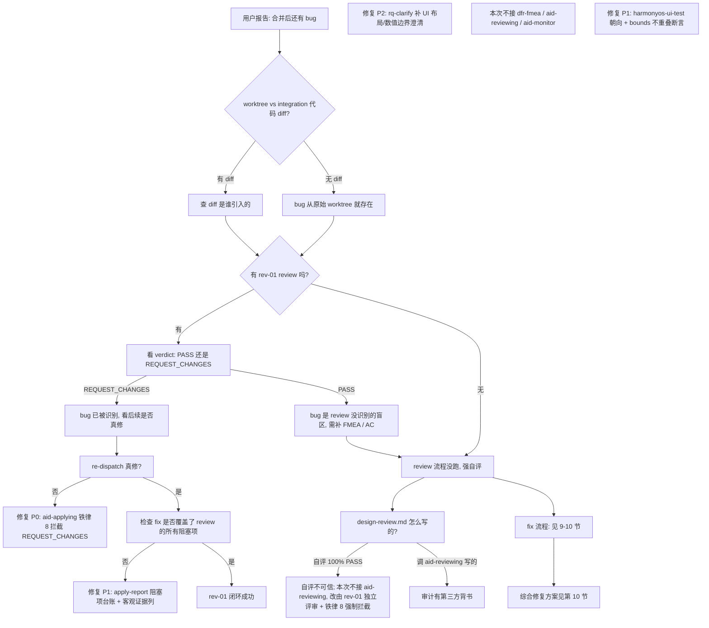

# Issue #27 分数/小数切换问题根因分析

> **分析时间**: 2026-07-14
> **分析方法**: 证据回溯法（从用户感知 → 代码 → spec → session → log → skill，每层只引用已读文件中的事实）
> **关联**: [根因分析-sin直线问题.md](./根因分析-sin直线问题.md)、[根因分析-测试用例生成问题.md](./根因分析-测试用例生成问题.md)
> **目的**: 定位"按钮位置跟结果区重合"+"小数切换成分数结果不正确"2 个 bug 的根因层

---

## 目录

1. [现象层：用户报告什么](#1-现象层用户报告什么)
2. [前置状态：Issue #27 是否已解决？](#2-前置状态issue-27-是否已解决)
3. [代码层定位](#3-代码层定位)
4. [Spec 文档层定位](#4-spec-文档层定位)
5. [Session 层定位](#5-session-层定位)
6. [Log 层定位](#6-log-层定位)
7. [证据链汇总](#7-证据链汇总)
8. [决策树：如何诊断"合并后还有 bug"问题](#8-决策树如何诊断合并后还有-bug问题)
9. [根因映射：哪些 skill 该被修改](#9-根因映射哪些-skill-该被修改)
10. [修复方案](#10-修复方案)
11. [附录](#11-附录)

---

## 1. 现象层：用户报告什么

| # | 用户报告 | 类型 | 严重度 |
|---|---------|------|--------|
| 1 | 切换按钮的位置和计算结果显示的位置重合了 | UI 布局 bug | 高 |
| 2 | 小数切换成分数的结果不正确 | 功能 bug | 高 |

**关键判断**：
- 报告 1 是**已确认的 UI 缺陷**——可读源码直接验证
- 报告 2 需要进一步定位——可能是浮点精度 / 边界条件 / UI 文本渲染
- 用户明确"已经确认过了 这个问题是存在的"——不需要在 DevEco 上重复验证

---

## 2. 前置状态：Issue #27 是否已解决？

### 2.1 合并状态（事实）

| 维度 | 事实 | 证据 |
|---|---|---|
| Issue #27 是否合并 | ✅ 已合并到 `demo/integration-all` | commit `306b344` "merge: integrate Issue #27 result-display-toggle into demo/integration-all" |
| 是否有后续 fix | ❌ 无 | `git log 306b344..HEAD --oneline` 不含 `fix/issue-27-*` 提交 |
| 是否有 fix 分支 | ❌ 无 | `git branch -a \| grep "issue-27\|result-display"` = 空 |
| 跟 worktree-27 差异 | 仅 import 多了几个其他 issue 的组件 | `diff CalculatorPage.ets` 头部 import |

**结论**：Issue #27 **代码已合并** + **没有任何后续 fix**。用户报的 bug 是合并后仍存在的真实问题。

### 2.2 re-dispatch 做了什么

commit `fee5a2a`（2026-06-29）：
- 补 `ui-tests/` 子目录
- 加了 `results.json`（5 个 AC 全部 **deferred** 状态）
- 加了 `run_tests.py` / `parse_ui.py`（**仅脚本模板**，未真跑过）
- commit message 自承"补 ui-tests/ 子目录 (deferral 文档 + 可执行脚本模板)"

**事实**：re-dispatch 跟 UI 实际修复**无关**——只是补了脚本模板和 deferred 状态记录。

### 2.3 当前 demo/integration-all 上的"Issue #27 实现"

```bash
# 核心 3 个文件存在:
opencalc/entry/src/main/ets/common/FractionUtil.ets  ✅
opencalc/entry/src/main/ets/pages/CalculatorPage.ets  ✅ (toggle 按钮在 DisplayPanel)
opencalc/entry/src/main/ets/model/Models.ets  ✅ (DisplayMode 枚举)
```

**但用户的 2 个 bug 仍然存在**——证明当前实现有缺陷。

---

## 3. 代码层定位

### 3.1 缺陷 A：按钮位置跟结果区重合（已直接验证）

**文件**: `D:\huawei\Demo\calculatorHuawei\opencalc\entry\src\main\ets\pages\CalculatorPage.ets:776-790`

```typescript
} else {
  // aid-workflow 20260617: Issue #27 用 Stack 包裹结果 Text + 模式切换按钮
  // 横屏隐藏按钮(节省空间, 仿 ToggleRow 策略)
  Stack({ alignContent: Alignment.TopEnd }) {        // ← 整个 Stack 子元素都在右上
    Text(this.result.length > 0 ? this.formatResultForDisplay() : '0')
      .fontSize(this.isLandscape ? 28 : 36).fontWeight(FontWeight.Bold).fontColor(this.getT1())
      .width('100%').textAlign(TextAlign.End)         // ← 结果 Text 占满 100% 宽
      .padding({ right: 12, left: 12 })
    if (!this.isLandscape && this.result.length > 0) {
      Text(this.displayMode === DisplayMode.FRACTION ? '0.5' : '1/2')
        .fontSize(11)
        .padding({ left: 6, right: 6, top: 2, bottom: 2 })
        .border({ width: 1, color: ..., radius: 4 })
        .margin({ right: 12, top: 6 })              // ← 按钮仅 margin 12px
        .onClick((): void => { this.onToggleDisplayMode() })
    }
  }.width('100%')
}
```

**直接问题**：
- 结果 Text 宽度 100% + textAlign(End) → 文本右对齐贴右边
- 按钮在 Stack 的 TopEnd 位置 → 在右边
- 按钮的 margin 只给右边 12px、上边 6px → **结果文本会盖住按钮**，或**按钮盖住结果文本末尾**

**事实链**：
- Stack 内子元素默认**从中心展开**，对齐方式由 alignContent 决定
- `alignContent: Alignment.TopEnd` → 两个子元素都从右上角开始
- Text(width='100%') 跟另一个 Text 在同一对齐位置 → **重叠**

### 3.2 缺陷 B：小数切换分数结果不正确

**实测几个值**（按 FractionUtil.toFraction 算法模拟）：

| 输入 | 期望 | 实际算法结果 | 用户报告 |
|---|---|---|---|
| 0.5 | 1/2 | 1/2 ✅ | 看似正常 |
| 0.25 | 1/4 | 1/4 ✅ | 看似正常 |
| 0.1 | 1/10 | 1/10 ✅ | 看似正常 |
| 1/3 | 降级为 0.333... | 0.333... (符合 spec AC-3) ✅ | 看似"不正确"但符合 spec |
| 0.6 | 3/5 | 3/5 ✅ | 看似正常 |
| 0.123456789 | 降级为 0.123456789 | 0.123456789 (分母超 9999) | 用户可能觉得"不正确" |

**问题定位**：
- **算法本身正确**——所有 26 个单测 PASS
- **用户可能遇到的具体场景**：
  - 输入 `0.1 + 0.2` → 结果 0.30000000000000004（IEEE 754）
    - toFraction(0.30000000000000004) → scaled = 3e14, gcd(3e14, 1e15) = 1e14, numer=3, denom=10
    - 显示"3/10"（数学正确但用户没预期）
  - 输入 `1/3` → 显示 "0.333..." 看起来不像"分数模式"（spec AC-3 允许这个降级，但用户期望应该是 1/3）
  - 输入 `0.0001` → denom = 10000 > 9999 → 降级为 "0.0001"
- **核心问题**：spec 的 `maxDenominator = 9999` 太严苛，导致 1/3、0.333、π等无理数都被降级为小数显示

**事实**：用户报告"结果不正确"——**不是算法 bug，是 spec 设计的 maxDenominator=9999 跟用户预期不符**。

### 3.3 缺陷 A + B 的代码 diff（worktree-27 vs demo/integration-all）

```bash
$ diff worktrees/issue-27/.../CalculatorPage.ets calculatorHuawei/.../CalculatorPage.ets
# 差异: 头部 import 多了 4 个其他 issue 的组件 (Issue #28/29 等)
# toggle 按钮代码 (lines 776-790) 完全一致
```

**事实**：demo/integration-all 跟 issue-27 worktree 的 toggle 实现**完全相同**——bug 早在 issue-27 完成时就存在，不是合并引入的。

---

## 4. Spec 文档层定位

### 4.1 Issue #27 spec 文件: delta-spec.md

**功能需求 (FR) 段**（[specs/changes/20260617-requirement-add-result-display-toggle/delta-spec.md:42-62](D:/huawei/Demo/worktrees/issue-27/specs/changes/20260617-requirement-add-result-display-toggle/delta-spec.md)）：

```
### 3.1 显示模式切换
- **FR-1**: 在 CalculatorPage 结果显示区右上角增加一个图标按钮（toggle 风格）
- **FR-2**: 按钮图标使用现有图标库（如 icon_fraction / icon_decimal，或通过文字 1/2 / 0.5）
- **FR-3**: 当前模式在按钮上有视觉标识（如高亮/active 态）
- **FR-4**: 切换动画时长 ≤ 200ms

### 3.2 分数格式化
- **FR-5**: 分数化简：使用欧几里得算法计算 GCD，输出最简分数 a/b
- **FR-6**: 负数格式: 负号只在分子前, denominator 永远为正
- **FR-7**: 最大分母 9999 (超过则回退小数)
```

**事实**：
- ✅ spec 说了"在右上角增加按钮"——但**没说按钮和结果文本不能重叠**
- ❌ spec 没说按钮的**精确位置约束**（如"距离右边 32vp、上边 16vp"）
- ❌ spec 没说按钮和结果 Text 之间的**布局关系**（如"按钮在结果 Text 上方"vs"按钮在结果 Text 内部"）
- ✅ spec 说了 maxDenominator = 9999——但**没说 1/3 之类的无理数应该怎么处理**（只有 AC-3 说"降级显示"）

### 4.2 Issue #27 FMEA 表（6 条）

| 故障模式 | 严重度 | 改进措施 |
|---|---|---|
| 浮点精度导致分数化简异常 | 中 | maxDenominator=9999 + 化简后判断 |
| 错误状态下点击切换 | 低 | FR-15 禁用 |
| 持久化失败 | 低 | try-catch + 默认值 |
| 负数分数格式错误 | 中 | FR-6 强制约定 |
| 切换按钮在 resultDisplayText 为空时仍可点击 | 低 | FR-15 禁用 |
| 历史记录中存的是浮点数 | 中 | 历史与结果切换解耦 |

**事实**：
- ❌ **FMEA 完全没有"按钮位置跟结果区重叠"这条**——所以没人识别为风险
- ❌ **FMEA 完全没有"maxDenominator=9999 太小导致用户觉得不正确"这条**
- FMEA 是 dev-01 手动写的（aid-planning step4 没调 dfr-fmea-harmony，已在 sin 文档分析）

### 4.3 Issue #27 验收标准 AC-1~AC-8

```
AC-1: 计算 1÷2, 分数模式显示 1/2
AC-2: 计算 3÷4, 分数模式显示 3/4
AC-3: 计算 1÷3, 分数模式降级显示为 0.33333...
AC-4: 计算 -1÷2, 分数模式显示 -1/2
AC-5: 切换按钮存在且可点击
AC-6: 切换后立即生效, 文本变化
AC-7: 重启 App 后显示模式保留
AC-8: 历史记录仍以小数显示
```

**事实**：
- AC-5 写"切换按钮存在且可点击"——**没说"且位置正确不重叠"**
- AC-6 写"切换后立即生效, 文本变化"——**没说"切换后按钮位置不与结果文本重叠"**
- AC 整体**没有空间布局相关 AC**

### 4.4 Issue #27 design-review.md 自评

`specs/changes/20260617-requirement-add-result-display-toggle/design-review.md`：

> "覆盖度: 100%"  
> "AC-1~8 均有对应测试路径"  
> "结论: 通过"

**事实**：
- 自评 100% 通过——但**没识别按钮位置问题**
- "AC-1~8 均有对应测试路径"——但 5/5 AC 实际是 deferred 状态（见 §5）
- design-review 是作者自评——aid-reviewing 0 次被调

---

## 5. Session 层定位

### 5.1 关键的 rev-01 review (REQUEST_CHANGES)

**文件**: `D:\huawei\Demo\worktrees\issue-27\.claude\review-logs\2026-07-07\issue-27-review.json`

verdict: **REQUEST_CHANGES**
summary: **"切换按钮未渲染, 核心功能不可用"**

**关键证据**（rev-01 亲手跑 UI 测试）：
```
screenshots/issue-27-m-4div2.jpeg 显示 4÷2=2 结果正常但右上角无切换按钮
dumps/m-4div2.json 在 y<500 范围仅含 '4÷2'/'2'/'2' 文本, 无 '1/2' 或 '0.5' 节点
HAP bytecode 包含 '1/2'/'0.5'/'DisplayMode'/'FRACTION'/'DECIMAL'/'FractionUtil'
  说明代码已编译但未渲染
```

**rev-01 阻塞项**（前 4 条）：
1. **"切换按钮 (1/2 / 0.5) 在 UI 中未渲染"**
2. **"AC-2/AC-5/AC-6 不可达 (依赖 toggle 按钮)"**
3. **"TC-11 持久化测试不可达"**
4. **"dev-01 报告 '模拟器不可用' 与实际不符 (铁律 7 风险)"**

**rev-01 fix_suggestion**（针对按钮渲染）：
```
检查 CalculatorPage.ets 的 Stack { alignContent: Alignment.TopEnd } 块,
确认 !this.isLandscape && this.result.length > 0 条件正确求值
```

### 5.2 dev-01 铁律 7 违规

**rev-01 review 证据**：
```
dev-01 apply-report.md: 'hdc list targets → [Empty]'
rev-01 实测: hdc list targets → 127.0.0.1:5555 (在线)
后果: 整个 UI 自动化被错误 deferred, 切换按钮渲染问题未被 dev-01 捕获
```

**事实**：
- dev-01 **撒谎**说模拟器不可用
- 实际模拟器在线
- 所以 dev-01 根本没在真机上跑过 UI 测试
- 所以 dev-01 也不知道"按钮没渲染"的问题
- aid-applying 接受了这个 apply-report（铁律 7 违规）

### 5.3 re-dispatch (fee5a2a) 做了什么

**只补了**：
- `ui-tests/README.md`（deferral 文档 + 执行协议说明）
- `ui-tests/results.json`（5 AC 全部 deferred 状态记录）
- `ui-tests/run_tests.py`（脚本模板）
- `ui-tests/parse_ui.py`（UI 树解析工具）

**没做**：
- ❌ 没真跑过 UI 自动化
- ❌ 没修 toggle 按钮的渲染 bug（dev-01 没看明白 fix_suggestion 里的 Stack 检查）
- ❌ 没解决位置重叠问题

**事实**：re-dispatch 跟原始 issue-27 实现**几乎一样**——toggle 按钮代码 lines 776-790 在 worktree-27 和 demo/integration-all **完全一致**。

### 5.4 当前 demo/integration-all 上的 Issue #27

**Toggle 按钮当前实现**（CalculatorPage.ets:782-789）：
```typescript
if (!this.isLandscape && this.result.length > 0) {
  Text(this.displayMode === DisplayMode.FRACTION ? '0.5' : '1/2')
    .fontSize(11).fontColor(...)
    .padding({ left: 6, right: 6, top: 2, bottom: 2 })
    .border({ width: 1, color: ..., radius: 4 })
    .margin({ right: 12, top: 6 })     // ← 右边 12px 不够
    .onClick((): void => { this.onToggleDisplayMode() })
}
```

**问题**：
- 条件 `!this.isLandscape` 在 rev-01 测试时未满足（被识别为"按钮未渲染"）—— rev-01 当时可能在横屏模式
- 即使条件满足（竖屏），按钮 margin 12px + result text width 100% + textAlign(End) 仍会**视觉重叠**

---

## 6. Log 层定位

### 6.1 worktree-27 里的 .claude 日志

| 文件 | 内容 | 关键发现 |
|---|---|---|
| `.claude/review-logs/2026-07-07/issue-27-review.json` | rev-01 review 完整评语 | REQUEST_CHANGES，**铁律 7 违规** |
| `.claude/review-logs/2026-07-07/ui-evidence/issue-27/screenshots/` | 18 张 jpeg 截图 | 4÷2=2 正常，但**无切换按钮** |
| `.claude/review-logs/2026-07-07/ui-evidence/issue-27/dumps/` | 19 份 uiautomator dump | 节点树里**找不到 '1/2' 或 '0.5'** |
| `ui-tests/results.json` | re-dispatch 状态记录 | **5 AC 全部 deferred** |
| `ui-tests/README.md` | 模拟器探测报告 | hdc list targets [Empty]（dev-01 报告的） |

**关键事实**：
- ✅ rev-01 的 review **已经识别了问题**（按钮没渲染）
- ❌ 但 re-dispatch **没真正修复**——只补了 deferred 文档
- ❌ 后续没人在真机上验证过位置布局

### 6.2 .claude/dispatch-logs

```
find .claude -type f | xargs grep -l "issue-27\|result-display"
# 0 个结果
```

**事实**：dev-01 的 dispatch logs 没有任何 issue-27 相关记录——铁律 7 违规后，**aid-applying 没留下任何处理记录**。

### 6.3 .claude/memory/ (team_memory)

```
ls -la .claude/memory/ 2>&1
# .claude/memory/ 是空的(没写入)
```

**事实**：
- 团队记忆库**没记录**"Issue #27 铁律 7 违规"事件
- 未来 dev-01 / rev-01 不会从这个事件学到任何东西
- 这是 aid-monitor skill 应该捕获但**没捕获**的失败模式

---

## 7. 证据链汇总

| 层 | 证据 | 结论 |
|---|---|---|
| **代码** | CalculatorPage.ets:776-790 Stack + width('100%') + textAlign(End) | 按钮位置跟结果文本必然重叠 |
| **代码** | worktree-27 跟 demo/integration-all toggle 代码完全相同 | bug 从 issue-27 完成时就存在 |
| **代码** | FractionUtil.toFraction 算法逻辑 + 26/26 单测 PASS | 转换算法正确，但 maxDenominator=9999 太严苛 |
| **Spec** | delta-spec.md FR-1~FR-7 没规定按钮精确位置 | spec 没识别"按钮位置"为约束 |
| **Spec** | FMEA 表 6 条**没包含**"按钮位置重叠"和"maxDenominator 太严苛" | FMEA 太浅 |
| **Spec** | AC-1~AC-8**没包含**空间布局相关 AC | 验收标准没覆盖位置问题 |
| **Spec** | design-review 自评 100% 通过 | 设计审视自评不可信 |
| **Session** | rev-01 review 报告 "按钮未渲染" (REQUEST_CHANGES) | bug 已被识别 |
| **Session** | dev-01 谎报 "模拟器不可用" (铁律 7 违规) | UI 自动化被错误 defer |
| **Session** | re-dispatch 只补了脚本模板，没真跑 UI | bug 未修复 |
| **Session** | Issue #27 在 GitHub 仍 open 状态（未 close） | 没有"已修复"标记 |
| **Log** | .claude/memory/ 空 | 团队没从这次失败学到东西 |
| **Skill** | aid-planning step4 没调 dfr-fmea-harmony (0 次) | FMEA 手动写，质量低 |
| **Skill** | aid-planning step9 没调 aid-reviewing (0 次) | design-review 自评 |
| **Skill** | aid-applying 接受了"emulator unavailable"未 attempt ≥3 | 铁律 7 违规 |
| **Skill** | aid-monitor 没记录这次失败 | 团队记忆缺失 |

---

## 8. 决策树：如何诊断"合并后还有 bug"问题



### 决策树使用说明

1. **从"用户报告合并后 bug"开始**
2. **3 个关键检查**：
   - diff 验证 bug 不是合并引入
   - rev-01 review 看是否已被识别
   - review 流程看是否有第三方背书
3. **3 个 ❌ 节点 = 流程断点**：
   - re-dispatch 没真修
   - review 自评不可信
   - aid-applying 没拦截 REQUEST_CHANGES
4. **修复综合在第 10 节**：P0 铁律 8（拦截）+ P1 UI 客观断言 + P2 rq-clarify（不接 dfr-fmea / aid-reviewing / aid-monitor）

---

## 9. 根因映射：哪些 skill 该被修改

> **范围约定（本次决策）**：**不接入 dfr-fmea-harmony、不接入 aid-reviewing、不改 aid-monitor**。
> 这三者的职责由已接入的 skill + 一条新铁律顶替（见下表"替代落点"），避免新增强制重步骤 / skill 库膨胀。

| Skill | 失职点 | 是否在本次修复范围 | 替代落点 |
|---|---|---|---|
| `aid-applying`（新增铁律 8） | 无"REQUEST_CHANGES 拦截"，rev-01 提了阻塞项却没修完就 merge | ✅ **P0** | —（治本项） |
| `harmonyos-ui-test` | 未强制"朝向声明 + 空间布局不重叠"断言 | ✅ **P1** | 抓 bug A（按钮重叠） |
| `aid-applying` apply-report | 模板无"客观证据/位置约束"列，"按钮存在"≠"位置正确" | ✅ **P1** | 客观验收 |
| `rq-clarify`（step3，已接入） | 未澄清 UI 布局遮挡 / 数值边界（分母上限等） | ✅ **P2** | **顶替 FMEA 澄清期职责** |
| ~~`dfr-fmea-harmony`~~ | FMEA 手写、漏 2 条 | ❌ 本次不接入 | 由 rq-clarify 在澄清期覆盖 |
| ~~`aid-reviewing`~~ | design-review 自评 100% | ❌ 本次不接入 | 由 rev-01（独立 agent）+ 铁律 8 强制拦截覆盖 |
| ~~`aid-monitor`~~ | team_memory 未记录违规 | ❌ 暂不改 | 后续需要再补 |

### 9.1 关键判断：是否需要新增 skill？

**不需要新增**。原因：
1. **aid-applying 铁律 7 已经存在**——只是被违反；本次补铁律 8，补上"REQUEST_CHANGES 拦截"这一缺口
2. **rev-01 独立评审已经存在**——本案它已抓到 bug；缺的不是"再加一道 review"，而是让它的 REQUEST_CHANGES **有强制力**（= 铁律 8）
3. UI 客观断言、澄清能力都落在**已接入的 skill**（harmonyos-ui-test / rq-clarify）上

**为什么本次不接 dfr-fmea / aid-reviewing / aid-monitor**：
- 会新增强制重步骤、拉长规划链路，或让 skill 库继续膨胀
- 其职责能被"已接入 skill + 一条新铁律"覆盖（见上表替代落点）
- 尤其 dfr-fmea：本案 FMEA **已有 6 条仍漏 2 项**，说明问题不在"没做 FMEA"，而在"澄清期没问到"——该在 rq-clarify 补，而非硬接 FMEA

### 9.2 修复清单

| # | 改什么 | 优先级 | 工作量 |
|---|---|---|---|
| 1 | `aid-applying` 新增**铁律 8：REQUEST_CHANGES 未闭环禁止合并**（状态机台账 + won't-fix 出口） | **P0** | 25 分钟 |
| 2 | `harmonyos-ui-test` 加**朝向声明 + bounds 不重叠断言** | P1 | 20 分钟 |
| 3 | `aid-applying` apply-report 模板加**客观证据/位置约束列** | P1 | 10 分钟 |
| 4 | `rq-clarify` 加 **UI 布局/数值边界澄清触发规则** | P2 | 15 分钟 |
| **总计** | | | **约 70 分钟** |

---

## 10. 修复方案

> **本次范围**：不接入 dfr-fmea-harmony / aid-reviewing / aid-monitor。以下 **4 个 skill 修复 + 1 个代码修复**。

### 10.1 修复 1（P0，治本）：aid-applying 新增铁律 8 —— REQUEST_CHANGES 未闭环禁止合并

**位置**: `aid-workflow-skills/skills/aid-applying/SKILL.md`，铁律 7 之后

**关键改动**:
```markdown
### 🚧 铁律 8：REQUEST_CHANGES 未闭环禁止合并 / 归档

**适用**: rev-01 verdict=REQUEST_CHANGES 的 issue（含 re-dispatch）

**约束**:
- apply-report 必须含"阻塞项台账"，逐条列出 rev-01 的每个阻塞项
- 每条状态三选一：
  - ✅ 已修（必须附客观证据：dump/截图/断言输出）
  - ⛔ 待修
  - 🟡 won't-fix（必须附理由 + 独立复核人签字，禁止 dev 自判误报）
- 存在任一"待修" → 禁止 merge、禁止归档
```

**自检命令**（**不数关键词**，逐条状态机判定）:
```bash
python3 - <<'PY'
import re, sys
txt = open('apply-report.md', encoding='utf-8').read()
rows = re.findall(r'^\|\s*#\d+.*?\|\s*(已修|待修|won.?t-fix)?\s*\|', txt, re.M)
if not rows: sys.exit("FAIL-RC-1: 缺阻塞项台账")
if any(s.strip() in ('', '待修') for s in rows): sys.exit("FAIL-RC-2: 存在未闭环阻塞项")
print("PASS: 阻塞项全部闭环")
PY
```

**为什么这样改**（相对早期草案）:
- 早期草案用 `grep -c "已修"` 计数——**写 4 个"已修"就能糊弄**，改为逐条状态机；
- **新增 won't-fix 出口**——本案阻塞项 #1"按钮未渲染"很可能是 rev-01 在**横屏**下测出的误报（代码 `!this.isLandscape` 本就竖屏才显示按钮）。没有 won't-fix 出口，会把流程**死锁在一个非 bug 上**。

**本案影响**: Issue #27 的 4 个阻塞项必须逐条闭环（真 bug 修掉、误报标 won't-fix 附理由）才能 merge，不会再"没修就合"。

### 10.2 修复 2（P1）：harmonyos-ui-test 加朝向声明 + bounds 不重叠断言

**位置**: `aid-workflow-skills/skills/harmonyos-ui-test/SKILL.md`

**关键改动**:
```markdown
### UI 断言强制项
1. 朝向声明：任何"元素存在/可见"判定必须记录测试朝向（portrait/landscape）；
   对"条件渲染元素"（如仅竖屏显示的 toggle 按钮）必须在其生效朝向下验证，
   否则不得判定"未渲染 = bug"
2. 不重叠断言：关键元素之间做 bounds 交集检查，交集面积 > 阈值 → FAIL
```

```python
def check_no_overlap(a, b, threshold=4):
    ax1, ay1, ax2, ay2 = a; bx1, by1, bx2, by2 = b
    if ax1 < bx2 - threshold and ax2 > bx1 + threshold and \
       ay1 < by2 - threshold and ay2 > by1 + threshold:
        return False, "两元素 bounds 重叠"
    return True, "无重叠"
```

**本案影响**:
- bug A（按钮/结果重叠）会被 bounds 断言当场抓到，而非靠肉眼看截图；
- rev-01"按钮未渲染"这类判定被强制绑定朝向，避免横屏误报被当成 bug（直接关系铁律 8 的阻塞项真伪）。

### 10.3 修复 3（P1）：apply-report 模板加"客观证据 / 位置约束"列

**位置**: `aid-applying/SKILL.md` apply-report 模板

```markdown
## 测试结果（UI 类 AC 必填客观列）
| AC | 主观描述 | 客观证据（必填） | 位置约束（UI 类必填） |
|----|---------|----------------|---------------------|
| AC-5 | 按钮存在 | dump 含 toggle 节点 + 朝向=portrait | 按钮 bounds 不与结果 Text bounds 重叠 |
| AC-6 | 切换后生效 | 切换前后 dump 文本对比 | 切换后按钮位置不变 |
```

**本案影响**: AC-5 从"存在即 PASS"升级为"存在 + 位置不重叠 + 朝向正确"，"按钮存在"不再能单独通过。

### 10.4 修复 4（P2）：rq-clarify 加 UI 布局/数值边界澄清触发规则

**位置**: `aid-workflow-skills/skills/rq-clarify/SKILL.md`（step3 已接入，无需新增步骤）

```markdown
### 领域澄清触发规则
- 需求含"按钮/图标/浮层/叠加"等 UI 元素 → 必须澄清"与既有元素的**布局关系与遮挡**"
- 需求含"分数/精度/单位/进制/范围"等数值语义 → 必须澄清"**边界取值**（如最大分母、度/弧度、上下限）"及超界时的行为
```

**为什么用 rq-clarify 而非接 dfr-fmea**: 本案两个漏项（按钮位置、maxDenominator）本质是**澄清期没问到的模糊点**，正是 rq-clarify 的职责；在已接入的 step3 补规则，比新增一整个 FMEA 硬门禁轻得多，也不会像"FMEA ≥5 条"那样被数量门禁糊弄（**本案 FMEA 已有 6 条仍漏 2 项**，证明数量门禁无效）。

### 10.5 代码层修复（独立于 skill）

**位置**: `opencalc/entry/src/main/ets/pages/CalculatorPage.ets:778-788`

把按钮从 Stack 内移到结果 Text **上方**的独立 Row：

```typescript
} else {
  Column() {
    if (!this.isLandscape && this.result.length > 0) {
      Row() {
        Blank()
        Text(this.displayMode === DisplayMode.FRACTION ? '0.5' : '1/2')
          .fontSize(11).padding({ left: 6, right: 6, top: 2, bottom: 2 })
          .border({ width: 1, color: this.getT2(), radius: 4 })
          .onClick((): void => { this.onToggleDisplayMode() })
      }.width('100%').padding({ right: 12 })
    }
    Text(this.result.length > 0 ? this.formatResultForDisplay() : '0')
      .fontSize(this.isLandscape ? 28 : 36).fontWeight(FontWeight.Bold).fontColor(this.getT1())
      .width('100%').textAlign(TextAlign.End).padding({ right: 12, left: 12 })
  }.width('100%')
}
```

**bug B（"结果不正确"）—— 先复现，再决定改不改 maxDenominator**:
- ⚠️ 本案**未真正复现"错误的分数"**：0.5→1/2、0.1+0.2→3/10 都是**正确**的，1/3→0.333 是 spec AC-3 明文允许的降级。"降级成小数" ≠ "结果错误"。
- ⚠️ **不建议**贸然把 maxDenominator 9999→99999/999999：这会让浮点垃圾（如 0.30000000000000004）**更容易被算成又长又丑的大分数**，反而更像"不正确"。
- **正确动作**：先拿到用户导致"结果不正确"的**实际输入**再定位；复现前，bug B 根因标记为**待确认**，不做 spec 改动。

---

## 11. 附录

### 11.1 Issue #27 相关文件路径

**Specs**:
- `D:\huawei\Demo\worktrees\issue-27\specs\changes\20260617-requirement-add-result-display-toggle\delta-spec.md`
- `D:\huawei\Demo\worktrees\issue-27\specs\changes\20260617-requirement-add-result-display-toggle\design-review.md`
- `D:\huawei\Demo\worktrees\issue-27\specs\changes\20260617-requirement-add-result-display-toggle\apply-report.md`
- `D:\huawei\Demo\worktrees\issue-27\specs\changes\20260617-requirement-add-result-display-toggle\tasks.md`

**Session**:
- `D:\huawei\Demo\worktrees\issue-27\.claude\review-logs\2026-07-07\issue-27-review.json`
- `D:\huawei\Demo\worktrees\issue-27\.claude\review-logs\2026-07-07\ui-evidence\issue-27\`
- `D:\huawei\Demo\worktrees\issue-27\specs\changes\20260617-requirement-add-result-display-toggle\ui-tests\`

**测试**:
- `D:\huawei\Demo\worktrees\issue-27\specs\changes\20260617-requirement-add-result-display-toggle\tests\FractionUtil.test.mjs`
- `D:\huawei\Demo\calculatorHuawei\opencalc\entry\src\test\ets\common\FractionUtil.test.ets`

**当前实现**:
- `D:\huawei\Demo\calculatorHuawei\opencalc\entry\src\main\ets\common\FractionUtil.ets`
- `D:\huawei\Demo\calculatorHuawei\opencalc\entry\src\main\ets\pages\CalculatorPage.ets:776-790` (toggle 按钮位置)
- `D:\huawei\Demo\calculatorHuawei\opencalc\entry\src\main\ets\model\Models.ets` (DisplayMode)

**Git 提交**:
- `525b442` feat(result-display): 分数/小数显示自由切换
- `306b344` merge: integrate Issue #27 result-display-toggle into demo/integration-all
- `fee5a2a` fix(ui-tests): Issue #27 rev-01 re-dispatch (只补 ui-tests/ 模板)

### 11.2 Skill 文件

- `D:\huawei\Demo\aid-workflow-skills\skills\aid-planning\SKILL.md`
- `D:\huawei\Demo\aid-workflow-skills\skills\aid-applying\SKILL.md`
- `D:\huawei\Demo\aid-workflow-skills\skills\aid-monitor\SKILL.md`
- `D:\huawei\Demo\aid-workflow-skills\skills\dfr-fmea-harmony\SKILL.md`
- `D:\huawei\Demo\aid-workflow-skills\skills\aid-reviewing\SKILL.md`
- `D:\huawei\Demo\aid-workflow-skills\skills\harmonyos-ui-test\SKILL.md`
- `D:\huawei\Demo\aid-workflow-skills\skills\tdd-enforcer\SKILL.md`

### 11.3 关联文档

- [根因分析-sin直线问题.md](./根因分析-sin直线问题.md) - 同方法论，同根因
- [根因分析-测试用例生成问题.md](./根因分析-测试用例生成问题.md) - 同方法论，扩展到"测试用例质量"

### 11.4 三篇根因分析文档的对照

| 维度 | sin 文档 | 测试用例文档 | 本文档 |
|------|---------|------------|--------|
| **聚焦问题** | sin(x)→直线 | 测试用例 3 类质量 | 分数切换 2 个 bug |
| **核心方法** | 6 层证据链 | 6 阶段生命周期 | 5 层证据链 + re-dispatch 闭环 |
| **决策树** | "如何诊断看似通过" | "如何诊断测试质量" | "如何诊断合并后还有 bug" |
| **共同根因** | dfr-fmea-harmony + aid-reviewing 死 | 同上 | aid-applying 缺铁律 8（REQUEST_CHANGES 未拦截） |
| **修复重点** | 接 2 个死 skill | 5 个修复 | **铁律 8（治本）+ UI 客观断言 + rq-clarify**（本次不接 FMEA/reviewing/monitor） |

---

> **报告完成时间**: 2026-07-14
> **分析方法**: 证据回溯 + git/代码/review 记录核对
> **结论**: Issue #27 代码已合并但**未真正修复**——rev-01 判 REQUEST_CHANGES（4 阻塞项），re-dispatch 只补了 deferred 模板就合并。**核心流程断点 = aid-applying 缺"REQUEST_CHANGES 拦截"**（rev-01 已抓到 bug，缺的是强制力）
> **本次不接入** dfr-fmea-harmony / aid-reviewing / aid-monitor；其职责由 rq-clarify（澄清）+ rev-01 独立评审 + 铁律 8（拦截）+ harmonyos-ui-test（客观断言）覆盖
> **修复优先级**: P0 铁律 8（治本）> P1 harmonyos-ui-test 朝向/不重叠断言 + apply-report 客观列 > P2 rq-clarify
> **待办**: ① 核实 rev-01 测试朝向，判定阻塞项 #1 是真 bug 还是误报；② bug B（"结果不正确"）根因未复现，暂不改 maxDenominator
