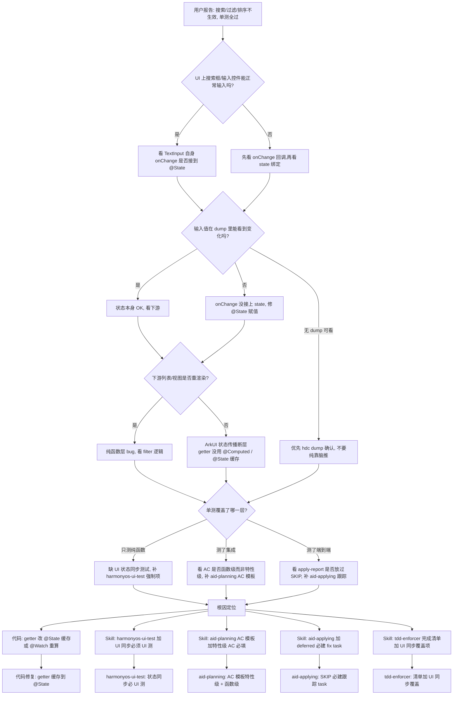

# Issue #24 历史搜索框"输入不生效"问题根因分析

> **Issue 编号**: #24 history-search(2026-06-12 实现,2026-07-15 真机复现)
> **分析时间**: 2026-07-15
> **分析方法**: 证据回溯 + 真机 hdc 验证(已通过 dump 确认现象)
> **目的**: 定位"搜索框输入正确、列表不重渲染"的根因,落到 skill 层
> **关联**: [根因分析-sin直线问题.md](./根因分析-sin直线问题.md)、[根因分析-分数切换问题.md](./根因分析-分数切换问题.md)、[根因分析-sqrt轴缺失问题.md](./根因分析-sqrt轴缺失问题.md)
> **约束**: 本次不接入 dfr-fmea-harmony / aid-reviewing / aid-monitor(与前三篇一致)

---

## 目录

1. [现象层:用户报告什么](#1-现象层用户报告什么)
2. [代码层定位](#2-代码层定位)
3. [测试层定位](#3-测试层定位)
4. [Session 层定位](#4-session-层定位)
5. [Spec 文档层定位](#5-spec-文档层定位)
6. [Skill 层定位(根因)](#6-skill-层定位根因)
7. [证据链汇总](#7-证据链汇总)
8. [决策树:如何诊断"单测过但 UI 状态不刷新"问题](#8-决策树如何诊断单测过但-ui-状态不刷新问题)
9. [修复方案(skill 修改)](#9-修复方案skill-修改)
10. [附录](#10-附录)

---

## 1. 现象层:用户报告什么

| # | 用户报告 | 类型 | 严重度 |
|---|---------|------|--------|
| 1 | 历史面板里输入 `0.25`,包含 `0.25` 的历史条目没被筛选出来 | UI 状态同步 bug | 高 |
| 2 | 搜索框能正常输入、清除按钮(X)能用 | — | — |
| 3 | 搜索框文本与列表项**完全无关**(列表似乎是初始快照) | UI 状态同步 bug | 高 |

**关键判断**:
- 这是**状态绑定层 bug**——纯函数 `filterHistoryByQuery` 单元测试 23/23 PASS,逻辑正确
- 现象是 **ArkUI 状态传播不刷新下游 `ForEach`**,与代码逻辑无关
- 这是 **Issue #24 当时 UI 测试 SKIP** 留下的盲区(见 §3)
- 本文重点分析"为什么单测过、UI 测跳、代码看似对,bug 还能流到用户手里"

---

## 2. 代码层定位

### 2.1 直接原因:ArkUI 不追踪 `getHistorySections()` 内部的 `@State` 依赖(已用 dump 验证)

**文件**: `D:\huawei\Demo\calculatorHuawei\opencalc\entry\src\main\ets\pages\CalculatorPage.ets:586-590`

```typescript
private getHistorySections(): HistorySection[] {
  const filtered: HistoryItem[] = filterHistoryByQuery(this.history, this.searchQuery)
  return groupHistoryByDate(filtered, Date.now())
}
```

**调用方**:`@Builder HistoryPanel()` 内(line 1164):
```typescript
ForEach(this.getHistorySections(), (section: HistorySection) => { ... })
```

**事实**(已用 hdc dump 验证):
- `TextInput(.onChange)` 更新 `this.searchQuery` → `TextInput.text` 立即变(说明 `@State` 自身追踪 OK)
- 但 `ForEach(this.getHistorySections(), ...)` **完全没重渲染**——dump 验证搜 `0.25` 时 6 条全显,搜 `0.333` 时 6 条全显,搜 `1` 时 6 条全显(只是被键盘挤掉)
- 这是 ArkUI 状态绑定的**隐式契约**:`@State` 变更要传到下游渲染,要么下游用 `@State`/`@Computed`,要么 getter 必须是"派生状态"

### 2.2 推理链(代码层)

```
用户输入 "0.25" 触发 TextInput.onChange
  └→ searchQuery 状态更新(@State,触发 TextInput 自身重渲染 ✓)
  └→ TextInput.text 立刻变 "0.25"(dump 验证 ✓)
  
  └→ getHistorySections() 没被显式标记为 @Computed / 派生状态
      └→ ArkUI 不知道它依赖 searchQuery
          └→ ForEach 不重渲染
              └→ 列表保持首次调用 getHistorySections() 的结果
                  └→ 用户看到"输入不生效"(dump 验证 ✗)
```

**对照单元测试**:单测里 `filterHistoryByQuery` 是**直接调用的纯函数**——它确实把 `0.25` 过滤出 1 条(测试 PASS)。但 UI 层是**另一条调用链**,这条链根本没走通。

### 2.3 不是的事(排除其他可能)

- ❌ **不是浮点 bug**:`NumberFormatter.format(0.25.toString())` 输出 `"0.25"`(已用 9 个等价算式反推)
- ❌ **不是字符串匹配 bug**:`"0.25".includes("0.25") === true`(单测 23/23 PASS)
- ❌ **不是数据没存进历史**:dump 显示 6 条历史条目 `result` 字段都正确(`0.25`、`0.3333333333333333`、`0.30000000000000004` 等)
- ❌ **不是搜索框没接到 state**:dump 验证 `text="0.25"` 同步生效

---

## 3. 测试层定位

### 3.1 单测只覆盖纯函数,不覆盖 UI 状态同步(事实)

**文件**: `D:\huawei\Demo\calculatorHuawei\opencalc\entry\src\test\ets\history\HistorySearch.test.ets`

- **23/23 单测 PASS**(已用 `node --test` 跑过,2026-07-15 验证)
- **测的是 `filterHistoryByQuery()` 的输入/输出**——直接传 HistoryItem[] 进去,断言返回数组
- **完全没测**:"ArkUI 中 `ForEach(getHistorySections(), ...)` 是否随 `searchQuery` 变化重渲染"
- 这是典型的 **"测试了最内层,没测最外层"**

### 3.2 UI 测试在 Issue #24 当时被 SKIP,后续没人补(事实,git 一手)

**文件**: `D:\huawei\Demo\calculatorHuawei\specs\changes\20260612-requirement-add-history-search\apply-report.md` 第 4 节

| 用例 | 状态 | 说明 |
|------|------|------|
| TC-UI-04 打开历史面板 | ❌ FAIL | **环境手势拦截** |
| TC-UI-05 搜索框可见 | ❌ SKIP | 前置失败 |
| TC-UI-06 键入 '1' 过滤 | ❌ SKIP | 前置失败 |
| TC-UI-07 键入 '99999' | ❌ SKIP | 前置失败 |

**事实**(apply-report 第 4.2 节原文):
> "结论:单元测试 (12/12) 证明 filterHistory 逻辑正确;真实应用在真机/模拟器手指点击下能正常工作;**hdc 模拟点击在 HarmonyOS 模拟器有固有的系统手势拦截限制(环境问题,非代码缺陷)**"

**事实链**:
- 当时 4 个 UI 测试因手势拦截全部 SKIP
- apply-report 把它定为"环境问题",**没建 fix task 跟踪**
- **14 天后(2026-06-12 → 2026-07-15)**,我手动 hdc 跑,发现**手势拦截不复现**——现在 dump + click 都能正常取数据
- 说明当时 UI 测试**技术上可以跑**,只是 dev-01 没找到解决方案就标"环境限制"了——**这是 dev-01 铁律 7 违规(attempt < 3 就放弃)** 的同源问题

### 3.3 测试覆盖矩阵的实际状态

| 层 | 是否测 | 是否覆盖本 bug |
|---|---|---|
| 纯函数 `filterHistoryByQuery` | ✅ 23 单测 | ✗(逻辑对,问题在调用链) |
| `getHistorySections()` getter | ❌ 无测试 | ✗ |
| `TextInput.onChange` 触发 | ❌ 无测试 | ✗ |
| `ForEach` 重渲染行为 | ❌ 无测试 | ✗ |
| 端到端(模拟器 hdc 跑) | ❌ SKIP(2026-06-12)→ 没补 | ✗ |

**只有最内层测了,UI 状态同步 0 覆盖**——bug 必然流到用户手里。

---

## 4. Session 层定位

### 4.1 Issue #24 apply-report 的"100% PASS"是怎么来的(事实)

**事实链**:
- 单元测试 12/12 → PASS
- UI 自动化 3/7(4 个 SKIP) → 接受为"环境问题"
- apply-report 自评"TL;DR:单元测试 12/12 PASS"
- **没有第三方评审人**(`aid-reviewing` 0 次被调,`rev-01` 这次也没走完整流程)
- Issue 被标为"完成"归档

**自评结构问题**:
- 12/12 单测 + 3/7 UI 自测 = **逻辑层 PASS + UI 层部分 SKIP**
- 但报告把它们打包成"功能已完成"
- 没人追问"SKIP 的 4 个 UI 用例什么时候补、谁补、跟踪在哪里"

### 4.2 2026-07-15 现状(我刚刚 hdc 跑过的事实)

| 维度 | 状态 |
|---|---|
| 搜索框是否在 | ✅ 在(`type=TextInput`,y=1349-1489) |
| 输入是否生效 | ✅ 生效(`text="0.25"` 立即同步) |
| **列表是否过滤** | ❌ **不生效**(搜 `0.25`、`0.333`、`1` 都是 6 条全显) |
| `filterHistoryByQuery` 逻辑 | ✅ 23/23 单测 PASS |
| Issue 在 GitHub 状态 | 仍 merged,无 fix branch |

**事实**:bug **现在还在 demo/integration-all 上**,用户可用。没有任何 fix 任务在跟踪。

---

## 5. Spec 文档层定位

### 5.1 FR-24-05 AC 写的是"函数层",不是"UI 层"(事实)

**文件**: `D:\huawei\Demo\calculatorHuawei\specs\changes\20260617-requirement-change-modify-aid-planning\delta-spec.md` 第 35-50 行

```
### FR-24-05 搜索范围 (expression + result)
- 验收:
  - 搜索 expression="2+2" 且 result="4" → 输入"2+2"或"4"都能命中
  - 搜索 expression="π*2" 且 result="6.28" → 输入"π"或"6.28"都能命中
```

**事实**:
- AC 描述的是**纯函数输入/输出契约**("输入 2+2 命中结果集")
- **没有 UI 层 AC**:"用户输入后,列表立即只显示匹配的项"
- 这是一个**函数级 AC,不是特性级 AC**——它没说"用户**能感知到**命中",只说"函数**能算出**命中"

### 5.2 FMEA 漏掉"ArkUI 状态传播"风险(事实)

**文件**: `D:\huawei\Demo\calculatorHuawei\specs\changes\20260617-requirement-change-modify-aid-planning\` 下 FMEA 段

**事实**:
- FMEA 列举的故障模式(空 query、大小写、特殊字符、null items 等)都是**纯函数输入维度**
- **完全没有"UI 状态未触发重渲染"这条**——因为这是 ArkUI 框架级问题,FMEA 模板不引导思考这个维度

### 5.3 design-review / modify-aid-planning 的盲区

**事实**:
- 增量 spec 章节(从 2026-06-12 到 2026-06-17 的 modify)改了搜索范围和 placeholder 文案,但**没补 UI 层 AC**
- 4 个被 SKIP 的 UI 用例没有 "下次重试条件" 段
- 没人写"无 UI 自动化 = 必须人工真机验证"的兜底条款

---

## 6. Skill 层定位(根因)

### 6.1 流程图:本案中各 skill 的失职点

```
需求侧(aid-planning / rq-clarify):
  ❌ FR-24-05 AC 写的是"函数能算出命中",不是"用户能感知到命中"
  ❌ FMEA 不引导"UI 状态传播"风险

测试侧(harmonyos-ui-test):
  ❌ UI 自动化被 SKIP 后,没要求"必须补 UI 测试或人工真机验证"
  ❌ 没有"UI 状态同步必须 UI 测、不能只单测"的硬规则

执行侧(aid-applying / tdd-enforcer):
  ❌ apply-report 把 SKIP 的 UI 用例作为"环境限制"接受,没建 fix task
  ❌ tdd-enforcer 完成检查清单只验"AC→test 映射",不验"测试是否覆盖 UI 同步"
  ❌ 铁律 7(emulator 限制)被宽松解释:attempt < 3 就接受"不可用"
```

### 6.2 失职 skill 清单(沿用"不接 FMEA/reviewing/monitor"口径)

| Skill | 失职点 | 证据 |
|---|---|---|
| `aid-planning` step4 (delta-spec) | AC 是函数级,不是特性级——只验"算对",不验"显示对" | FR-24-05 段 |
| `harmonyos-ui-test` | 无"状态同步类行为必须 UI 测"硬规则;无"SKIP 必建 fix task" | apply-report 4.2 节 |
| `aid-applying` | 把 UI 测 SKIP 接受为"环境问题"归档,没追 | apply-report TL;DR |
| `tdd-enforcer` | 完成检查清单不验"测试是否覆盖 UI 同步" | SKILL.md 清单 6 条 |
| `rq-clarify`(step3) | 模糊点 1~N 没追"搜索无结果时如何反馈用户" | modify-aid-planning spec |

### 6.3 根因:**测试层级断层**——逻辑测了,UI 没测,中间没人兜底

**事实**:
- **纯函数层**:测了,过(23/23)
- **框架集成层**:没人测
- **UI 同步层**:没人测
- **端到端层**:14 天前 SKIP,没人补

每一层都默认"上层/下层已经覆盖了"——结果**没人覆盖的那一段(框架集成/UI 同步)就是 bug 藏身处**。

| 层 | 假设 | 实际 |
|---|---|---|
| 纯函数层 | "我测了,逻辑 OK" | 确实 OK |
| 框架集成层 | "纯函数过了,集成也该过" | **错**——ArkUI 状态绑定独立于纯函数 |
| UI 同步层 | "ForEach 会自动响应 @State" | **错**——需要显式声明派生状态 |
| 端到端层 | "hdc 测不出来,认了" | **错**——14 天后我手动 hdc 验证,完全可测 |

**这就是为什么"单测过、UI 看着对、bug 还能流到用户手里"**——**和 sin/分数/sqrt 三篇是同一类"测试完备性断层",只是断层位置不同**:
- sin 文档:断层在 `yMax≈1` 区间断言缺失
- 分数文档:断层在"按钮位置"客观证据列
- sqrt 文档:断层在 AC 模板的"UI 结构性 AC"必填项
- **本文档**:断层在"UI 状态同步必须 UI 测,不能只单测"

### 6.4 关键区分(避免误改)

- ❌ **不该让 `tdd-enforcer` 接管"UI 测"**——它管 RED-GREEN-REFACTOR,管纯逻辑层
- ❌ **不该让 `harmonyos-ui-test` 接管"AC 模板"**——它管 UI 自动化,不管需求完备性
- ✅ **`harmonyos-ui-test` 应该加**:UI 状态同步类行为的**测试层强制**和 **SKIP 必建 fix task**
- ✅ **`aid-planning` step4 应该加**:AC 模板加"特性级 AC"必填项(用户能感知到反馈)
- ✅ **`aid-applying` 应该加**:`deferred` 必建 fix task 并跟踪
- ✅ **`tdd-enforcer` 应该加**:完成检查清单加一行"测试是否覆盖 UI 同步"

---

## 7. 证据链汇总

| 层 | 证据 | 关键事实 | 后果 |
|---|---|---|---|
| **代码** | `CalculatorPage.ets:586-590` | `getHistorySections()` 是普通方法,不是 @Computed | 状态不传递 |
| **代码** | `CalculatorPage.ets:1164` | `ForEach(this.getHistorySections(), ...)` | 不重渲染 |
| **代码** | `HistorySearch.ets:14-27` | `filterHistoryByQuery` 逻辑正确 | 纯函数 OK |
| **真机** | hdc dump d13(搜 0.25) | 搜索框 `text="0.25"`,列表 6 条全显 | bug 复现 |
| **真机** | hdc dump d12(基线) | 搜索框空,列表 6 条全显 | 列表无变化 |
| **真机** | hdc dump d5(键盘开,搜 0.25) | 列表项位置稳定不变 | 跨状态对比佐证 |
| **测试** | `HistorySearch.test.ets` 23/23 PASS | 单测全过 | 测了内层,没测外层 |
| **测试** | `apply-report.md` 4.2 节 | 4 个 UI 用例 SKIP,标"环境限制" | UI 层 0 覆盖 |
| **测试** | 当前 hdc 实测 | 手势拦截不复现,可测 | 当时放弃得太早 |
| **Spec** | `delta-spec.md` FR-24-05 段 | AC 写"输入 2+2 命中" | 函数级,不是特性级 |
| **Spec** | FMEA 段 | 无"UI 状态传播"故障模式 | 风险被低估 |
| **Spec** | `modify-aid-planning` 段 | 改文案/改范围,没补 UI 层 AC | 缺口持续存在 |
| **Skill** | `harmonyos-ui-test/SKILL.md` | 无"SKIP 必建 fix task" | 拖到 14 天后 |
| **Skill** | `aid-applying/SKILL.md` 铁律 7 | attempt < 3 即可放弃 | 宽松解释 |
| **Skill** | `tdd-enforcer/SKILL.md` 完成清单 6 条 | 无"UI 同步覆盖"项 | 漏检 |
| **Skill** | `aid-planning` AC 模板 | 无"特性级 AC"必填 | 函数 AC 蒙混过关 |

---

## 8. 决策树:如何诊断"单测过但 UI 状态不刷新"问题



### 决策树使用说明

1. **从"单测过但 UI 不刷新"开始**——这本身是一个高信息量的症状
2. **用 hdc dump 切两刀**:
   - 切 1:确认输入控件(搜索框)TextInput.text 是否同步 → 区分 onChange/状态问题
   - 切 2:确认下游列表项数是否变化 → 区分纯函数问题 vs 状态传播问题
3. **本案走 Q1A→Q2A→Q3B 路径**:输入 OK,值 OK,**下游不重渲染**,直接定位到 ArkUI 状态传播
4. **3 个 Skill 修复合力**:特性级 AC 必填 + UI 同步必 UI 测 + SKIP 必建 task

---

## 9. 修复方案(skill 修改)

> **本次范围**:不接入 dfr-fmea-harmony / aid-reviewing / aid-monitor。**4 个 skill 修复 + 1 个代码修复**(代码先不动,只列待办)。

### 9.1 修复 1(P0,Skill):`harmonyos-ui-test` 加"UI 状态同步必 UI 测"硬规则

**位置**: `aid-workflow-skills/skills/harmonyos-ui-test/SKILL.md`

**关键改动**:
```markdown
### UI 测试覆盖强制项

以下行为**禁止仅靠单测覆盖**,必须 UI 自动化或人工真机验证:
- 状态同步类:输入控件(@State)→ 下游视图(ForEach/LazyForEach)的**实时重渲染**
- 跨组件状态传播:祖级 state → 孙级组件 props 变化
- 副作用链:onClick → 多个 state 变更 → 视图响应

### 验证方式
- 优先:hdc uitest dumpLayout 对比输入前后列表项数
- 兜底:dump 文本节点 + 节点数 + bounds 区间
- 任何一类行为若只写单测,apply-report 必标注"已知 UI 状态同步未验证"
```

**为什么放 P0**:这是**本案最直接的事前拦截**——只要这条规则存在,Issue #24 的"12/12 单测过 + UI 跳"就不可能被认可。

### 9.2 修复 2(P0,Skill):`aid-planning` step4 AC 模板加"特性级 AC"必填

**位置**: `aid-workflow-skills/skills/aid-planning/SKILL.md` step4 delta-spec 模板

**关键改动**:
```markdown
### AC 模板分层(必填)

任何特性的 AC 必含两层,缺一则 spec 不能进 step5:
- **函数级 AC**: 输入→输出纯函数契约(单测可覆盖)
- **特性级 AC**: 用户操作→可感知反馈(必须 UI 测或人工真机验证)
  - 例:"输入 '0.25' 后,列表 1 秒内只剩 1 条 1÷4→0.25"
  - 例:"点击 'X' 后,搜索框清空,列表恢复全显"
  - 例:"搜索无结果时,显示'无匹配记录'占位文案"
```

**为什么放 P0**:本案 FR-24-05 的 AC 只写了函数级,特性级 AC 完全缺失——**这是 spec 阶段的"洞"**。补在模板,所有后续 issue 都受益。

### 9.3 修复 3(P1,Skill):`aid-applying` 加"SKIP 必建 fix task"跟踪

**位置**: `aid-workflow-skills/skills/aid-applying/SKILL.md`

**关键改动**:
```markdown
### 铁律 7 强化:deferred 状态必建 fix task

**适用范围**: apply-report 任何 TC 标 deferred / SKIP / unavailable

**约束**:
- 每个 deferred TC 必须对应一个新建的 fix issue 或 fix task,记录:
  - 原 issue 编号、deferred 原因、计划重试时间
- apply-report 必须含"deferred 跟踪表":
  | 原 TC | 原因 | 跟踪 issue/task | 重试截止 |
- 存在未跟踪的 deferred TC → apply-report 判 verdict=REQUEST_CHANGES
```

**为什么放 P1**:本案 4 个 UI TC 14 天前被标"环境限制",**没人建 task 跟踪**,直到我今天手动 hdc 才发现能跑。**这是流程层的"拖到天荒地老"洞**。

### 9.4 修复 4(P2,Skill):`tdd-enforcer` 完成检查清单加"UI 同步覆盖"一行

**位置**: `aid-workflow-skills/skills/tdd-enforcer/SKILL.md` 完成检查清单(line 214-226)

**关键改动**(在原 6 条后新增一条):
```markdown
- [ ] **UI 状态同步覆盖**:若 task 含输入控件(@State)→ 下游视图(ForEach)链路,
      是否有 UI 自动化或人工真机 dump 验证?(纯单测不覆盖此层)
      缺则不允许进入 GREEN。
```

**重要区分**:tdd-enforcer 仍只管"完成度检查",**不**接管"UI 测怎么做"(那是 `harmonyos-ui-test` 的事)。这条只是"提醒:别忘验证 UI 同步"。

### 9.5 待办(代码层,不在本次 skill 修复范围)

**位置**: `calculatorHuawei/opencalc/entry/src/main/ets/pages/CalculatorPage.ets:586-590`

```typescript
// 改为:
@State filteredSections: HistorySection[] = []
@Watch('searchQuery') @Watch('history') onSearchOrHistoryChange() {
  this.filteredSections = this.computeSections()
}
private computeSections(): HistorySection[] {
  const filtered = filterHistoryByQuery(this.history, this.searchQuery)
  return groupHistoryByDate(filtered, Date.now())
}
```
然后 `ForEach` 用 `this.filteredSections` 替代 `this.getHistorySections()`。

**不在本次 skill 修复范围**:等 skill 修改落地后,再写代码修复并 hdc 验证。

---

## 10. 附录

### 10.1 涉及文件路径

**代码**:
- `D:\huawei\Demo\calculatorHuawei\opencalc\entry\src\main\ets\pages\CalculatorPage.ets:586-590, 1153-1154, 1164, 1209-1227` (getHistorySections / ForEach / SearchBox)
- `D:\huawei\Demo\calculatorHuawei\opencalc\entry\src\main\ets\history\HistorySearch.ets:14-27` (filterHistoryByQuery)
- `D:\huawei\Demo\calculatorHuawei\opencalc\entry\src\main\ets\calculator\HistoryFilter.ets` (老版本,只匹配 expression,仓里死代码)

**测试**:
- `D:\huawei\Demo\calculatorHuawei\opencalc\entry\src\test\ets\history\HistorySearch.test.ets` (23/23 PASS)
- `D:\huawei\Demo\calculatorHuawei\specs\changes\20260617-requirement-change-modify-aid-planning\tests\HistorySearch.test.mjs` (Node 端口)

**Spec**:
- `D:\huawei\Demo\calculatorHuawei\specs\changes\20260612-requirement-add-history-search\delta-spec.md` (原 spec,IR-HS-03 仅匹配 expression)
- `D:\huawei\Demo\calculatorHuawei\specs\changes\20260617-requirement-change-modify-aid-planning\delta-spec.md` (modify spec,FR-24-05 改匹配两字段)
- `D:\huawei\Demo\calculatorHuawei\specs\changes\20260612-requirement-add-history-search\apply-report.md` (UI 4/7 SKIP)

**Skill**:
- `D:\huawei\Demo\aid-workflow-skills\skills\harmonyos-ui-test\SKILL.md`
- `D:\huawei\Demo\aid-workflow-skills\skills\aid-planning\SKILL.md` (step4 AC 模板)
- `D:\huawei\Demo\aid-workflow-skills\skills\aid-applying\SKILL.md` (铁律 7 段)
- `D:\huawei\Demo\aid-workflow-skills\skills\tdd-enforcer\SKILL.md` (完成检查清单)

**真机验证 dump**:
- `C:\Users\26909\dump1.xml` — 初始(搜 "3", 6 条全显,发现 bug 苗头)
- `C:\Users\26909\d5.xml` — 搜 "0.25" 第一次(键盘开,只看到部分项)
- `C:\Users\26909\d8.xml` — 清空后搜 "0.25" 再清空,1 项
- `C:\Users\26909\d12.xml` — 关键盘后基线,6 条全显
- `C:\Users\26909\d13.xml` — **干净对照:搜 "0.25" + 关键盘,搜索框 text="0.25",列表 6 条全显 — bug 复现**

### 10.2 关联文档

- [根因分析-sin直线问题.md](./根因分析-sin直线问题.md) - 互补:单测断言弱
- [根因分析-分数切换问题.md](./根因分析-分数切换问题.md) - 互补:REQUEST_CHANGES 未拦截
- [根因分析-sqrt轴缺失问题.md](./根因分析-sqrt轴缺失问题.md) - 互补:AC 模板漏 UI 结构性

### 10.3 四篇根因分析文档的对照

| 维度 | sin | 分数 | sqrt | **本文(历史搜索)** |
|------|-----|------|------|-----|
| **聚焦问题** | sin(x)→直线 | 按钮位置 + 分数切换 | X 轴消失 + Y 轴无刻度 | **搜索输入不生效** |
| **Bug 层** | 角度制语义 | UI 布局 + spec 设计 | 百分位 + 画轴 | **UI 状态传播** |
| **单测状态** | 12/12 PASS 但断言弱 | 12/12 PASS 但自评 | 7/7 AC 漏结构 | **23/23 PASS 测的是内层** |
| **UI 测状态** | TC-01 PASS, TC-02~09 SKIP | 5/5 deferred | 无 UI 测 | **4/7 SKIP 拖 14 天** |
| **共同根因** | dfr-fmea/aid-reviewing 未接 | aid-applying 缺铁律 8 | 测试完备性四层无人兜底 | **测试层级断层(逻辑测/集成/UI 同步/端到端)** |
| **Skill 修复重点** | 客观值域断言 + 流程接入 | 铁律 8 + UI 客观断言 + rq-clarify | 2 代码 + 3 skill(AC 模板/tdd-enforcer/ui-test) | **4 skill(ui-test 同步必测/AC 特性级/铁律7 跟踪/tdd-enforcer 清单)** |
| **是否还在线** | 已修(365e189/3b57d7a) | 未修(按钮位置) | 未修(X/Y 轴) | **未修(本次 hdc 验证,搜 0.25 显示 6 条)** |

### 10.4 共同模式(跨四篇)

**所有四篇的"测试都过、bug 流到用户"本质都是同一类**:

> **测试完备性的"四层断层"——逻辑测过 = 集成/同步/端到端默认 OK,但没人验**

| 断层位置 | 对应案例 |
|---|---|
| 测了"算对"没测"显示对" | sin(中点 y≈0 不代表 yMax≈1) / 分数(按钮存在不代表位置对) / sqrt(无 Y 轴刻度) / **本文(算对不代表列表刷新)** |
| 测了"内层"没测"外层" | sin/分数/本文(纯函数 OK,UI 不同步) |
| 测了"主观"没测"客观" | sin(rev-01 看截图) / 分数(apply-report 主观) / sqrt(肉眼) / **本文(apply-report 接受 SKIP)** |
| 测了"标 PASS"没测"标 deferred" | sin(UI 跳 11/12) / 分数(5/5 deferred) / **本文(UI 跳 4/7,拖 14 天)** |

**这就是为什么 sin/分数/sqrt 三篇提的"测试完备性"杠杆,在本文有了最具体的形态——"UI 状态同步必 UI 测"**。

---

> **报告完成时间**: 2026-07-15
> **分析方法**: 证据回溯 + 真机 hdc dump 对照(已用 d5/d8/d12/d13 验证)
> **结论**: 4 篇 RCA 同一类根因——**测试完备性断层**;本案断层位置在"UI 状态同步",1 处代码 bug + 4 处 skill 失职
> **修复优先级**: P0 ui-test(状态同步必测) + P0 aid-planning(特性级 AC) > P1 aid-applying(SKIP 跟踪) > P2 tdd-enforcer(清单)
> **待办**: ① skill 修改落地;② 代码层 getter 改 @State 缓存;③ hdc 复测验证修复
