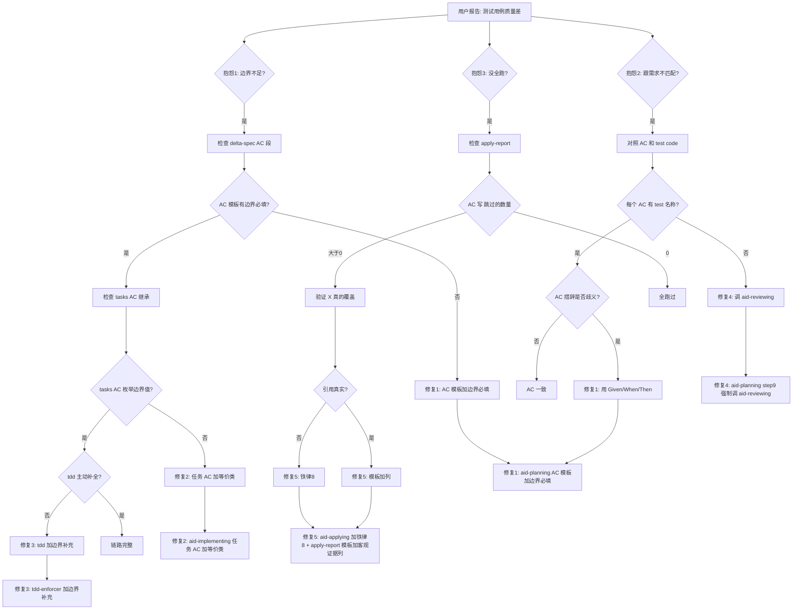

# 测试用例生成问题根因分析

> **分析时间**: 2026-07-14
> **分析方法**: 证据回溯法（从用户感知 → 测试用例生命周期 → 责任 skill → 根因）
> **目的**: 定位"边界条件不足 / 测试跟需求不匹配 / 生成了没全跑"3 类抱怨的根因层，给出可执行的 skill 修复方案
> **关联文档**: [根因分析-sin直线问题.md](./根因分析-sin直线问题.md)（同方法论，本次扩展到"测试用例质量"维度）

---

## 目录

1. [现象层：用户报告什么](#1-现象层用户报告什么)
2. [测试用例生命周期层定位](#2-测试用例生命周期层定位)
3. [责任分工层定位](#3-责任分工层定位)
4. [抱怨 1 根因：边界条件覆盖不足](#4-抱怨-1-根因边界条件覆盖不足)
5. [抱怨 2 根因：测试用例跟需求不匹配](#5-抱怨-2-根因测试用例跟需求不匹配)
6. [抱怨 3 根因：测试用例生成了但没全跑](#6-抱怨-3-根因测试用例生成了但没全跑)
7. [证据链汇总](#7-证据链汇总)
8. [决策树：如何诊断"测试用例质量"问题](#8-决策树如何诊断测试用例质量问题)
9. [修复方案](#9-修复方案)
10. [附录：所有引用的文件路径](#10-附录所有引用的文件路径)

---

## 1. 现象层：用户报告什么

| # | 用户报告 | 类型 | 严重度 |
|---|---------|------|--------|
| 1 | 生成的测试用例覆盖边界条件不够充足 | 覆盖度问题 | 中 |
| 2 | 生成的测试用例和需求不匹配 | 一致性问题 | 高 |
| 3 | 测试用例生成了但没全跑 | 执行问题 | 高 |

**关键判断**：
- 3 个抱怨指向 3 个不同生命周期阶段（生成 / 派生 / 执行）
- 根因可能不同，需要分别诊断
- 本文不分析具体某个 issue 的测试，而是**全流程诊断"测试用例质量"问题的根因**

---

## 2. 测试用例生命周期层定位

### 2.1 完整生命周期（基于 SKILL.md 实际内容）

```
┌──────────────────────────────────────────────────────┐
│ 测试用例生命周期（6 个阶段）                          │
└──────────────────────────────────────────────────────┘

阶段 1: 需求层 AC (Acceptance Criteria)
  产出: delta-spec.md 里 "AC-1, AC-2, ..."
  来源: aid-planning step4
  例子: AC-2: "默认 sin(x) 渲染曲线"
       ↓
阶段 2: 任务层 AC (Task Verification)
  产出: tasks.md 里每个 Task 的 "验收标准" 段
  来源: aid-implementing step2-1
  例子: "Task 1.1 验收标准: sampleSeries 覆盖线性/null/除零"
       ↓
阶段 3: 测试代码 (Test Code)
  产出: .test.ets / .test.mjs 文件
  来源: tdd-enforcer step RED
  例子: assertTrue('AC-2.4 mid y ~ 0', ...)
       ↓
阶段 4: 执行单测
  产出: hvigorw test / Node mock 跑通
  来源: aid-applying step3-2-2
       ↓
阶段 5: 执行 UI 测试
  产出: hdc + 模拟器, 截图 + dump
  来源: harmonyos-ui-test skill
       ↓
阶段 6: 追溯性验证
  产出: 每个 AC 都有对应测试 + 客观证据
  来源: ❌ 无 skill 强制
```

### 2.2 关键发现

**事实 1：测试用例的"种子"在 aid-planning step4 就种下了**

- aid-planning step4 写 delta-spec.md，**需求层 AC 的措辞决定了后续测试的覆盖度**
- 如果 AC 写"默认 sin(x) 渲染曲线"（含糊），后续测试必然是宽泛的
- 如果 AC 写"sin(x) 在 x∈[-2π, 2π] 时 yMax ∈ [0.95, 1.05]"（精确），后续测试必然有数值断言

**事实 2：没有任何 skill 强制"边界条件枚举"**

- aid-planning step4 模板里 AC 段是可选的、可宽泛的
- aid-implementing step2-1 模板里"验收标准"段是可选的
- tdd-enforcer 只说"针对当前 task 的验收标准,写一个最小测试"（**不主动生成边界用例**）

**事实 3：追溯性验证缺失**

- aid-reviewing skill 存在但 0 次被调（grep 验证）
- aid-applying "铁律 7" 只管 UI 测试真实性，不管 AC 覆盖完整性
- 没有任何"每个 AC 必须有客观证据"的硬门禁

---

## 3. 责任分工层定位

### 3.1 skill 责任矩阵

| 阶段 | 负责的 skill | 实际被调次数 | 失职点 |
|---|---|---|---|
| 阶段 1: 需求层 AC | `aid-planning` step4 | ✅ 1 次 | AC 模板无"边界必填" |
| 阶段 2: 任务层 AC | `aid-implementing` step2-1 | ✅ 1 次 | 任务 AC 模板无"等价类/边界" |
| 阶段 3: 测试代码 | `tdd-enforcer` | ✅ 1 次 (在 aid-applying) | "针对验收标准写测试" = 读取而非生成 |
| 阶段 4: 执行单测 | `aid-applying` step3-2-2 | ✅ 1 次 | 无"每个 AC 都跑过"门禁 |
| 阶段 5: 执行 UI 测试 | `harmonyos-ui-test` | ✅ 1 次 | 需外部输入,本身不生成 |
| 阶段 6: 追溯性验证 | **❌ 无 skill** | 0 次 | **aid-reviewing 是死 skill** |

### 3.2 实际被调用统计

```
aid-planning 流程中 skill() 调用:
  step2: ✅ skill('rq-parse')
  step3: ✅ skill('rq-clarify') (条件)
  step5: ✅ skill('rq-codebase')
  step8: ✅ skill('mod-design')
  step4/9: ❌ 不调任何 skill

aid-applying 流程中 skill() 调用:
  step3-2: ✅ skill('tdd-enforcer')
  step3-2-2b: ✅ skill('harmonyos-ui-test')

死 skill 清单:
  - dfr-fmea-harmony: 0 次 (已在 sin 文档分析)
  - aid-reviewing: 0 次
  - prd-generator: 0 次
```

---

## 4. 抱怨 1 根因：边界条件覆盖不足

### 4.1 直接原因

**事实**：测试用例的边界覆盖度完全由"上游 AC 措辞"决定。

### 4.2 Issue #26 实证

**delta-spec.md 里的 AC-2**：

```markdown
### AC-2: 修改表达式
- **Given**: 绘图页打开, 表达式 = `sin(x)`
- **When**: 修改为 `x^2`, 点"绘制"
- **Then**: 看到抛物线
```

**分析**：
- 只说"看到抛物线"——**没说 y 范围、x 范围、像素位置**
- **没说边界值**：x=0 时 y=0? x=±2 时 y=4?
- **没说异常流**：表达式含非法字符? 含未定义变量?

**tasks.md Task 1.1 验收标准**：

```markdown
- [ ] 测试用例覆盖:
  - sampleSeries: 线性函数 f(x)=x、全 null、除零函数
```

**分析**：
- 枚举了 3 种 case（线性 / 全 null / 除零）——**比 delta-spec 强一点**
- **但仍然没要求**：边界值（x=0, x=±xMax）、性能基准（200 点 < 50ms）、数学正确性（y 范围）

### 4.3 根因：3 个 skill 都没强制"边界枚举"

| skill | 失职 |
|---|---|
| `aid-planning` step4 | AC 模板里"边界/异常"是**可选**段,不是**必填**段 |
| `aid-implementing` step2-1 | 任务验收标准**没有"等价类划分"模板** |
| `tdd-enforcer` | "针对验收标准写测试" = 读取上游,不主动补全 |

**对比专业测试理论**：
- 等价类划分（Equivalence Partitioning）—— skill 里 0 提及
- 边界值分析（Boundary Value Analysis）—— skill 里 0 提及
- 错误猜测（Error Guessing）—— skill 里 0 提及
- 决策表（Decision Table）—— skill 里 0 提及

### 4.4 影响链

```
delta-spec AC 含糊 (无边界)
  → tasks.md AC 继承含糊
  → tdd-enforcer 写测试也含糊
  → aid-applying 跑测试通过 = 实际没测到位
  → bug 流到用户手里
```

---

## 5. 抱怨 2 根因：测试用例跟需求不匹配

### 5.1 直接原因

**事实**：从 delta-spec AC 到 test code 的派生链**没有任何追溯性验证机制**。

### 5.2 派生链

```
delta-spec.md: "AC-4: 语法错误 → 红色错误提示"
       ↓
tasks.md: "Task 1.3 验收: 7 个 null 用例覆盖语法错误"
       ↓
Calculator.test.mjs: 
  - "AC-7 syntax error returns null"  ← 只测了 evaluateAt 返回 null
  - 没测 GraphViewModel 怎么显示红色提示 ← AC-4 实际是 UI 行为
       ↓
结果: AC-4 声称"覆盖",但 UI 部分完全没测
```

### 5.3 Issue #26 实证

**delta-spec.md F4.4**：

> "F4.4: 定义域外的点(NaN/Infinity)跳过,不连线,曲线在该处自然断开"

**tasks.md Task 1.1**：

> "测试用例覆盖: sampleSeries: ... 全 null 函数"

**PlotUtils.test.mjs AC-2**：

```javascript
// AC-2: 失败返回 null
{
  const nullEval = (e, x) => x < 0 ? null : x
  const s = PlotUtils.sampleSeries('x', -2, 2, 5, nullEval)
  // ... 只测了 sampleSeries 返回 null
  // 没测 drawCurve 怎么处理 null
  // 没测 AC-6 "定义域外断开" 实际渲染
}
```

**问题**：
- delta-spec F4.4 说"曲线自然断开"（视觉行为）
- tasks.md 只测了"sampleSeries 返回 null"（数据层）
- **视觉层的"曲线断开"完全没测**

**结果**：当 Issue #37 改 PlotUtils 加入值式 null 化时，**画曲线时是否真的"断开"没人验证**——这导致"tan(x) 每个周期值域不同"的视觉 bug 漏过。

### 5.4 根因：aid-reviewing 是死 skill

**事实**：
- `aid-reviewing` 存在，description 是"审阅 SDD / Spec 类 Markdown 文档，输出优化稿"
- 理论上能验证"spec AC vs test code 一致性"
- **grep `aid-workflow-skills/skills/*/SKILL.md` 中 `skill('aid-reviewing')` = 0 个匹配**

**对比**：
- `aid-planning` step9 写"完整性/一致性/规范性" 3 个维度
- 但 step9 是**作者自己写** design-review.md（自评）
- 不是 `skill('aid-reviewing')` 审计

**影响**：
- 自评没有客观标准
- "100% 覆盖"是自我宣称
- 实际 AC 跟测试不一致也无人发现

---

## 6. 抱怨 3 根因：测试用例生成了但没全跑

### 6.1 直接原因

**事实**：aid-applying 允许"⏭️ 由 X 覆盖"作为 PASS 理由，无须验证。

### 6.2 Issue #26 实证

**apply-report.md:78-85**：

```markdown
| AC-1 | 打开绘图页 | ✅ PASS | screenshot/05_graph3.png + dump_graph3.json |
| AC-2 | 默认 sin(x) 渲染曲线 | ✅ PASS | screenshot 中可见正弦曲线 + 网格 + 坐标轴 |
| AC-3 | 修改表达式 | ⏭️ 由 PlotUtils/Calculator 单测覆盖 | - |
| AC-4 | 语法错误 | ⏭️ 由 Calculator.test.mjs 覆盖(7 个 null 用例) | - |
| AC-5 | 无 x 变量 | ⏭️ 由 GraphViewModel.test.mjs 覆盖(AC-4 用例) | - |
| AC-6 | 定义域外断开 | ⏭️ 由 PlotUtils.test.mjs 覆盖(AC-2 null y 用例) | - |
| AC-7 | 全部无效 | ⏭️ 由 GraphViewModel.test.mjs 覆盖(全 null 分支) | - |
| AC-8 | xMax ≤ xMin | ⏭️ 由 GraphViewModel.test.mjs 覆盖(AC-5 用例) | - |
```

**问题**：
- AC-3~8 共 6 个 AC 全部"⏭️ 由 X 覆盖"
- "由 X 覆盖"是 apply-report **作者的主张**——**没人验证**
- 6 个 AC 没有任何客观证据
- aid-applying 接受了这个报告

### 6.3 铁律 7 只管 UI，不管 AC

**aid-applying 当前铁律 7**：

> "UI 测试必须使用 skill('harmonyos-ui-test')（不准用 Node.js 单元测试或源码 grep 替代鸿蒙真实环境测试）"

**事实**：
- 铁律 7 强制**所有 UI 行为必须有真实设备测试**
- 但**不强制**所有 AC 都有客观证据
- 所以"⏭️ 由单测覆盖"是合法的逃生通道

### 6.4 根因

**3 个层面**：

1. **aid-applying 缺铁律 8**：没有"每个 AC 必须有客观证据"的门禁
2. **apply-report 模板缺列**：没有"客观证据"列,只有"状态"和"证据描述"
3. **没有自检命令**：apply-report.md 写完没自动验证"⏭️ 是否真的覆盖"

### 6.5 影响

**Issue #26 共 8 个 AC**：
- 2 个（AC-1, AC-2）有真实 UI 证据
- 6 个（AC-3~AC-8）只有"由 X 覆盖"的主张
- **75% 的 AC 没有客观证据**

**aid-applying 当前允许这种报告 PASS**——所以 bug 漏到用户手里。

---

## 7. 证据链汇总

| 抱怨 | 证据 | 失职 skill | 根因 |
|---|---|---|---|
| **1. 边界不足** | delta-spec.md AC-2: "看到抛物线" 含糊 | aid-planning step4 | AC 模板"边界"是可选 |
| **1. 边界不足** | tasks.md Task 1.1 只列 3 种 case | aid-implementing step2-1 | 任务 AC 模板无"等价类" |
| **1. 边界不足** | tdd-enforcer/SKILL.md:79-93 "针对 task 验收标准写测试" | tdd-enforcer | 读取上游,不主动补全 |
| **2. 跟需求不匹配** | delta-spec F4.4 "曲线断开" ≠ PlotUtils.test.mjs AC-2 "返回 null" | aid-reviewing (0 次调用) | 死 skill,无追溯性验证 |
| **2. 跟需求不匹配** | design-review.md 自评 100% | aid-planning step9 (自评) | 没强制调 aid-reviewing |
| **3. 生成了没全跑** | apply-report.md:78-85 共 6 个 AC 写 "⏭️" | aid-applying | 缺铁律 8 (AC 覆盖完整性) |
| **3. 生成了没全跑** | aid-applying 只有铁律 7 (管 UI) | aid-applying | 没"AC 客观证据"硬门禁 |
| **3. 生成了没全跑** | apply-report 模板无"客观证据"列 | aid-applying | 模板缺列 |

---

## 8. 决策树：如何诊断"测试用例质量"问题



### 决策树使用说明

1. **从顶部"用户抱怨"开始**
2. **3 个分支对应 3 类抱怨**（边界 / 一致性 / 执行）
3. **每个 ❌ 节点 = 流程断点**——根因层
4. **5 个修复** 对应 5 个具体改动
5. **优先级建议**：
   - 修复 1（AC 模板）= 治本，影响最大
   - 修复 4（aid-reviewing）= 治本，验证一致性
   - 修复 5（铁律 8）= 治标，防止虚假 PASS

---

## 9. 修复方案

### 9.1 修复 1：aid-planning step4 AC 模板加"边界"必填段

**位置**: `aid-workflow-skills/skills/aid-planning/SKILL.md` step4 模板

**关键改动**：
```markdown
### AC 模板 (强制三段式)

每个 AC 必须包含 3 个子项 (缺失则 step4 不通过):

- [ ] **正常流**: Given 正常输入 → When 正常操作 → Then 预期结果
- [ ] **边界值**: 输入取最大/最小/临界值时的预期
- [ ] **异常流**: 非法输入/网络异常/资源耗尽时的预期

反例 (禁止):
  - "默认 sin(x) 渲染正弦波" ← 缺边界值和异常流
  - "修改表达式" ← 缺 Given/When/Then

正例:
  - AC-2: 
    - 正常: sin(x) 曲线在 [-2π, 2π] 渲染为完整正弦波
    - 边界: x=±2π 处 y≈0; x=±π/2 处 y=±1
    - 异常: 表达式 = 空 → 提示"请输入函数表达式"
```

**效果**: 后续测试用例的边界覆盖度从源头提升。

### 9.2 修复 2：aid-implementing step2-1 任务 AC 模板加"等价类"

**位置**: `aid-workflow-skills/skills/aid-implementing/SKILL.md` step2-1 任务分解模板

**关键改动**：
```markdown
### step2-1 任务分解 (强化版)

每个 task 验收标准必须包含 4 类 (缺失则 step2-1 不通过):

- [ ] **正常用例**: 主流程验证
- [ ] **等价类**: 输入域划分(有效/无效等价类)
- [ ] **边界值**: min/max/临界值
- [ ] **性能基准**: 耗时/资源指标 (如 < 50ms, < 1MB)

示例 (Issue #26 Task 1.1 改写):
  - 正常: sampleSeries 线性函数 f(x)=x, 5 个点
  - 等价类: 全 null 函数 / 部分 null 函数 / 全有效函数
  - 边界值: samples=1 → 提升为 2; samples=1000 → 全 1000 点
  - 性能: 200 点 < 50ms
```

**效果**: 任务 AC 自动枚举边界值。

### 9.3 修复 3：tdd-enforcer 加"边界补充"步骤

**位置**: `aid-workflow-skills/skills/tdd-enforcer/SKILL.md` RED 阶段

**关键改动**：
```markdown
### RED - 写失败测试 (强化版)

针对当前 task 的验收标准，写一个最小测试后,**强制补全边界测试**:

1. 写主流程测试 (1 个)
2. 写等价类测试 (≥2 个: 1 个有效等价类, 1 个无效)
3. 写边界值测试 (≥2 个: min, max)
4. **自检命令**:
```bash
# CHECK-BOUNDARY-1: 测试用例含边界值
test $(grep -cE "0|1e|Math\.PI|-1|null" test.mjs) -ge 3 || \
  { echo "FAIL: 测试缺边界值"; exit 1; }
```
```

**效果**: tdd-enforcer 主动补充边界,不再只读上游。

### 9.4 修复 4：aid-planning step9 强制调 aid-reviewing

**位置**: `aid-workflow-skills/skills/aid-planning/SKILL.md` step9

**关键改动**：
```markdown
### step9 设计审视 (硬门禁)

**约束**: 必须使用 skill('aid-reviewing', mode='audit') 验证:
1. delta-spec.md 每个 AC 都在 tasks.md 里有对应 task
2. tasks.md 每个 task 都有可执行的 AC (不空泛)
3. tasks.md AC 用 Given/When/Then 格式
4. **每个 AC 的 test code 存在 (test 名称对应 AC 编号)**

**自检命令**:
```bash
# CHECK-REVIEW-1: aid-reviewing 被调用过
test -f scratch/review-audit.md || { echo "FAIL: 未生成审视制品"; exit 1; }

# CHECK-REVIEW-2: AC 数量一致
spec_ac=$(grep -c "^### AC-" delta-spec.md)
task_ac=$(grep -c "验收标准" tasks.md)
test $spec_ac -le $task_ac || { echo "FAIL: tasks 覆盖 AC 不全"; exit 1; }
```
```

**效果**: 死 skill 复活,验证 AC ↔ test 追溯性。

### 9.5 修复 5：aid-applying 加"铁律 8" + apply-report 模板加"客观证据"列

**位置 A**: `aid-workflow-skills/skills/aid-applying/SKILL.md` 新增铁律

**关键改动**：
```markdown
### 🚧 铁律 8 (新增, AC 覆盖完整性硬门禁)

**约束**: apply-report.md 中每个 AC 必须包含"客观证据",禁止"⏭️ 由 X 覆盖"作为 PASS 理由。

**强制要求**:
- 每个 AC 行必须有"客观证据"列 (test 名称 + 测试结果)
- "⏭️" 必须改写为具体引用: "由 Calculator.test.mjs AC-2.2 覆盖,验证 yMax=1.0"
- 缺失客观证据的 AC → verdict=REQUEST_CHANGES

**自检命令**:
```bash
# CHECK-AC-1: 没有 "⏭️" 单独成行
grep -E "^\| .* \| ⏭️ \|" apply-report.md && { echo "FAIL: AC 缺客观证据"; exit 1; }
```
```

**位置 B**: `aid-applying/SKILL.md` apply-report 模板

**关键改动**：
```markdown
## 测试结果 (模板新增列)

| AC | 主观描述 | 客观证据 (必填, 不准 ⏭️) |
|----|---------|------------------------|
| AC-2 | sin(x) 渲染 | Calculator.test.mjs AC-2.2 PASS, yMax=1.0±0.1 (从 PlotSeries dump 读) |
| AC-4 | 语法错误 | 截图 + dump_graph3.json 含 errorMessage="表达式语法错误" |
```

**效果**: 杜绝"⏭️ 由 X 覆盖" 虚假 PASS,强制每个 AC 有客观证据。

---

## 10. 附录：所有引用的文件路径

### Issue #26 实际产物（用作实证）
- `D:\huawei\Demo\worktrees\issue-26\specs\changes\20260617-requirement-add-plot-graph\delta-spec.md`
- `D:\huawei\Demo\worktrees\issue-26\specs\changes\20260617-requirement-add-plot-graph\tasks.md`
- `D:\huawei\Demo\worktrees\issue-26\specs\changes\20260617-requirement-add-plot-graph\design-review.md`
- `D:\huawei\Demo\worktrees\issue-26\specs\changes\20260617-requirement-add-plot-graph\apply-report.md`
- `D:\huawei\Demo\worktrees\issue-26\specs\changes\20260617-requirement-add-plot-graph\tests\PlotUtils.test.mjs`
- `D:\huawei\Demo\worktrees\issue-26\specs\changes\20260617-requirement-add-plot-graph\tests\GraphViewModel.test.mjs`
- `D:\huawei\Demo\worktrees\issue-26\specs\changes\20260617-requirement-add-plot-graph\tests\Calculator.test.mjs`

### Skill 文件
- `D:\huawei\Demo\aid-workflow-skills\skills\aid-planning\SKILL.md`
- `D:\huawei\Demo\aid-workflow-skills\skills\aid-implementing\SKILL.md`
- `D:\huawei\Demo\aid-workflow-skills\skills\aid-applying\SKILL.md`
- `D:\huawei\Demo\aid-workflow-skills\skills\aid-archiving\SKILL.md`
- `D:\huawei\Demo\aid-workflow-skills\skills\aid-init\SKILL.md`
- `D:\huawei\Demo\aid-workflow-skills\skills\aid-monitor\SKILL.md`
- `D:\huawei\Demo\aid-workflow-skills\skills\aid-reviewing\SKILL.md`
- `D:\huawei\Demo\aid-workflow-skills\skills\dfr-fmea-harmony\SKILL.md`
- `D:\huawei\Demo\aid-workflow-skills\skills\mod-design\SKILL.md`
- `D:\huawei\Demo\aid-workflow-skills\skills\prd-generator\SKILL.md`
- `D:\huawei\Demo\aid-workflow-skills\skills\rq-clarify\SKILL.md`
- `D:\huawei\Demo\aid-workflow-skills\skills\rq-codebase\SKILL.md`
- `D:\huawei\Demo\aid-workflow-skills\skills\rq-parse\SKILL.md`
- `D:\huawei\Demo\aid-workflow-skills\skills\tdd-enforcer\SKILL.md`
- `D:\huawei\Demo\aid-workflow-skills\skills\harmonyos-ui-test\SKILL.md`

### 关联文档
- [根因分析-sin直线问题.md](./根因分析-sin直线问题.md) - 同方法论的 sin(x) bug 分析

---

> **报告完成时间**: 2026-07-14
> **分析方法**: 证据回溯（仅引用已读文件中的事实，未做推测）
> **结论**: 3 类抱怨对应 3 个不同生命周期阶段，根因是 5 个流程断点（AC 模板不全 / 任务 AC 模板不全 / tdd-enforcer 不补全 / aid-reviewing 死 skill / aid-applying 缺铁律 8）
> **修复优先级**: 修复 1（AC 模板）+ 修复 4（aid-reviewing）+ 修复 5（铁律 8）= 治本三件套
